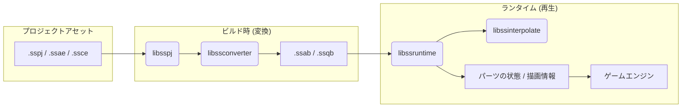

[**English**](./README.md) | [**日本語**](./README.ja.md)
# SpriteStudio7-SDK

[](https://github.com/SpriteStudio/SpriteStudio7-SDK/actions/workflows/ci.yml)

[OPTPiX SpriteStudio](https://www.webtech.co.jp/spritestudio/) 7 以降で作成された sspj プロジェクト用のソフトウェア開発キットです。あらゆるゲームエンジンやプラットフォーム上でアニメーションプレイヤーを柔軟に実装できます。

## 概要 (Overview)

この SDK に含まれる各ライブラリがどのように連携してアニメーションを変換・再生するかを以下の図に示します：



- ライブラリ
...
    - [libsspj](./libs/sspj/README.md): `sspj`、`ssae`、`ssee`、`ssse`、`charmap`ファイルで構成される`sspj`プロジェクトを解析するライブラリです。
    - [libssab](./libs/ssab/README.md): アニメーションバイナリファイルである`ssab`ファイルを作成・解析するライブラリです。
    - [libssconverter](./libs/ssconverter/README.md): `sspj` プロジェクトを解析し、`ssab` ファイルを作成するライブラリです。
    - [libssruntime](./libs/ssruntime/README.md): アニメーションプレーヤーの実装を支援するライブラリです。再生の制御、キーフレームの抽出、補間などの機能を備えています。
    - [libssinterpolate](./libs/ssinterpolate/README.ja.md): アニメーション補間計算のためのプラットフォーム非依存な数学ライブラリです。
- ツール
    - [ssconverter-cli](./cli/README.md): `sspj` プロジェクトを解析し、`ssab` ファイルを作成するコマンドラインツールです。

# ツールの使用方法
## ssconverter-cli
[ssconverter-cli](./cli/README.md) を参考してください。

# SDK 開発者向け
## 準備
[rustup](https://rustup.rs/) をインストールしてください。

## ビルド

```bash
cargo build --release
```

## テスト
### ユニットテスト

```bash
cargo test
```

### sspj から ssab への変換テスト

```bash
./target/release/ssconverter-cli ./
```
