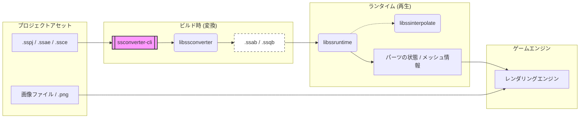

[**English**](./README.md) | [**日本語**](./README.ja.md)
# SpriteStudio7-SDK

[](https://github.com/SpriteStudio/SpriteStudio7-SDK/actions/workflows/ci.yml)

[OPTPiX SpriteStudio](https://www.webtech.co.jp/spritestudio/) 7 以降で作成された sspj プロジェクト用のソフトウェア開発キットです。あらゆるゲームエンジンやプラットフォーム上でアニメーションプレイヤーを柔軟に実装できます。

## 概要 (Overview)

この SDK を使用してアセットを変換し、アニメーションを再生する際の流れを以下の図に示します：



- ライブラリ
    - [libsspj](./libs/sspj/README.md): `sspj`、`ssae`、`ssee`、`ssse`、`charmap`ファイルで構成される`sspj`プロジェクトを解析するライブラリです。
    - [libssab](./libs/ssab/README.md): アニメーションバイナリファイルである`ssab`ファイルを作成・解析するライブラリです。
    - [libssinterpolate](./libs/ssinterpolate/README.ja.md): アニメーション補間計算のためのプラットフォーム非依存な数学ライブラリです。
    - [libssconverter](./libs/ssconverter/README.md): `sspj` プロジェクトを解析し、`ssab` ファイルを作成するライブラリです。
    - [libssruntime](./libs/ssruntime/README.md): アニメーションプレーヤーの実装を支援するライブラリです。再生の制御、キーフレームの抽出、補間などの機能を備えています。
- ツール
    - [ssconverter-cli](./cli/README.md): `sspj` プロジェクトを解析し、`ssab` ファイルを作成するコマンドラインツールです。

## クイックスタート

まずは、同梱されているサンプルプロジェクトを変換して SDK の動作を確認してみましょう。

### 1. ツール・ライブラリをダウンロードする
[GitHub Releases](https://github.com/SpriteStudio/SpriteStudio7-SDK/releases) ページから、各プラットフォーム向けの最新版をダウンロードしてください。
- **ssconverter-cli**: **Windows**、**macOS**、**Linux** 用の実行ファイルが用意されています。
- **Web (WASM)**: 直接 JavaScript/TypeScript から利用可能なパッケージが `spritestudio7-sdk-web.zip` として用意されています。

### 2. サンプルプロジェクトをコンバートする
ダウンロードしたツールを実行して、同梱のテスト用プロジェクトをバイナリ形式 (`.ssab`) に変換します：

**Windows:**
```powershell
.\ssconverter-cli.exe tests\overall\overall.sspj
```

**macOS / Linux:**
```bash
./ssconverter-cli tests/overall/overall.sspj
```

変換された `.ssab` ファイルは、`tests/overall/overall_ssab/` ディレクトリ内に生成されます。

### 3. エンジンへの組み込み
生成された `.ssab` ファイルを自分のゲームエンジンやアプリで読み込んで再生する方法については、[libssruntime の README](./libs/ssruntime/README.ja.md) を参照してください。実装の詳細については、[Player 移植ガイド](./libs/ssruntime/docs/README.ja.md) を参照してください。

### サンプルデータについて

このリポジトリの `tests/` ディレクトリには、SpriteStudio 7 の各種機能を検証するためのサンプルプロジェクトが含まれています：

- `tests/overall/overall.sspj`: 基本から応用までを網羅した包括的なプロジェクト（最初のテストにおすすめです）。
- `tests/allAttributeV7/allAttributeV7.sspj`: 全てのアニメーションアトリビュートを網羅しています。
- `tests/allPartsV7/allPartsV7.sspj`: 全てのパーツ種別の検証用プロジェクトです。
- `tests/ParticleEffect/ParticleEffect.sspj`: パーティクルエフェクトの検証用プロジェクトです。

これらは Player の実装時や動作確認の際の参照用データとして自由にご利用いただけます。

## ツールの使用方法
### ssconverter-cli
[ssconverter-cli](./cli/README.md) を参考してください。

## SDK 開発者向け
### 準備
[rustup](https://rustup.rs/) をインストールしてください。

### ビルド

```bash
cargo build --release
```

### テスト
#### ユニットテスト

```bash
cargo test
```

#### sspj から ssab への変換テスト

```bash
./target/release/ssconverter-cli ./
```
