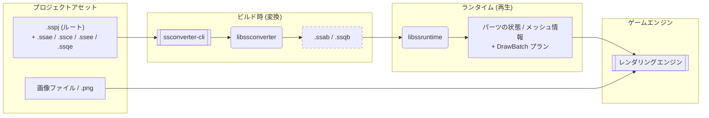

[**English**](./README.md) | [**日本語**](./README.ja.md)
# SpriteStudio-SDK

**SpriteStudio** 向けの、ハイパフォーマンスでエンジン非依存なアニメーションプレイヤー SDK です。この SDK を使用することで、あらゆるゲームエンジンやレンダリングフレームワーク上で、**ラスターベースの 2D アニメーション**を簡単に実装・再生することができます。

📚 この SDK・各公式 Player・変換ツールの関係は、エコシステム全体のポータル [**SpriteStudio Docs**](https://cri-middleware.github.io/SpriteStudio-Docs/ja/) にまとまっています — 🚧 初回リリース後に公開。

## 🎯 対応バージョン (Compatibility)

SpriteStudio-SDK `7.x.x` は **SpriteStudio 7.5 以上**で作成されたプロジェクトに対応しています。

## 🔄 ワークフロー (The Workflow)

1. **変換 (Convert):** 同梱の CLI ツール (`ssconverter-cli`) を使用して、SpriteStudio のプロジェクト (`.sspj`) を極限まで最適化されたバイナリフォーマット (`.ssab`) に変換します。
2. **どこでも再生 (Play Anywhere):** 生成された `.ssab` ファイルを本 SDK のランタイムに渡します。**SDK はすべての `.ssab` ファイルを再生できるよう設計されており**、SpriteStudio の機能を標準でサポートします。テキスト描画とサウンド再生は責務分担として Player 側の担当です（[制限事項 §1](./libs/ssruntime/docs/10_introduction/20_limitations.ja.md#1-テキストとサウンドは-player-が実装する) を参照）。

この SDK を使用してアセットを変換し、アニメーションを再生する際の流れを以下の図に示します：

> **図の凡例**
> - **図形**: `[ ]` データ/ファイル, `( )` ライブラリ/コンポーネント, `[[ ]]` ツール/アプリケーション
> - **矢印**: `-->` データの流れ, `-.->` 依存/参照
> - **枠線**: 点線枠は生成されたファイルを示します。



## ✨ 主なサポート機能 (Key Supported Features)

* **標準アニメーション:** ボーン階層、トランスフォーム、および完全なキーフレーム補間（ベジェ、エルミート、リニア等）。
* **サブフレーム補間:** 基本のフレームレートを超えた、滑らかで連続的な再生。高リフレッシュレートのディスプレイ（144Hz以上）やスローモーション表現に最適です。
* **メッシュ＆デフォーム:** ラスター画像に対するメッシュウェイトと頂点変形（デフォーム）の完全サポート。
* **パーティクルエフェクト:** SpriteStudio エディタの動作と完全に一致する、高性能なパーティクルシミュレーション。
* **シーケンス (`.ssqe`):** シーケンスパックの再生。*(対応予定 — ロードマップ Phase 3。[ROADMAP.md](./ROADMAP.md) 参照)*
* **インスタンス＆マスク:** サブアニメーションのインスタンス化と、ステンシルマスクによるクリッピング。
* **イベント＆ユーザーデータ:** オーディオ、シグナル、ユーザーデータに対する、フレーム単位で正確なコールバック。

## 💡 なぜこの SDK を選ぶべきか？

* **1. 数学不要の組み込みと、エンジン間の視覚的整合性 (Zero-Math Integration & Cross-Engine Visual Consistency)**
  SDK はすべての複雑な状態計算（ボーン行列、メッシュ変形、階層カラー/不透明度）を内部で処理し、最適化された描画プラン (`DrawBatch`) を出力します。あなたのエンジンは生成された頂点データを読み取り、プリミティブを描画するだけです。どのレンダラーも同じ `DrawBatch` プランを消費するため、エンジンごとの描画仕様の違いによる「見た目のブレ」を構造的に排除できます。
* **2. 極小のデータサイズと全環境での SIMD パフォーマンス (Ultra-Compact Payload & Universal SIMD Performance)**
  私たちはデータのフットプリントを最小化するために `.ssab` バイナリフォーマットを設計しました。カラム指向（Columnar）のデータレイアウトとハッシュベースのルックアップを利用することで、パース負荷がゼロの極小ファイルサイズを実現しています。このデータ指向の設計は、全環境で **SIMD (f32x4)** を活用するランタイムのアーキテクチャと完璧に噛み合っています。結果として、最小のメモリおよび CPU キャッシュフットプリントで、最大のアニメーション再生パフォーマンスを叩き出します。
* **3. 極限のポータビリティ (Extreme Portability via `#![no_std]` Rust)**
  コアランタイムは厳格な `#![no_std]` の Rust で書かれており、OS や標準ライブラリへの依存が一切ありません。C-API や WASM を通じてシームレスに統合できるため、メモリ制限の厳しいモバイルや組み込み機器から Web ブラウザまで、予測不可能なメモリ割り当て（アロケーション）をゼロに抑えた強固な安定性をもって、あらゆる場所で動作します。

## 📦 ライブラリとツール

- ライブラリ
    - [libsspj](./libs/sspj/README.ja.md): `sspj`、`ssae`、`ssce`、`ssee`、`ssqe`、`ssse`、ビットマップフォントの文字マップ（`fnt` / `json`）ファイルで構成される`sspj`プロジェクトを解析するライブラリです。
    - [libssab](./libs/ssab/README.ja.md): アニメーションバイナリファイルである`ssab`ファイルを作成・解析するライブラリです。
    - [libssconverter](./libs/ssconverter/README.ja.md): `sspj` プロジェクトを解析し、`ssab` ファイルを作成するライブラリです。
    - [libssruntime](./libs/ssruntime/README.ja.md): 再生の "Brain"。フレーム毎にパーツの状態（トランスフォーム、メッシュ変形、カラー）を計算し、エンジン非依存の `DrawBatch` プランを出力します。
- ツール
    - [ssconverter-cli](./cli/README.ja.md): `sspj` プロジェクトを解析し、`ssab` ファイルを作成するコマンドラインツールです。

## 🚀 クイックスタート

まずは、同梱されているサンプルプロジェクトを変換して SDK の動作を確認してみましょう。

### 1. ツール・ライブラリをダウンロードする
[GitHub Releases](https://github.com/cri-middleware/SpriteStudio-SDK/releases) ページから、各プラットフォーム向けの最新版をダウンロードしてください。
- **ssconverter-cli**: **Windows**、**macOS**、**Linux** 用の実行ファイルが用意されています。
- **Web (WASM)**: 直接 JavaScript/TypeScript から利用可能なパッケージが `spritestudio-sdk-web-libs.zip` として用意されています。

### 2. サンプルプロジェクトをコンバートする
ダウンロードしたツールを実行して、同梱のテスト用プロジェクトをバイナリ形式 (`.ssab`) に変換します：

**Windows:**
```powershell
.\ssconverter-cli.exe tests\overall\overall.sspj
```

**macOS / Linux:**
```bash
./ssconverter-cli tests/overall/overall.sspj
```

変換された `.ssab` ファイルは、`tests/overall/overall/` ディレクトリ内に生成されます。

### 3. エンジンへの組み込み
生成された `.ssab` ファイルを自分のゲームエンジンやアプリで読み込んで再生する方法については、[libssruntime の README](./libs/ssruntime/README.ja.md) を参照してください。実装の詳細については、[Player 移植ガイド](./libs/ssruntime/docs/README.ja.md) を参照してください。検索可能なサイト版を [cri-middleware.github.io/SpriteStudio-SDK/ja](https://cri-middleware.github.io/SpriteStudio-SDK/ja/) に公開しています。

### サンプルデータについて

このリポジトリの `tests/` ディレクトリには、SpriteStudio の各種機能を検証するためのサンプルプロジェクトが含まれています：

- `tests/overall/overall.sspj`: 基本から応用までを網羅した包括的なプロジェクト（最初のテストにおすすめです）。
- `tests/allAttributeV7/allAttributeV7.sspj`: 全てのアニメーションアトリビュートを網羅しています。
- `tests/allPartsV7/allPartsV7.sspj`: 全てのパーツ種別の検証用プロジェクトです。
- `tests/ParticleEffect/ParticleEffect.sspj`: パーティクルエフェクトの検証用プロジェクトです。
- `tests/Ringo/Ringo.sspj`: Ringoのテスト用プロジェクトです。
- `tests/Doll/Doll.sspj`: インスタンスパーツとエフェクトパーツを組み合わせたキャラクターのプロジェクトです。

これらは Player の実装時や動作確認の際の参照用データとして自由にご利用いただけます。

## 💬 サポートとフィードバック

不具合の報告、使い方の質問、機能の要望などについては、[サポートガイド (SUPPORT.md)](./SUPPORT.md) を参照してください。

## 🛠️ SDK 開発者向け
### 準備
[rustup](https://rustup.rs/) をインストールしてください。

### ビルド

```bash
cargo build --release
```

### テスト
#### ユニットテスト

```bash
cargo test --workspace --all-features
```

`--all-features` は省略できません。テストモジュールは `feature = "std"` 配下にあり、素の `cargo test` はそれらを実行しないまま成功します。

#### sspj から ssab への変換テスト

```bash
./target/release/ssconverter-cli ./
```
