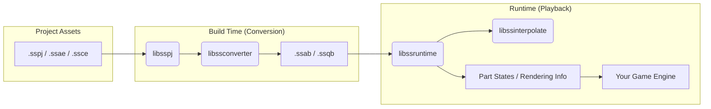

[**日本語**](./README.ja.md) | [**English**](./README.md)
# SpriteStudio7-SDK

[](https://github.com/SpriteStudio/SpriteStudio7-SDK/actions/workflows/ci.yml)

A Software Development Kit for sspj projects that are created by [OPTPiX SpriteStudio](https://www.webtech.co.jp/eng/spritestudio/) 7 or higher flexibly to implement an animation player on any game engines or platforms.

## Overview

The following diagram shows how the libraries in this SDK interact to convert and play SpriteStudio 7 animations:



- Libraries
...
    - [libsspj](./libs/sspj/README.md): a library that parses `sspj` projects that consist of `sspj`, `ssae`, `ssee`, `ssse`, `charmap` files.
    - [libssab](./libs/ssab/README.md): a library that creates and parses `ssab` files, which are animation binary files.
    - [libssinterpolate](./libs/ssinterpolate/README.md): a platform-agnostic math library for animation interpolations.
    - [libssconverter](./libs/ssconverter/README.md): a library that parses `sspj` projects and creates `ssab` files.
    - [libssruntime](./libs/ssruntime/README.md): a library that helps implement an animation player. The features are controlling playback, extracting keyframes, and doing interpolation.
- Tool
    - [ssconverter-cli](./cli/README.md): a command-line tool that parses `sspj` projects and creates `ssab` files.

# Tools Usage
## ssconverter-cli
reference: [ssconverter-cli](./cli/README.md)

# For SDK Developers
## Prepare
install [rustup](https://rustup.rs/)

## Build

```bash
cargo build --release
```

## Test
### Unit tests

```bash
cargo test
```

### tests for converting from sspj files to ssab files

```bash
./target/release/ssconverter-cli ./
```
