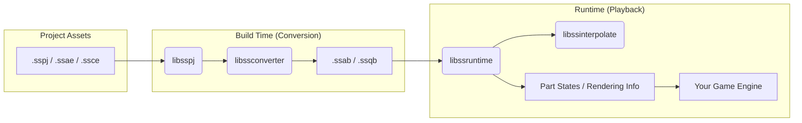

[**日本語**](./README.ja.md) | [**English**](./README.md)
# SpriteStudio7-SDK

[](https://github.com/SpriteStudio/SpriteStudio7-SDK/actions/workflows/ci.yml)

A Software Development Kit for sspj projects that are created by [OPTPiX SpriteStudio](https://www.webtech.co.jp/eng/spritestudio/) 7 or higher flexibly to implement an animation player on any game engines or platforms.

## Overview

The following diagram shows how the libraries in this SDK interact to convert and play SpriteStudio 7 animations:



- Libraries
    - [libsspj](./libs/sspj/README.md): a library that parses `sspj` projects that consist of `sspj`, `ssae`, `ssee`, `ssse`, `charmap` files.
    - [libssab](./libs/ssab/README.md): a library that creates and parses `ssab` files, which are animation binary files.
    - [libssinterpolate](./libs/ssinterpolate/README.md): a platform-agnostic math library for animation interpolations.
    - [libssconverter](./libs/ssconverter/README.md): a library that parses `sspj` projects and creates `ssab` files.
    - [libssruntime](./libs/ssruntime/README.md): a library that helps implement an animation player. The features are controlling playback, extracting keyframes, and doing interpolation.
- Tool
    - [ssconverter-cli](./cli/README.md): a command-line tool that parses `sspj` projects and creates `ssab` files.

## Quick Start

Follow these steps to convert a sample project and see the SDK in action.

### 1. Download the Converter
Download the latest version of `ssconverter-cli` for your platform from the [GitHub Releases](https://github.com/SpriteStudio/SpriteStudio7-SDK/releases) page. Pre-built binaries are available for **Windows**, **macOS**, and **Linux**.

### 2. Convert a Sample Project
Run the downloaded tool to convert one of the bundled test projects into the binary `.ssab` format:

**Windows:**
```powershell
.\ssconverter-cli.exe tests\overall\overall.sspj
```

**macOS / Linux:**
```bash
./ssconverter-cli tests/overall/overall.sspj
```

The converted `.ssab` files will be generated in the `tests/overall/overall_ssab/` directory.

### 3. Integrate into Your Engine
Refer to the [libssruntime README](./libs/ssruntime/README.md) for instructions on how to load and play these `.ssab` files in your own game engine or application.

### Sample Data

This repository includes several sample projects in the `tests/` directory to verify different features of SpriteStudio 7:

- `tests/overall/overall.sspj`: A comprehensive project covering basic to advanced features (recommended for initial testing).
- `tests/allAttributeV7/allAttributeV7.sspj`: Verifies all animation attributes.
- `tests/allPartsV7/allPartsV7.sspj`: Verifies all part types.
- `tests/ParticleEffect/ParticleEffect.sspj`: Verifies particle effects.

You can use these projects as references when implementing your own player or verifying the SDK's behavior.

## Tools Usage
### ssconverter-cli
reference: [ssconverter-cli](./cli/README.md)

## For SDK Developers
### Prepare
install [rustup](https://rustup.rs/)

### Build

```bash
cargo build --release
```

### Test
#### Unit tests

```bash
cargo test
```

#### tests for converting from sspj files to ssab files

```bash
./target/release/ssconverter-cli ./
```
