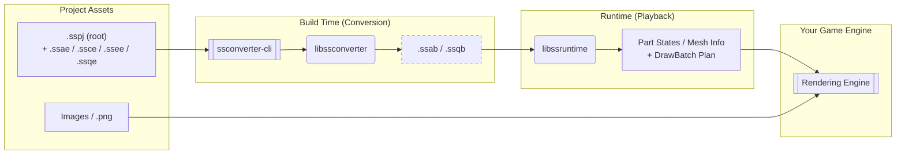

[**English**](./README.md) | [**日本語**](./README.ja.md)
# SpriteStudio-SDK

A high-performance, engine-agnostic animation player SDK for **SpriteStudio**.
This SDK allows you to easily implement and play **raster-based 2D animations** on any game engine or rendering framework.

📚 How this SDK, the official players, and the conversion tools fit together is documented in [**SpriteStudio Docs**](https://cri-middleware.github.io/SpriteStudio-Docs/), the portal for the whole ecosystem — 🚧 live after the first release.

## 🎯 Compatibility

SpriteStudio-SDK `7.x.x` supports projects authored in **SpriteStudio 7.5 or later**.

## 🔄 The Workflow (How it works)

1. **Convert:** Use the provided CLI tool (`ssconverter-cli`) to convert your SpriteStudio project (`.sspj`) into a highly optimized binary format (`.ssab`).
2. **Play Anywhere:** Pass the `.ssab` file to this SDK runtime. **The SDK is designed to play any `.ssab` file**, supporting the SpriteStudio feature set out of the box. Text drawing and audio playback are the Player's side of the split — see [Supported scope of drawing and playback features](./libs/ssruntime/docs/10_introduction/20_limitations.md#supported-scope-of-drawing-and-playback-features).

The following diagram shows the workflow of converting assets and playing animations using this SDK:

> **Diagram Legend**
> - **Shapes**: `[ ]` Data/Files, `( )` Libraries/Components, `[[ ]]` Tools/Applications.
> - **Arrows**: `-->` Data Flow, `-.->` Dependency/Reference.
> - **Borders**: Dashed borders indicate generated files.



## ✨ Key Supported Features

* **Standard Animations:** Bone hierarchies, transforms, and full keyframe interpolations (Bezier, Hermite, Linear, etc.).
* **Sub-frame Interpolation:** Smooth, continuous playback beyond the base framerate. Perfect for high-refresh-rate displays (144Hz+) and slow-motion effects.
* **Mesh & Deform:** Fully supported mesh weights and vertex deformations for raster images.
* **Particle Effects:** High-performance particle simulation matching the SpriteStudio editor.
* **Sequences (`.ssqe`):** Playback of sequence packs. *(planned — roadmap Phase 3; see [ROADMAP.md](./ROADMAP.md))*
* **Instance & Masks:** Sub-animation instancing and stencil mask clipping.
* **Events & User Data:** Frame-accurate callbacks for audio, signals, and user data.

## 💡 Why choose this SDK?

* **1. Zero-Math Integration & Cross-Engine Visual Consistency**
  The SDK handles all complex state computations (bone matrices, mesh deformations, and hierarchical opacity/colors) and outputs an optimized `DrawBatch` plan. Your engine just reads the generated vertices and renders the primitives. Every renderer consumes the same `DrawBatch` plan, structurally eliminating the most common source of engine-specific visual drift.
* **2. Ultra-Compact Payload & Universal SIMD Performance**
  We designed the `.ssab` binary format to minimize the data footprint. By utilizing a columnar data layout and hash-based lookups, we achieved an ultra-compact file size that requires zero parsing overhead. This data-oriented design perfectly aligns with our runtime architecture, which leverages **SIMD (f32x4)** across all environments. The result is maximum playback performance with minimal memory and CPU cache footprint.
* **3. Extreme Portability (Built with `#![no_std]` Rust)**
  The core runtime is written in strictly `#![no_std]` Rust, meaning it has zero dependencies on operating systems or standard libraries. It integrates seamlessly via C-API or WASM, allowing it to run anywhere—from memory-constrained mobile/embedded devices to web browsers—with rock-solid stability and zero unpredictable allocations.

## 📦 Libraries & Tools

- Libraries
    - [libsspj](./libs/sspj/README.md): a library that parses `sspj` projects, which consist of `sspj`, `ssae`, `ssce`, `ssee`, `ssqe`, `ssse` and bitmap-font character map (`fnt` / `json`) files.
    - [libssab](./libs/ssab/README.md): a library that creates and parses `ssab` files, which are animation binary files.
    - [libssconverter](./libs/ssconverter/README.md): a library that parses `sspj` projects and creates `ssab` files.
    - [libssruntime](./libs/ssruntime/README.md): the playback Brain. Computes per-frame part states (transforms, mesh deformations, color) and emits a cross-engine `DrawBatch` plan that any renderer can consume.
- Tool
    - [ssconverter-cli](./cli/README.md): a command-line tool that parses `sspj` projects and creates `ssab` files.

## 🚀 Quick Start

Follow these steps to convert a sample project and see the SDK in action.

### 1. Download the Tools or Libraries
Download the latest version of the tools for your platform from the [GitHub Releases](https://github.com/cri-middleware/SpriteStudio-SDK/releases) page.
- **ssconverter-cli**: Pre-built binaries are available for **Windows**, **macOS**, and **Linux**.
- **Web (WASM)**: A pre-built package for direct JavaScript/TypeScript usage is available as `spritestudio-sdk-web-libs.zip`.

### 2. Convert a Sample Project
Run the downloaded tool to convert one of the bundled test projects into the binary `.ssab` format:

**Windows:**
```powershell
.\ssconverter-cli.exe tests\overall\overall.sspj
```

**macOS / Linux:**
```bash
./ssconverter-cli tests/overall/overall.sspj
```

The converted `.ssab` files will be generated in the `tests/overall/overall/` directory.

### 3. Integrate into Your Engine
Refer to the [libssruntime README](./libs/ssruntime/README.md) for instructions on how to load and play these `.ssab` files in your own game engine or application. For detailed implementation steps, see the [Player Implementation Guide](./libs/ssruntime/docs/README.md), also published as a searchable site at [cri-middleware.github.io/SpriteStudio-SDK](https://cri-middleware.github.io/SpriteStudio-SDK/).

### Sample Data

This repository includes several sample projects in the `tests/` directory to verify different features of SpriteStudio:

- `tests/overall/overall.sspj`: A comprehensive project covering basic to advanced features (recommended for initial testing).
- `tests/allAttributeV7/allAttributeV7.sspj`: Verifies all animation attributes.
- `tests/allPartsV7/allPartsV7.sspj`: Verifies all part types.
- `tests/ParticleEffect/ParticleEffect.sspj`: Verifies particle effects.
- `tests/Ringo/Ringo.sspj`: Test project for Ringo.

You can use these projects as references when implementing your own player or verifying the SDK's behavior.

## 💬 Support & Feedback

If you encounter bugs, need help, or want to suggest features, please refer to our [Support Guide](./SUPPORT.md).

## 🛠️ For SDK Developers
### Prepare
install [rustup](https://rustup.rs/)

### Build

```bash
cargo build --release
```

### Test
#### Unit tests

```bash
cargo test
```

#### tests for converting from sspj files to ssab files

```bash
./target/release/ssconverter-cli ./
```
