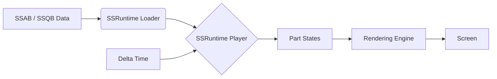

[**English**](./README.md) | [**日本語**](./README.ja.md)

# libssruntime

SpriteStudio 7 のアニメーションデータを再生するためのランタイムライブラリです。
バイナリデータ (`.ssab`, `.ssqb`) を読み込み、アニメーションの更新、キーフレームの抽出、補間計算などのコアロジックを提供します。

> **Note**
> このライブラリ自体は描画機能 (レンダリング) を持っていません。
> 各ゲームエンジンやプラットフォーム向けの「Player (描画部分)」を実装するためのバックエンドとして機能します。

# 主な機能

- **再生制御**: 再生、一時停止、シーク、ループ設定など。
- **データ管理**: アニメーションデータ (`SsAnimeBinary`) とシーケンスデータ (`SsSequenceBinary`) の保持。
- **更新ロジック**: デルタタイムに基づいたフレーム更新。
- **補間計算**: キーフレーム間の値を曲線やイージング関数に基づいて補間。
- **インスタンス機能**: 親パーツから別のアニメーションを呼び出す機能のサポート。
- **乱数シード管理**: パーティクルエフェクトなどの再現性を保つためのシード制御。

# アーキテクチャ

このライブラリは、計算結果を「パーツの状態 (State)」として出力します。
Player 側はこの State を受け取り、画面に描画する必要があります。

# FFI (C-API)

このライブラリは、C++ やその他の言語から利用することを主目的として設計されています。
Rust の機能を C 言語インターフェースを通じて公開しています。

## 利用フロー

1. **Context の作成**: ライブラリの状態を管理するコンテキストを生成します。
2. **データのロード**: メモリ上のバイナリデータ (`.ssab`) を渡してロードします。
3. **Player の作成**: ロードしたデータからプレイヤーインスタンスを生成します。
4. **更新ループ (Update)**: 毎フレーム `update(dt)` を呼び出し、内部時間を進めます。
5. **描画情報の取得**: 更新後のパーツ情報を取得し、レンダリングエンジンに渡します。

## ヘッダファイル

ビルド時に `cbindgen` を使用して C/C++ 用のヘッダファイル (`ssruntime.h`) が生成されます。
API のシグネチャや構造体の定義はそちらを参照してください。

# Player 実装者向け情報

T.B.D.
