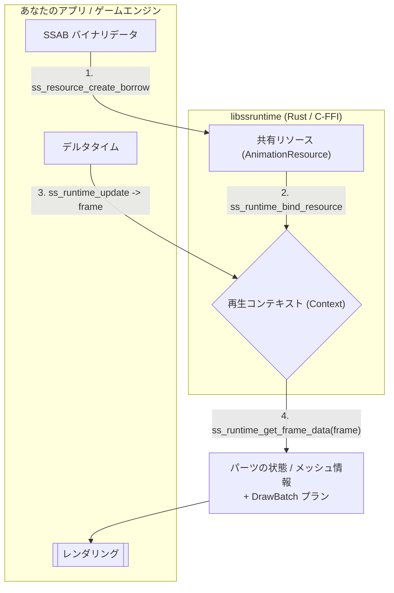

[**English**](./README.md) | [**日本語**](./README.ja.md)

# libssruntime

[SpriteStudio-SDK](https://github.com/cri-middleware/SpriteStudio-SDK/blob/HEAD/README.ja.md) のワークフローにおける再生の **Brain（中枢）** です。[ssconverter-cli](https://github.com/cri-middleware/SpriteStudio-SDK/blob/HEAD/cli/README.ja.md) が生成した `.ssab` バイナリを読み込み、レンダラーがフレーム毎に必要とするすべて — パーツの状態（トランスフォーム、メッシュ変形、カラー）、エンジン非依存の `DrawBatch` プラン、イベント信号 — を出力します。

> **エンジン非依存設計**
> `libssruntime` 自体は描画を一切行いません。各「Player」（エンジン / プラットフォーム統合）が出力された状態を受け取り、ネイティブの描画 API で実際の描画を行います。この分離設計こそが、エンジン間で一貫した再生結果を生む根拠です — 詳細はトップ README の「[なぜこの SDK を選ぶべきか？](https://github.com/cri-middleware/SpriteStudio-SDK/blob/HEAD/README.ja.md#-なぜこの-sdk-を選ぶべきか)」を参照してください。

# 主な機能

- **SpriteStudio の全機能対応**: ボーン階層、メッシュウェイトと頂点変形、パーティクルエフェクト、サブアニメーションのインスタンス、ステンシルマスク、フレーム単位で正確なイベント / ユーザーデータ。
- **サブフレーム補間**: ソースのフレームレートを超えた滑らかな再生 — Hermite、Bezier、Linear、各種イージング曲線をサポート。
- **`DrawBatch` プランの出力**: フレーム毎の出力にエンジン非依存のバッチプラン（頂点、マスク列、パーティクル quad スロット、インスタンス / エフェクトスロット）を含みます。詳細は [描画ループ](./docs/30_core/40_render_loop.ja.md) を参照してください。
- **決定論的な再生**: パーティクル等の再現性のための明示的な乱数シード制御。
- **詳細な再生制御** (`PlaybackController`): 再生 / 一時停止 / 停止、1 フレーム単位のステップ（前進 / 後退）、任意フレームへのサブフレーム精度シーク、再生範囲と FPS のカスタマイズ、ループ回数 (`-1` で無限)、`Normal` / `PingPong` スタイル、`Forward` / `Backward` 方向、リアルタイム / 固定ステップの時間進行モード。
- **アニメーションミキシング**: 複数のアニメーションを **トラック** に積んで合成します（クロスフェード、オーバーレイ、加算）。強度はトラックごとの `alpha`、離散属性とイベントの発火は track 0 が担当します。詳細は [アニメーションミキシング](./docs/50_features/10_animation_mixing.ja.md) を参照してください。
- **`no_std` ファースト**: コアは純粋な `no_std`。`std` は開発時の利便性のためだけのオプトイン。全環境で SIMD (`f32x4`) を活用。

# `no_std` サポート

`libssruntime` は `no_std` ファーストで設計されています。`std` は開発時の利便性のためだけのオプトインであり、リリース用のスクリプトでは一切使用されません。

Rust から依存する場合は、そのまま追加します。デフォルトで有効になる機能はありません：

```toml
ssruntime = "7.0.0-beta.1"
```

バイナリ成果物は、このクレートを `staticlib` / `cdylib` として出力する隣のクレート `ssruntime-ffi` からビルドします。ターゲットごとの機能セットと、それをビルドするコマンドは [no_std 環境への統合 §1](./docs/20_design/40_no_std_integration.ja.md#1-ビルド構成) にあります。

*注意: `no_std` モードでも、アニメーションの状態やメタデータを管理するためにアロケータ (`alloc` クレート) は必要です。*

# ⚠️ 制限事項とセキュリティに関する注意事項

本ライブラリをゲームエンジン等の Player に組み込む際は、以下の仕様に強く留意してください。

1. **データ検証 (バリデーション) の非実施**
   - パフォーマンスの最大化およびバイナリサイズの最小化 (特に組み込み/WebAssembly向け) を目的として、`libssruntime` は入力される `.ssab` データの構造検証（バリデーション）を行いません。
   - 悪意を持って細工されたデータや、破損した `.ssab` ファイルをロードした場合、範囲外メモリアクセスなどによる未定義動作やクラッシュを引き起こす危険性があります。
   - **対策:** ネットワーク経由やユーザーからの動的な入力を受け付ける環境では、Player 側で必ず事前にデータの整合性を検証するか、信頼できる安全なアセットのみをロードする設計にしてください。
   - Rust から使う場合、`AnimationResource::new` と `SsabResource::new` は `unsafe fn` です。リリースビルドでは範囲チェックをしない FlatBuffers のアクセサで読むため、正しい `.ssab` を渡すことが呼び出し側の前提になります。

2. **メモリリソースの共有とライフタイム (FFI利用時)**
   - メモリ効率を最適化するため、1つのアニメーションリソース (`AnimationResource`) を複数の再生インスタンス (`Context`) で共有する設計になっています。
   - リソースは内部で参照カウント管理されています。コンテキストにバインドしたままリソースを `ss_resource_destroy` しても安全です（バインドしている全コンテキストが破棄・リセットされるまでデータは保持されます）。
   - **一方で `ss_resource_create_borrow` に渡したバッファは別問題です。** これはコピーされないため、**リソースが破棄されるまで、呼び出し側がそのメモリを有効かつ不変に保つ必要があります**。保証できない場合は `ss_resource_create_copy` を使用してください。

# アーキテクチャ

このライブラリは、計算結果を「パーツの状態 (State)」として出力します。
Player 側はこの State を受け取り、画面に描画する必要があります。

> **図の凡例**
> - **図形**: `[ ]` データ/リソース, `{ }` コンテキスト/状態, `[[ ]]` アプリケーション/エンジン
> - **矢印**: `-->` データの流れ / API呼び出し



# FFI (C-API)

このライブラリは、C++ やその他の言語から利用することを主目的として設計されています。
Rust の機能を C 言語インターフェースを通じて公開しています。

## 利用フロー

1. **Context の作成**: 再生状態を管理するコンテキストを生成します (`ss_runtime_create`)。
2. **Resource のロード**: メモリ上のバイナリデータ (`.ssab`) をリソースオブジェクトとしてロードします (`ss_resource_create_borrow`)。
3. **Resource のバインド**: ロードしたリソースをコンテキストに紐付けます (`ss_runtime_bind_resource`)。
4. **アニメーションの設定**: 再生したいアニメーション名を指定します (`ss_runtime_setup_animation`)。
5. **更新ループ (Update)**: 毎フレーム `ss_runtime_update(ctx, dt)` を呼び出し、内部時間を進めます。
6. **描画情報の取得**: 更新後のパーツ情報を取得し (`ss_runtime_get_frame_data`)、レンダリングエンジンに渡します。

## C++ での利用例

```cpp
#include "ssruntime.h"

void play_animation(const uint8_t* ssab_data, size_t size) {
    // 1. Context の作成
    void* ctx = ss_runtime_create();
    
    // 2. Resource のロード (外部メモリの参照。コピーを避け最も効率的)
    // 注意: resource を破棄するまで、元の ssab_data がメモリ上に維持されている必要があります。
    void* res = ss_resource_create_borrow(ssab_data, size);
    
    // 3. Resource を Context にバインド
    ss_runtime_bind_resource(ctx, res);
    
    // 4. アニメーションの設定と再生開始
    ss_runtime_setup_animation(ctx, "Wait");
    ss_runtime_play(ctx);

    // 5. 更新ループ
    float dt_ms = 1000.0f / 60.0f; // ss_runtime_update はミリ秒を受け取ります
    while (ss_runtime_is_playing(ctx)) {
        float frame = ss_runtime_update(ctx, dt_ms);
        
        // 6. 描画情報の取得
        const uint8_t* data;
        uintptr_t len;
        // フレーム番号は浮動小数で管理・取得されます（サブフレーム対応）。
        // 整数フレームのみで再生したい場合は frame の代わりに floorf(frame) を渡します。
        ss_runtime_get_frame_data(ctx, frame, &data, &len);
    }

    // リソースとコンテキストの破棄
    ss_resource_destroy(res);
    ss_runtime_destroy(ctx);
}
```

## ヘッダファイル

`ssruntime.h` は C++ からもインクルードできる C ヘッダです。API のシグネチャや構造体の定義はそちらを参照してください。`ssruntime-ffi` をビルドすると、C# バインディングの `SSRuntimeMethods.g.cs` とともに `libs/ssruntime-ffi/target/` に書き出されます。どちらもコミットされた写しが `libs/ssruntime-ffi/bindings/` にあるので、ビルドしなくても読めます。リリースのライブラリ zip では `include/` と `bindings/` に入っています。

# Player 実装者向け情報

新しいゲームエンジンやプラットフォームで SpriteStudio プレイヤーを実装する場合は、以下のドキュメントを参照してください。

- [**Player 移植ガイド (日本語)**](./docs/README.ja.md)
- [**FrameData スキーマ解説**](./SCHEMA.ja.md)

このガイドでは、基本アーキテクチャから、メッシュ変形、インスタンスアニメーション、`no_std` 統合などの高度な機能まで網羅しています。

# 開発・コード生成 (fbsファイルの更新)

`fbs/` 内の `.fbs` ファイルを変更した場合は、`./scripts/generate.sh`（Windows では `./scripts/generate.ps1`）を実行して `src/runtime/` の Rust コードを再生成してください。使う `flatc` のバージョンは [CONTRIBUTING.md](../../CONTRIBUTING.md#前提条件) にあります。


