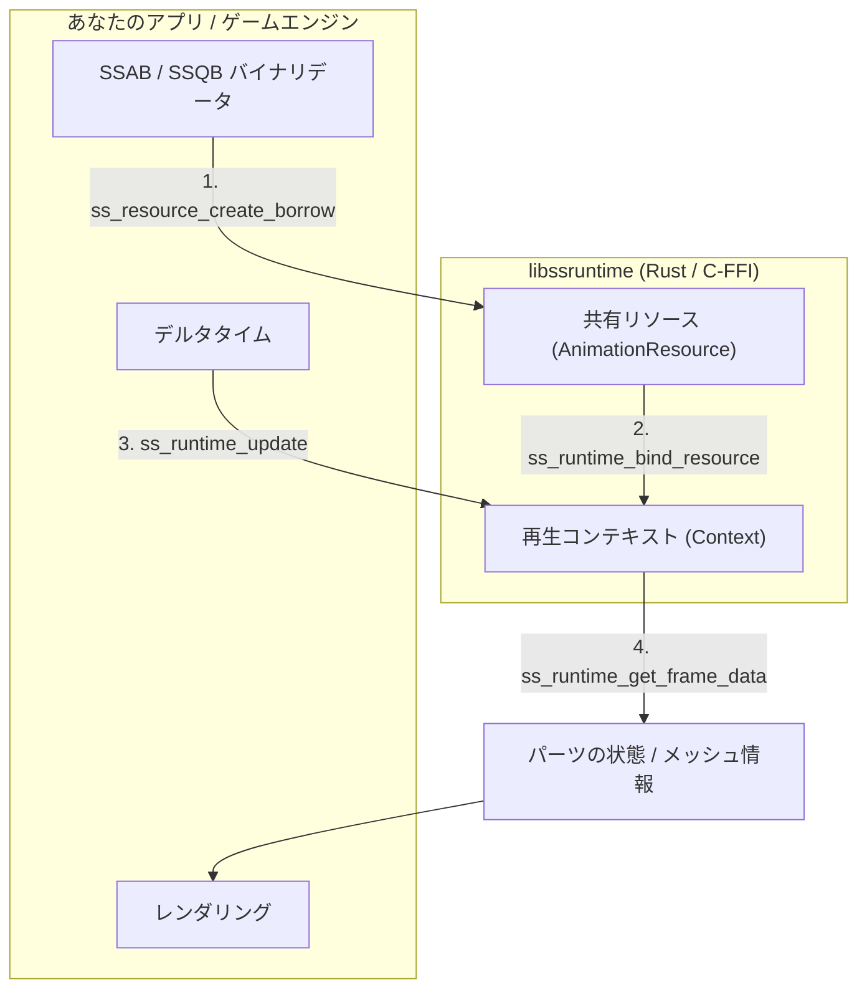

[**English**](./README.md) | [**日本語**](./README.ja.md)

# libssruntime

SpriteStudio 7 のアニメーションデータを再生するためのランタイムライブラリです。
バイナリデータ (`.ssab`, `.ssqb`) を読み込み、アニメーションの更新、キーフレームの抽出、補間計算などのコアロジックを提供します。

> **Note**
> このライブラリ自体は描画機能 (レンダリング) を持っていません。
> 各ゲームエンジンやプラットフォーム向けの「Player (描画部分)」を実装するためのバックエンドとして機能します。

# 主な機能

- **再生制御**: 再生、一時停止、シーク、ループ設定など。
- **データ管理**: アニメーションデータ (`SsAnimeBinary`) とシーケンスデータ (`SsSequenceBinary`) の保持。
- **更新ロジック**: デルタタイムに基づいたフレーム更新。
- **補間計算**: キーフレーム間の値を曲線やイージング関数に基づいて補間。
- **インスタンス機能**: 親パーツから別のアニメーションを呼び出す機能のサポート。
- **乱数シード管理**: パーティクルエフェクトなどの再現性を保つためのシード制御。

# `no_std` サポート

`libssruntime` は `no_std` 環境と互換性があるように設計されており、組み込みシステムやカスタムゲームエンジンのコアでの利用に適しています。

`no_std` 環境で使用する場合は、`Cargo.toml` でデフォルト機能を無効にします：

```toml
[dependencies]
ssruntime = { path = "libs/ssruntime", default-features = false }
```

*注意: `no_std` モードでも、アニメーションの状態やメタデータを管理するためにアロケータ (`alloc` クレート) は必要です。*

# ⚠️ 制限事項とセキュリティに関する注意事項

本ライブラリをゲームエンジン等の Player に組み込む際は、以下の仕様に強く留意してください。

1. **データ検証 (バリデーション) の非実施**
   - パフォーマンスの最大化およびバイナリサイズの最小化 (特に組み込み/WebAssembly向け) を目的として、`libssruntime` は入力される `.ssab` データの構造検証（バリデーション）を行いません。
   - 悪意を持って細工されたデータや、破損した `.ssab` ファイルをロードした場合、範囲外メモリアクセスなどによる未定義動作やクラッシュを引き起こす危険性があります。
   - **対策:** ネットワーク経由やユーザーからの動的な入力を受け付ける環境では、Player 側で必ず事前にデータの整合性を検証するか、信頼できる安全なアセットのみをロードする設計にしてください。

2. **メモリリソースの共有とライフタイム (FFI利用時)**
   - メモリ効率を最適化するため、1つのアニメーションリソース (`AnimationResource`) を複数の再生インスタンス (`Context`) で共有する設計になっています。
   - `ss_runtime_bind_resource` でリソースをコンテキストに紐付けた後、**コンテキストが破棄されるか別リソースがバインドされる前に、元のリソースを破棄しないでください**。ダングリングポインタ（Use-after-free）が発生し、クラッシュの原因となります。

# アーキテクチャ

このライブラリは、計算結果を「パーツの状態 (State)」として出力します。
Player 側はこの State を受け取り、画面に描画する必要があります。



# FFI (C-API)

このライブラリは、C++ やその他の言語から利用することを主目的として設計されています。
Rust の機能を C 言語インターフェースを通じて公開しています。

## 利用フロー

1. **Context の作成**: 再生状態を管理するコンテキストを生成します (`ss_runtime_create`)。
2. **Resource のロード**: メモリ上のバイナリデータ (`.ssab`) をリソースオブジェクトとしてロードします (`ss_resource_create_borrow`)。
3. **Resource のバインド**: ロードしたリソースをコンテキストに紐付けます (`ss_runtime_bind_resource`)。
4. **アニメーションの設定**: 再生したいアニメーション名を指定します (`ss_runtime_setup_animation`)。
5. **更新ループ (Update)**: 毎フレーム `ss_runtime_update(ctx, dt)` を呼び出し、内部時間を進めます。
6. **描画情報の取得**: 更新後のパーツ情報を取得し (`ss_runtime_get_frame_data`)、レンダリングエンジンに渡します。

## C++ での利用例

```cpp
#include "ssruntime.h"

void play_animation(const uint8_t* ssab_data, size_t size) {
    // 1. Context の作成
    void* ctx = ss_runtime_create();
    
    // 2. Resource のロード (外部メモリの参照。コピーを避け最も効率的)
    // 注意: resource を破棄するまで、元の ssab_data がメモリ上に維持されている必要があります。
    void* res = ss_resource_create_borrow(ssab_data, size);
    
    // 3. Resource を Context にバインド
    ss_runtime_bind_resource(ctx, res);
    
    // 4. アニメーションの設定と再生開始
    ss_runtime_setup_animation(ctx, "Wait");
    ss_runtime_play(ctx);

    // 5. 更新ループ
    float dt = 1.0f / 60.0f;
    while (ss_runtime_is_playing(ctx)) {
        int frame = ss_runtime_update(ctx, dt);
        
        // 6. 描画情報の取得
        uint8_t* data;
        size_t len;
        ss_runtime_get_frame_data(ctx, frame, &data, &len);
        
        // render_parts(data, len);
    }

    // リソースとコンテキストの破棄
    ss_resource_destroy(res);
    ss_runtime_destroy(ctx);
}
```

## ヘッダファイル

ビルド時に `cbindgen` を使用して C/C++ 用のヘッダファイル (`ssruntime.h`) が生成されます。
API のシグネチャや構造体の定義はそちらを参照してください。

# Player 実装者向け情報

新しいゲームエンジンやプラットフォームで SpriteStudio 7 プレイヤーを実装する場合は、以下のドキュメントを参照してください。

- [**Player 移植ガイド (日本語)**](./docs/README.ja.md)
- [**FrameData スキーマ解説**](./SCHEMA.ja.md)

このガイドでは、基本アーキテクチャから、メッシュ変形、インスタンスアニメーション、`no_std` 統合などの高度な機能まで網羅しています。

# 開発・コード生成 (fbsファイルの更新)

`fbs` フォルダ内の `.fbs` ファイルを変更・更新した場合、Rust コードを再生成する必要があります。
再生成には `flatc` コマンド (Google FlatBuffers Compiler) がインストールされている必要があります。

## 更新手順

1. `flatc` (Google FlatBuffers Compiler) をインストールします。
2. `fbs/` フォルダ内の `.fbs` ファイルを更新・編集します。
3. 以下のスクリプトを実行し、Rust コードを再生成します。

### Windows (PowerShell)

```powershell
./scripts/generate.ps1
```

### macOS / Linux (Bash)

```bash
./scripts/generate.sh
```


