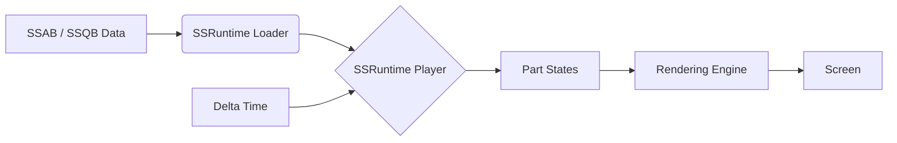

[**日本語**](./README.ja.md) | [**English**](./README.md)

# libssruntime

A runtime library for playing SpriteStudio 7 animation data.
It loads binary data (`.ssab`, `.ssqb`) and provides core logic such as animation updates, keyframe extraction, and interpolation calculations.

> **Note**
> This library itself does not have rendering capabilities.
> It functions as a backend for implementing "Players (rendering parts)" for various game engines and platforms.

# Key Features

- **Playback Control**: Play, pause, seek, loop settings, etc.
- **Data Management**: Holds animation data (`SsAnimeBinary`) and sequence data (`SsSequenceBinary`).
- **Update Logic**: Frame updates based on delta time.
- **Interpolation**: Interpolates values between keyframes based on curves or easing functions.
- **Instance Feature**: Supports calling other animations from parent parts.
- **Random Seed Management**: Seed control to ensure reproducibility for particle effects, etc.

# `no_std` Support

`libssruntime` is designed to be compatible with `no_std` environments, making it suitable for embedded systems or custom game engine cores.

To use it in a `no_std` environment, disable the default features in your `Cargo.toml`:

```toml
[dependencies]
ssruntime = { path = "libs/ssruntime", default-features = false }
```

*Note: In `no_std` mode, an allocator (`alloc` crate) is still required for managing animation state and metadata.*

# Architecture

This library outputs the calculation results as "Part States".
The Player side needs to receive this State and render it to the screen.



# FFI (C-API)

This library is designed primarily for use from C++ and other languages.
It exposes Rust functionality through a C language interface.

## Usage Flow

1.  **Create Context**: Create a context to manage the playback state (`ss_runtime_create`).
2.  **Load Resource**: Load binary data (`.ssab`) into a resource object (`ss_resource_create_copy`).
3.  **Bind Resource**: Bind the resource to the context (`ss_runtime_bind_resource`).
4.  **Setup Animation**: Specify which animation to play by its name (`ss_runtime_setup_animation`).
5.  **Update Loop**: Call `ss_runtime_update(ctx, dt)` every frame to advance internal time.
6.  **Get Rendering Info**: Retrieve updated part information (`ss_runtime_get_frame_data`) and pass it to the rendering engine.

## Example C++ Usage

```cpp
#include "ssruntime.h"

void play_animation(const uint8_t* ssab_data, size_t size) {
    // 1. Create Context
    void* ctx = ss_runtime_create();
    
    // 2. Load Resource (copying binary data into internal storage)
    void* res = ss_resource_create_copy(ssab_data, size);
    
    // 3. Bind Resource to Context
    ss_runtime_bind_resource(ctx, res);
    
    // 4. Setup Animation
    ss_runtime_setup_animation(ctx, "Wait");
    ss_runtime_play(ctx);

    // 5. Update Loop
    float dt = 1.0f / 60.0f;
    while (ss_runtime_is_playing(ctx)) {
        int frame = ss_runtime_update(ctx, dt);
        
        // 6. Get Rendering Info
        uint8_t* data;
        size_t len;
        ss_runtime_get_frame_data(ctx, frame, &data, &len);
        
        // render_parts(data, len);
    }

    ss_resource_destroy(res);
    ss_runtime_destroy(ctx);
}
```

## Header File

A C/C++ header file (`ssruntime.h`) is generated using `cbindgen` during the build.
Please refer to it for API signatures and struct definitions.

# For Player Implementers

T.B.D.
