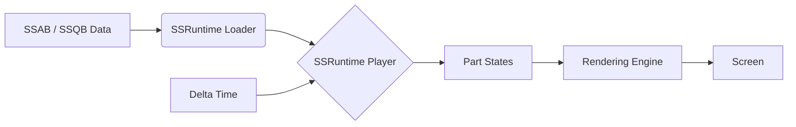

[**日本語**](./README.ja.md) | [**English**](./README.md)

# libssruntime

A runtime library for playing SpriteStudio 7 animation data.
It loads binary data (`.ssab`, `.ssqb`) and provides core logic such as animation updates, keyframe extraction, and interpolation calculations.

> **Note**
> This library itself does not have rendering capabilities.
> It functions as a backend for implementing "Players (rendering parts)" for various game engines and platforms.

# Key Features

- **Playback Control**: Play, pause, seek, loop settings, etc.
- **Data Management**: Holds animation data (`SsAnimeBinary`) and sequence data (`SsSequenceBinary`).
- **Update Logic**: Frame updates based on delta time.
- **Interpolation**: Interpolates values between keyframes based on curves or easing functions.
- **Instance Feature**: Supports calling other animations from parent parts.
- **Random Seed Management**: Seed control to ensure reproducibility for particle effects, etc.

# Architecture

This library outputs the calculation results as "Part States".
The Player side needs to receive this State and render it to the screen.

# FFI (C-API)

This library is designed primarily for use from C++ and other languages.
It exposes Rust functionality through a C language interface.

## Usage Flow

1.  **Create Context**: Create a context to manage the library state.
2.  **Load Data**: Pass binary data (`.ssab`) in memory to load it.
3.  **Create Player**: Generate a player instance from the loaded data.
4.  **Update Loop**: Call `update(dt)` every frame to advance internal time.
5.  **Get Rendering Info**: Retrieve updated part information and pass it to the rendering engine.

## Header File

A C/C++ header file (`ssruntime.h`) is generated using `cbindgen` during the build.
Please refer to it for API signatures and struct definitions.

# For Player Implementers

T.B.D.
