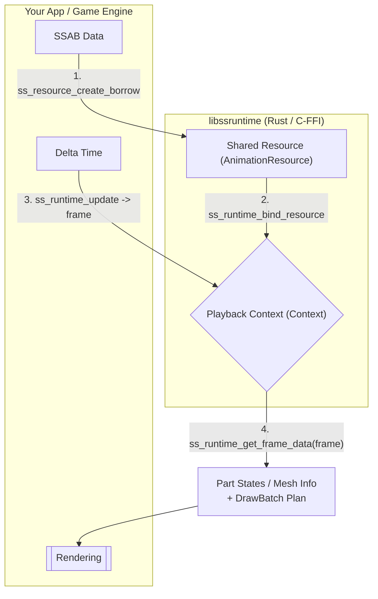

[**日本語**](./README.ja.md) | [**English**](./README.md)

# libssruntime

The playback **Brain** of the [SpriteStudio-SDK](https://github.com/cri-middleware/SpriteStudio-SDK/blob/HEAD/README.md) workflow. Loads `.ssab` binaries produced by [ssconverter-cli](https://github.com/cri-middleware/SpriteStudio-SDK/blob/HEAD/cli/README.md) and emits everything a renderer needs per frame — part states (transforms, mesh deformations, color), cross-engine `DrawBatch` plans, and event signals.

> **Engine-agnostic by design**
> `libssruntime` performs no rendering itself. Each "Player" (engine/platform integration) consumes the emitted state and draws using its native API. This separation is what makes playback consistent across engines — see [Why choose this SDK?](https://github.com/cri-middleware/SpriteStudio-SDK/blob/HEAD/README.md#-why-choose-this-sdk) in the top-level README for the rationale.

# Key Features

- **Full SpriteStudio feature set**: bone hierarchies, mesh weights and vertex deformations, particle effects, sub-animation instances, stencil masks, frame-accurate events and user data.
- **Sub-frame interpolation**: smooth playback beyond the source framerate — Hermite, Bezier, Linear, and easing curves.
- **`DrawBatch` plan emission**: each frame's output includes a cross-engine batch plan (vertices, mask sequences, particle quad slots, instance / effect slots). See [Render Loop](./docs/30_core/40_render_loop.md).
- **Deterministic playback**: explicit random-seed control for reproducible particle simulation.
- **Rich playback control** (`PlaybackController`): transport (play / pause / stop), single-frame stepping (forward / backward), seek to any frame at sub-frame precision, custom playback range and FPS, loop count (`-1` = infinite), `Normal` / `PingPong` styles, `Forward` / `Backward` direction, and real-time vs. fixed-step time advancement.
- **Animation mixing**: stack several animations on **tracks** — crossfades, overlays, additive blending. Strength is a per-track `alpha`; track 0 carries the discrete attributes and event firing. See [Animation Mixing](./docs/50_features/10_animation_mixing.md).
- **`no_std`-first**: pure `no_std` core; `std` is opt-in for developer ergonomics only. SIMD (`f32x4`) on every target.

# `no_std` Support

`libssruntime` is `no_std`-first. `std` is opt-in (developer ergonomics only) and is never used by release scripts.

A Rust dependent takes the crate as it comes — nothing is on by default:

```toml
ssruntime = "7.0.0-beta.1"
```

The binary deliverables are built from `ssruntime-ffi`, the sibling crate that emits this one as a `staticlib` / `cdylib`. The feature set for each target, and the command that builds it, are in [Integrating into no_std environments §1](./docs/20_design/40_no_std_integration.md#1-build-configuration).

*Note: An allocator (`alloc` crate) is still required even in `no_std` mode — animation state and metadata are heap-allocated.*

# ⚠️ Limitations and Security Notes

When integrating this library into a Player (game engine), please pay close attention to the following specifications:

1. **No Data Validation**
   - To maximize performance and minimize binary size (especially for embedded/WebAssembly targets), `libssruntime` **does not perform structural validation** on the input `.ssab` data.
   - Loading maliciously crafted or corrupted `.ssab` files can cause undefined behavior or crashes (e.g., out-of-bounds memory access).
   - **Mitigation:** In environments that accept dynamic input from networks or users, the Player MUST validate the data integrity beforehand or ensure that only trusted, safe assets are loaded.
   - From Rust, `AnimationResource::new` and `SsabResource::new` are `unsafe fn`: they read through FlatBuffers accessors that do not bounds-check in release builds, so a valid `.ssab` is the caller's precondition.

2. **Resource Sharing and Lifetimes (FFI)**
   - To optimize memory usage, a single animation resource (`AnimationResource`) can be shared across multiple playback instances (`Context`).
   - Resources are reference-counted internally. It is safe to call `ss_resource_destroy` on a resource that is still bound to one or more contexts — the data stays alive until every bound context is destroyed or reset.
   - **The buffer you pass to `ss_resource_create_borrow` is a different matter:** it is *not* copied, so **the caller must keep that memory valid and unmodified until the resource is destroyed**. Use `ss_resource_create_copy` instead if you cannot guarantee that.

# Architecture

This library outputs the calculation results as "Part States".
The Player side needs to receive this State and render it to the screen.

> **Diagram Legend**
> - **Shapes**: `[ ]` Data/Resources, `{ }` Context/State, `[[ ]]` Applications/Engines.
> - **Arrows**: `-->` Data Flow / API Call.



# FFI (C-API)

This library is designed primarily for use from C++ and other languages.
It exposes Rust functionality through a C language interface.

## Usage Flow

1.  **Create Context**: Create a context to manage the playback state (`ss_runtime_create`).
2.  **Load Resource**: Load binary data (`.ssab`) into a resource object (`ss_resource_create_borrow`).
3.  **Bind Resource**: Bind the resource to the context (`ss_runtime_bind_resource`).
4.  **Setup Animation**: Specify which animation to play by its name (`ss_runtime_setup_animation`).
5.  **Update Loop**: Call `ss_runtime_update(ctx, dt)` every frame to advance internal time.
6.  **Get Rendering Info**: Retrieve updated part information (`ss_runtime_get_frame_data`) and pass it to the rendering engine.

## Example C++ Usage

```cpp
#include "ssruntime.h"

void play_animation(const uint8_t* ssab_data, size_t size) {
    // 1. Create Context
    void* ctx = ss_runtime_create();
    
    // 2. Load Resource (Reference to external memory. Most efficient, avoiding copies)
    // Note: The original ssab_data MUST remain in memory until the resource is destroyed.
    void* res = ss_resource_create_borrow(ssab_data, size);
    
    // 3. Bind Resource to Context
    ss_runtime_bind_resource(ctx, res);
    
    // 4. Setup Animation
    ss_runtime_setup_animation(ctx, "Wait");
    ss_runtime_play(ctx);

    // 5. Update loop
    float dt_ms = 1000.0f / 60.0f; // ss_runtime_update takes milliseconds
    while (ss_runtime_is_playing(ctx)) {
        float frame = ss_runtime_update(ctx, dt_ms);

        // 6. Get rendering information
        const uint8_t* data;
        uintptr_t len;
        // The frame number is managed as a float (Sub-frame support).
        // Pass floorf(frame) instead of frame when playing on integer frames only.
        ss_runtime_get_frame_data(ctx, frame, &data, &len);
    }

    // Destroy the resource and the context
    ss_resource_destroy(res);
    ss_runtime_destroy(ctx);
}
```

## Header File

`ssruntime.h` is a C header that C++ can include as well; refer to it for API signatures and struct definitions. A build of `ssruntime-ffi` writes it, with the C# bindings `SSRuntimeMethods.g.cs`, to `libs/ssruntime-ffi/target/`. Committed copies of both are in `libs/ssruntime-ffi/bindings/`, to read without building, and a release's library zips carry them in `include/` and `bindings/`.

# For Player Implementers

If you are planning to implement a SpriteStudio player for a new game engine or platform, please refer to the following documentation:

- [**Player Porting Guide**](./docs/README.md)
- [**FrameData Schema Documentation**](./SCHEMA.md)

This guide covers everything from basic architecture to advanced features like mesh deformation, instance animations, and `no_std` integration.

# Development & Code Generation (Updating fbs files)

When you edit `.fbs` files under `fbs/`, regenerate the committed Rust bindings in `src/runtime/` with `./scripts/generate.sh` (or `./scripts/generate.ps1` on Windows). The `flatc` release to use is in [CONTRIBUTING.md](../../CONTRIBUTING.md#prerequisites).


