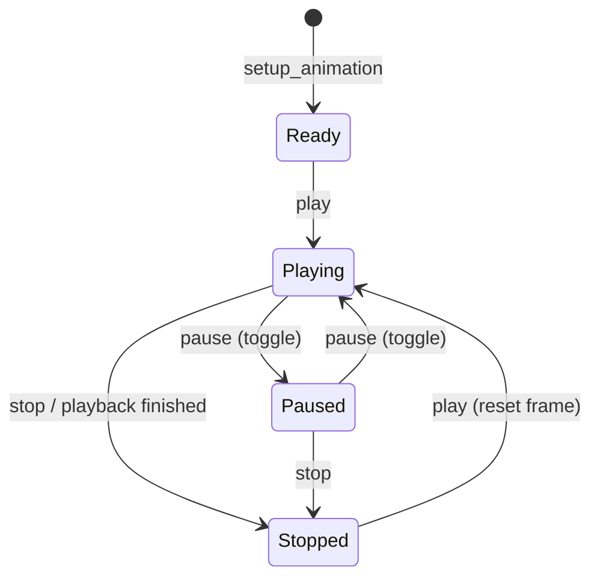

# 実装フェーズ 2：アニメーション指定 (Setup Animation)

再生するアニメーションの選択や、再生オプションの設定を行うフェーズです。

## 1. アニメーションのセットアップ
ssab 内に含まれる複数のアニメーションの中から、再生したいアニメーションを名前で指定します。

```cpp
// 指定したアニメーション名が存在するか確認し、準備する
const char* anime_name = "anime_1";
bool success = ss_runtime_setup_animation(context, anime_name);
```

## 2. 再生設定
アニメーションのループ回数や速度、再生方向などを設定します。

```cpp
// ループ回数（0 = 無限ループ, 1 = 1回再生, n = n回再生）
ss_runtime_set_loop(context, 0);

// 再生速度（1.0 = 等倍, 2.0 = 2倍速, 0.5 = 半速）
ss_runtime_set_animation_speed(context, 1.0f);

// 再生方向とスタイル（0 = 正方向, 1 = 逆方向 / 0 = 通常, 1 = ピンポン）
ss_runtime_set_playback_direction(context, 0, 0);

// 指定したフレーム範囲のみ再生する場合
ss_runtime_set_animation_section(context, 0, 30);
```

## 3. 再生開始・制御
アニメーションの再生、停止、一時停止を行います。

```cpp
// 再生開始 (開始フレームから再生)
ss_runtime_play(context);

// 特定のフレームから再生開始
// ss_runtime_play_with_start_frame(context, 10.0f);

// 一時停止 (時間の更新を止める)
ss_runtime_pause(context);

// 停止 (再生フラグを降ろす。※フレーム位置は維持されます)
ss_runtime_stop(context);
```

## 4. 状態の確認
現在の再生状況を取得します。

```cpp
// 再生中か？
bool is_playing = ss_runtime_is_playing(context);

// 最終フレームに到達したか？
bool is_end = ss_runtime_is_end_frame_reached(context);
```

---

# 実装フェーズ 2：再生制御と状態管理 (Playback Control)

アニメーションの再生状態の管理、ループ設定、再生終了の検知など、Player のコントローラーとしての機能を実装します。

## 1. 再生状態の遷移と操作
Player は `libssruntime` のコンテキストを通じて以下の状態を管理します。

### 状態遷移図


### 操作コマンドと挙動の詳細
`libssruntime` の C-API における標準的な挙動は以下の通りです。

| コマンド | 遷移後の状態 | 再生ヘッド (Frame) | 備考 |
| :--- | :--- | :--- | :--- |
| **ss_runtime_play** | Playing | **開始位置にリセット** | 常に最初（または指定セクションの端）から再生します。 |
| **ss_runtime_pause** | Paused / Playing | 現在位置で保持 | 内部の `is_pausing` フラグを反転（トグル）させます。 |
| **ss_runtime_stop** | Stopped | 現在位置で保持 | 再生中フラグのみを降ろします。完全に初期位置へ戻したい場合は、別途 `set_frame_no` を呼んでください。 |

## 2. 再生コントロールメソッド (推奨 API)
Player の API を設計する際は、上記のライブラリ挙動をラップして、ユーザーにとって直感的なインターフェースを提供することを推奨します。

- **play(name, loop, startFrame)**: アニメーションをセットアップし、再生を開始します。
- **pause()**: 再生を一時停止します。
- **resume()**: 一時停止から復帰（再開）します。
- **stop()**: 再生を終了し、再生ヘッドを初期位置に戻します。
- **isPlaying()**: `ss_runtime_is_playing` だけでなく、`!ss_runtime_is_pausing` も考慮して「実際に動いているか」を返すと親切です。

## 3. 再生設定と取得
アニメーションの挙動をカスタマイズするための設定項目です。

### 基本設定
- **setSpeed(speed) / getSpeed()**: `ss_runtime_set_animation_speed(context, speed)` / `1.0f` が等倍。
- **setFrame(frame) / getFrame()**: `ss_runtime_set_frame_no(context, frame)` / `ss_runtime_get_frame_no(context)`
- **getTotalFrames()**: `ss_runtime_get_total_frames(context)`
- **フレームレート**: `ss_runtime_set_frame_rate(context, fps)` / ssab のデフォルト値以外を使いたい場合に設定。
- **再生範囲**: `ss_runtime_set_animation_section(context, start, end)`

### 再生方向とスタイル
- **再生方向**: `ss_runtime_set_playback_direction(context, direction, style)`
    - `direction`: 0 = 正方向 (Forward), 1 = 逆方向 (Backward)
    - `style`: 0 = 通常 (Normal), 1 = ピンポン (PingPong)
- **ループ回数**: `ss_runtime_set_loop(context, count)`
    - `0` で無限ループ。

## 3. 状態の取得
Player の外部（スクリプト等）から現在の状況を確認するための API です。

- `ss_runtime_is_playing(context)`: 再生中か
- `ss_runtime_get_frame_no(context)`: 現在のフレーム番号（小数）
- `ss_runtime_get_fps(context)`: 設定されている FPS

## 4. 再生終了コールバックの実装
libssruntime は、再生が終了（またはループの終端に到達）した際に内部でフラグを立てます。

- **終了検知**: `ss_runtime_is_end_frame_reached(context)` が `true` になったタイミングを確認します。

### コールバックの発火タイミングの検討
Player 実装者は、用途に合わせて以下のタイミングでイベント（コールバック）を発火させる必要があります。

- **無限ループ時**: 
    - 終端に到達するたびに発火する（1ループ終了ごと）
    - または、発火させない
- **有限ループ時**:
    - 終端に到達するたびに発火する
    - すべてのループが完了した最後のみ発火する

## 5. フレームスキップの設定
`ss_runtime_set_skip_frames(context, bool)` を用いて、処理が追いつかない場合にフレームを飛ばすかどうかを設定できます。
- **ON**: 経過時間（デルタタイム）を優先し、描画が間に合わないフレームをスキップします。
- **OFF**: 毎フレーム確実に進めます。処理が重い場合、アニメーションはスローモーションになります。

---
[目次に戻る](./README.ja.md)
