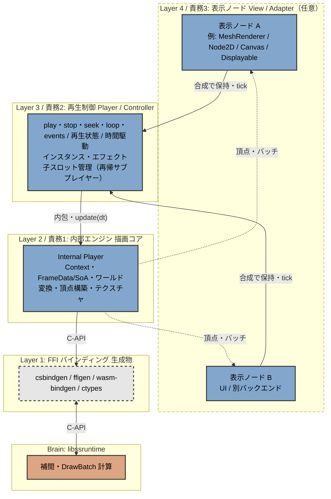

> **日本語** | [English](./20_architecture.md)

# Player と libssruntime の役割分担

SpriteStudio-SDK の再生環境は、計算ロジックを担う **libssruntime** と、実際の描画やプラットフォーム依存処理を担う **Player** の 2 つに分かれています。

この分担により、一度 Player を実装すれば、ロジックの変更（アニメーション仕様の追加など）を libssruntime の更新だけで吸収でき、高い移植性とメンテナンス性を実現しています。

## 1. 役割分担の概要

| 機能カテゴリ | libssruntime の役割（計算・管理） | Player の役割（描画・実行） |
| :--- | :--- | :--- |
| **データ管理** | アニメーション計算に必要な範囲のパース、変化点データの展開 | **ssab メタデータのパース**（パーツ構成、アセット情報の取得） |
| **時間管理** | 経過時間からフレーム番号の算出、ループ制御 | デルタタイム（経過時間）の入力 |
| **値の計算** | キーフレーム間の補間計算、アトリビュートのマージ | - |
| **座標・行列** | 計算済みの**ローカルアトリビュート（位置・回転等）**の出力 | **ワールド座標への変換**、エンジン座標系への合わせ込み |
| **レンダリング** | - | テクスチャのロード、実際の描画処理、最適化 |
| **イベント** | イベントデータの抽出 | ユーザーデータ等の取得とコールバックの実行 |
| **サウンド** | - | 音声ファイルのロード、再生の実行 |

## 2. libssruntime の主な責務（Brain）
libssruntime は「アニメーションの計算機」として動作します。

- **アニメーションの展開**: ssab データ内の変化点情報を解析し、指定されたフレームの全パーツの状態（アトリビュート）を算出します。
- **サブフレーム（浮動小数フレーム）への対応**: libssruntime は内部的にフレーム番号を浮動小数 (`f32`) で管理しています。これにより、キーフレーム間に位置する「小数点以下のフレーム」の状態を補間計算によって正しく算出でき、高リフレッシュレート環境でも滑らかなアニメーションを実現します。
- **補間計算**: Hermite、Bezier などの複雑な曲線補間を含め、フレーム間の値を正しく計算します。
- **再生ステートの管理**: 現在再生中か、ループのどの位置か、再生速度はいくらか、といった状態を保持します。

## 3. Player の主な責務（Body / Renderer）
Player は「ゲームエンジンとの橋渡し」および「データの統合」を担当します。

- **ssab メタデータの参照と検証 (バリデーション)**: **libssruntime は描画に必要なメタデータ（パーツ名、親子関係、テクスチャパス等）を返さず、さらにパフォーマンス最適化のためデータの検証も行いません。** Player 側で FlatBuffers を用いて ssab をパースし情報を取得するとともに、外部から取得したファイルを使用する場合は必要に応じて Player 側でデータ破損・不正チェックを行ってください。
- **リソースの保持**: テクスチャ、サウンド、および libssruntime コンテキストをインスタンスとして保持します。
- **座標・行列の変換（重要）**: libssruntime は親子階層の状態を考慮した**ローカルのアトリビュート（位置、回転、スケール等）**を FlatBuffers 形式のバイナリチャンクとして返します。
    - **パターン 1 (ダイレクト描画 / バッチレンダリング方式)**: Player 側で `ssab` の親子関係（parent_index）を参照しつつ、自前で行列スタック等を用いてワールド座標を算出します。近年のデータドリブンなアーキテクチャにおいて効率的な方式です。
    - **パターン 2 (シーングラフ / 階層ノード方式)**: エンジン側のオブジェクトに親子階層を構築し、取得した値をそのまま Transform に流し込みます。行列計算はエンジンに任せます。実装は容易ですが、パーツ数が多い場合にオーバーヘッドが発生します。
- **描画実行**: エンジンの描画機能を用いて、最終的な絵を出力します。

## 4. なぜこの分担なのか
- **移植性の向上**: 描画（DirectX, Metal, OpenGL, etc.）を Player に任せることで、libssruntime を Rust で一度書けば、あらゆるプラットフォームに持ち込めるようになります。
- **品質の均一化**: 複雑なアニメーション計算（補間やパーツカラーの計算など）を共通化することで、どのゲームエンジンでも同じアニメーション結果が得られるようになります。

---

# Player 実装方針の検討

Player の実装を開始する前に、対象のゲームエンジンやプラットフォームの特性に合わせて、以下の技術仕様を検討・決定してください。

## 1. libssruntime の統合方法
利用する環境において、ネイティブライブラリをどのように組み込むかを決定します。

### ライブラリタイプ
- **静的ライブラリ (.lib / .a)**: C/C++ プロジェクトでリンクする場合。
- **動的ライブラリ (.dll / .so / .dylib)**: C# やスクリプト言語から FFI 経由で呼び出す場合。
- **WebAssembly (.wasm)**: ブラウザ環境で動作させる場合。

### no_std 環境（組み込み・コンソール機）のサポートについて
ファイルシステムや OS 標準機能を持たない `no_std` 環境、またはコンソールゲーム機向けに独自のメモリアロケータを組み込みたい環境に SDK を統合させることが可能です。C/C++ プロジェクト等で `no_std` 環境向けにビルドするための具体的なアプローチ（`libc_alloc` の利用やカスタムアロケータの注入）については、[no_std 組み込み環境への統合](../50_reference/10_no_std_integration.ja.md) を参照してください。

### メモリ管理戦略とデータ二重持ちの回避 (Zero-Duplication)
ネットワークやディスクから読み込んだ `ssab` データを `libssruntime` にどう渡すかを決定します。特に WebAssembly (WASM) などの環境では、「Player側（JSヒープ）」と「ライブラリ側（WASMヒープ）」の両方に同じバイナリが存在してしまう**メモリの二重持ち**を防ぐ設計が重要になります。

- **参照 (Borrow) 方式 (推奨)**:
  Player 側がメインメモリのオーナーシップを完全に管理し、ライブラリ側は対象データのポインタのみを参照する方式です。不要なコピーが一切発生しないため、最もメモリ効率が高くパフォーマンスに優れます。
  - **C++ / C# 等の場合**: ファイルマッピング（mmap）や標準のアセットバンドルから読み込んだメモリのポインタを `libssruntime` に渡すだけでこの方式が完結します。

- **コピー (Copy) 方式と即時 GC の活用 (WASM 等の特殊環境向け)**:
  ライブラリ側にメモリを一度コピーさせ、ライブラリにオーナーシップを持たせる方式です。WASM (JS) のように「JSヒープ」と「WASMヒープ」が物理的に分断されている環境では、生データを渡す際に必ず WASM ヒープへのコピーが発生するため、この方式が標準となります。
  二重持ちを防ぐため、WASM 環境では以下のパターンのいずれかを採用します。
  
  **パターンA: 即時破棄 (基本)**
  ```typescript
  const data = await response.arrayBuffer();
  // 1. Rust(WASM) 側にデータをコピーしてリソースを生成 (WASM側がオーナーになる)
  const resource = SSRuntimeResource.new(new Uint8Array(data));
  
  // 2. JS側の生データはもう不要なので参照を切り、ガベージコレクション(GC)に直ちに回収させる
  // これにより、メモリ上に残る ssab バイナリは WASM 内の1つだけになる
  ```
  以降、Player 側からアニメーション名などのメタデータが必要な場合は、生バイナリを自前でパースするのではなく、`resource.get_animation_names()` のようにライブラリ側のAPIを経由して取得します。

  **パターンB: WASM メモリの逆参照 (JS 側で直接パースしたい場合)**
  もし JS 側で `flatbuffers` ライブラリを用いて生バイナリを直接パースしたい要件がある場合は、JS 側でデータを保持し続けるのではなく、Rust 側からデータのポインタ (`ptr`) を受け取り、`new Uint8Array(wasmMemory.buffer, ptr, len)` として **WASM 側のメモリを逆参照 (Borrow) する** ことで、メモリの二重確保を完全に防ぎます。

## 2. 内部構造と描画戦略
Player がアニメーションをどう管理し、レンダリングするかを決定します。

### クラス設計のベストプラクティス（責務分離と推奨レイヤー構成）

Player のクラス構成は **3 つの責務**へ分けます（**FFI 生存管理・再生状態・ホスト統合**という直交関心事から導かれ、既存 Player はいずれもこの形に収束）。各責務の下には言語ごとの生成 **FFI バインディング**（csbindgen / ffigen / wasm-bindgen / ctypes 等）が常在します。

- **(1) 内部エンジン（描画コア）** — `libssruntime` コンテキスト保持・FrameData/SoA 取得・ワールド変換・頂点構築・テクスチャ解決・描画発行。**ホスト非依存**でヘッドレステストや複数表示から再利用可。
- **(2) 再生制御（Player / Controller）** — `play`/`stop`/`seek`・速度・ループ・イベント・再生状態・デルタ入力。**＋インスタンス／エフェクトの子スロット管理**（子は *再帰サブプレイヤー*。生成・破棄・独立再生・サブフレーム伝播を担う。step と頂点合成は (1)。詳細 → [インスタンスパーツ (Instance)](../40_components/10_instance.ja.md)）。
- **(3) 表示ノード（View / Adapter）＝任意** — エンジンの標準表示ノード（`MonoBehaviour` / `Node2D` / `Displayable` / Widget 等）にコアを**合成で保持**し描画へ渡す薄い層。

**コア（Layer 1–3）が成果物、表示ノード（Layer 4）は糊**: バインディング＋内部エンジン＋再生制御の **L1–3 がホスト非依存の「コア Player」** で、これ単体で再生に十分です。自前で描画ループを回すホスト（カスタム C++ / SDL / 生 OpenGL / 多くのグラフィックスライブラリ）は `update(dt)` → DrawBatch 取得 or `paint` でコアを直接駆動でき、L4 は不要。**L4 は任意**で、保持型シーングラフ／ウィジェットを持つエンジン（Unity / Godot / Flutter）への idiomatic 統合時のみ足します。



**鉄則**: コアと表示ノードは**継承でなく合成**で分離します（表示ノードがコアを継承する実装は皆無）。図の合成チェーンが骨子で、これにより 1 つの再生状態を**複数の表示方式**へ出せます（Unity=ワールド/uGUI、Web=PixiJS/RMMZ、Ren'Py=transform/mesh）。

#### 束ね方はホスト次第（実装の実構成）

| Player | 言語 | (1) 内部エンジン | (2) 再生制御 | (3) 表示ノード | 束ね方 |
| :--- | :--- | :--- | :--- | :--- | :--- |
| Unity | C# | `SpriteStudioNativeContext` ＋ `SpriteStudioInternalPlayer` ＋ `GeometryBuilder` | `SpriteStudioPlaybackCore` | `SpriteStudioPlayer`(Mesh) / `SpriteStudioGraphic`(uGUI) | (1) 独立／(2) を各 View が保持 |
| Web | TS | `SSRuntimeManager` | `InternalPlayerBase` / `DirectInternalPlayer` | `SSPlayer`(PixiJS) | (1)+(2) 密結合／(3) 分離 |
| Godot | C++ | `SsInternalPlayer` | （同左に内包） | `SpriteStudioPlayer2D`(Node2D) | (1)+(2) 融合／(3) 分離 |
| Ren'Py | Python | `SSRuntime` ＋ framedata ＋ rigs | `SSInternalPlayer` | `SSPlayer`(Displayable) | (1)/(2)/(3) 分離（バインディングは (1) に内包） |
| Flutter（設計） | Dart | `SpriteStudioInternalPlayer` | `SpriteStudioPlayer` | `SpriteStudioView` ほか | バインディング(`ffigen`)＋(1)(2)(3) をすべて独立＝**4 層** |

- **(1)+(2) は融合可**（Web / Godot）— 再生制御が C-API の薄ラッパで足りる場合。
- **(2) は (3) から必ず分離**— 表示ノードが再生成される（Flutter の Widget）か、複数表示で再生状態を共有する場合。Unity のようにベース制約（`MonoBehaviour` と `Graphic`）があれば (2) を `PlaybackCore` に括り出し各 View が保持。
- **迷ったら完全分離**（Ren'Py / Flutter）。**名前でなく責務で設計**する（「InternalPlayer」が指す層は実装ごとに異なる）。

#### 参考実装
難所（マスク・パーツカラー・Instance/Effect・寿命管理）は既存 Player のソースが最良の手本です。

- **SSPlayerForUnity**（C#）— Job System 頂点構築、ワールド／uGUI の 2 アダプタ、`IDisposable` ＋ Burst Job 同期。
- **SSPlayerForWeb**（TS / PixiJS）— wasm-bindgen、ゼロコピー view、`FinalizationRegistry`、`IResourceManager`。
- **SSPlayerForGodot**（C++）— `RenderingServer` 直接描画、Node2D 合成、デストラクタ破棄順。
- **SSPlayerForRenPy**（Python）— カバレッジ方式マスク、`Displayable` 統合、コアのヘッドレステスト。

#### 補足（生存管理・ECS）
- **ネイティブ寿命**: 生存管理を 1 箇所に集約し**破棄順を厳守**（Context → Resource、非同期処理は完了後に解放）。明示破棄＋GC ファイナライザを併設。
- **ECS（Unity DOTS / Bevy 等）**: オブジェクト階層でなく**コンポーネント＋システム**で実装。クラス構成は変わるが「コア / 制御 / 統合」の責務分離は保つ。

### 描画方式の選択
- **ダイレクト描画 / バッチレンダリング方式**:
    - 1 つの描画コンポーネント内で全パーツをループして描画する。
    - メリット：描画パフォーマンスが高い。データドリブンな設計やオフスクリーンレンダリングに適している。
    - デメリット：特定のパーツにエンジンのオブジェクトを連動させるのが少し工夫が必要。
- **シーングラフ / 階層ノード方式**:
    - エンジンのオブジェクト（ノード等）をパーツ数分生成して階層化する。
    - メリット：エンジンの機能をパーツ単位で利用しやすい（当たり判定、エフェクトの付与など）。
    - デメリット：パーツ数が多い場合にエンジン側のオーバーヘッドが大きくなる。近年のゲームエンジンでは、描画コストの観点からダイレクト描画が主流になりつつあります。

### 座標系の合わせ込み（重要）
SpriteStudio と対象エンジンの座標系の違いをどう吸収するかを検討します。
SpriteStudio および **`libssruntime` の標準的な座標系は「Y-Up（上がプラス）」「中心原点」「ピクセル単位」** です。

#### なぜ座標系の設定が必要か
SpriteStudio エディタ上の「キャンバス」と、ゲームエンジン上の「ワールド空間」では、座標の扱いが異なることが一般的です。
- **Y 軸の向き**: エディタ上では「下がプラス（Y-Down）」ですが、3D エンジンや多くの 2D エンジンでは「上がプラス（Y-Up）」が標準です。
- **原点位置**: エディタ上では「左上」が原点 (0,0) ですが、ゲームエンジンではキャラクターの中心を (0,0) として扱いたいケースが多いです。

これらを Player 側で手動で計算し直すと、親子構造の回転方向やオフセット計算でミスが発生しやすくなります。`libssruntime` の **`Context` 設定 API** を利用することで、ライブラリ内部でこれらを一貫して吸収し、エンジンにそのまま流し込める値として取得できます。

- **Y 軸の向き (`ss_context_set_coordinate_system`)**: 上向き（Y-Up）か、下向き（Y-Down）か。
    - `Y-Down` (1) を指定すると、ライブラリ内部で Y 座標と回転方向が自動的に反転されます。エンジンの 2D 座標系が Y-Down の場合はこちらを選択してください。
- **原点の位置 (`ss_context_set_origin`)**: 中心（Center）か、左上（Top-Left）か。
    - `Top-Left` (1) を指定すると、キャンバスサイズに基づいたオフセットが自動的に適用されます。UI システムのように左上基準で配置したい場合に有効です。
- **単位 (`ss_context_set_unit`)**: ピクセル単位（Pixel）か、正規化座標（Normalized）か。
    - `Normalized` (1) を指定すると、すべての座標値がキャンバスサイズで除算され、0.0 〜 1.0 の範囲に正規化されます。解像度独立な描画を行いたい場合に適しています。

## 3. アセット管理戦略
ssab 内のアセット（テクスチャ等）をどのようにロード・保持するかを決定します。

### 対応する ssab タイプの決定
実装する Player のターゲットに合わせて、サポートする `ssab` のタイプを選択してください。片方のみの実装でも、両方の実装でも問題ありません。

- **Reference (参照方式)**:
    - **特徴**: アセットを外部ファイルとして参照します。
    - **ターゲット**: Unity や Godot などのゲームエンジン向け。エンジンの標準的なアセット管理・ロード機構（AssetBundle や Resource ロードなど）をそのまま利用したい場合に最適です。
- **Embedded (埋め込み方式)**:
    - **特徴**: アセットを ssab 自体にデータとして埋め込みます。
    - **ターゲット**: Web 広告やシンプルなアプリ、またはリソースファイルを一つにまとめたい場合。アセットファイルを個別に配布・管理する手間を省きたい場合に最適です。

## 4. 機能スコープの決定
一度にすべての機能を実装するのは困難なため、段階的なサポート計画を立てることを推奨します。

- **必須（基本）**: 基本アトリビュート、親子関係の継承、合成モード。
- **推奨**: インスタンス再生、ユーザーデータ。
- **発展**: メッシュ、ボーン、エフェクト、シェーダー。
- **オプション**: オーディオ、テキスト、9スライス。

## 5. ユーザビリティとツールチェーン
利用者の利便性を向上させるための周辺実装を検討します。

- **自動コンバート**: `sspj` から `ssab` への変換をエンジンのエディタ（Unity Editor 等）上で自動実行する拡張機能。

## 6. 必要な Player API

Player 実装において、利用者がアニメーションを制御するために最低限必要な API インターフェースの設計指針です。

### 再生制御（プレイバック）
- **set_animation(name)**: 再生するアニメーションをセットアップします。`ss_runtime_setup_animation` がこのタイミングで内部アロケーションを伴うため、**再生の前**に実施します。
- **play(loop, startFrame)**: セットアップ済みのアニメを指定した再生回数・開始フレームで再生開始します（アロケーションを伴わない軽い操作）。
- **stop()**: アニメーションの再生を完全に停止します。
- **pause()**: 再生中のアニメーションを一時停止します。
- **resume()**: 一時停止中のアニメーションを再開します。
- **isPlaying()**: 現在アニメーションが再生中かどうかを返します。

### タイム・フレーム制御
- **setFrame(frame) / getFrame()**: 現在の再生フレームを直接指定（シーク）または取得します。
- **setSpeed(speed) / getSpeed()**: 再生速度（タイムスケール）を設定または取得します。
- **getTotalFrames()**: 現在のアニメーションの総フレーム数を取得します。

### パーツ操作
- **setPartVisible(partName, visible)**: パーツ名を指定して表示・非表示を切り替える。

### イベント通知
Player は内部的に `libssruntime` からイベントをポーリングし、ゲーム側のスクリプトやシステムが受け取れるように以下のコールバックやイベント機構（C# の delegate や Godot の signal など）を提供することを推奨します。
- **setAnimationFinishedCallback(callback)**: ループも含めてアニメーション再生が完了した際の通知を受け取る。
- **setAnimationLoopedCallback(callback)**: アニメーションが1周して先頭に戻った際の通知を受け取る。
- **setUserDataCallback(callback)**: タイムライン上のユーザーデータを検出した際の通知を受け取る。
- **setSignalCallback(callback)**: シグナルコマンドを検出した際の通知を受け取る。

`finished` / `looped` の正確な意味とポーリング方法は [再生制御とイベント処理](../30_core/20_playback_control.ja.md) を参照してください。

---
[目次に戻る](../README.ja.md)
