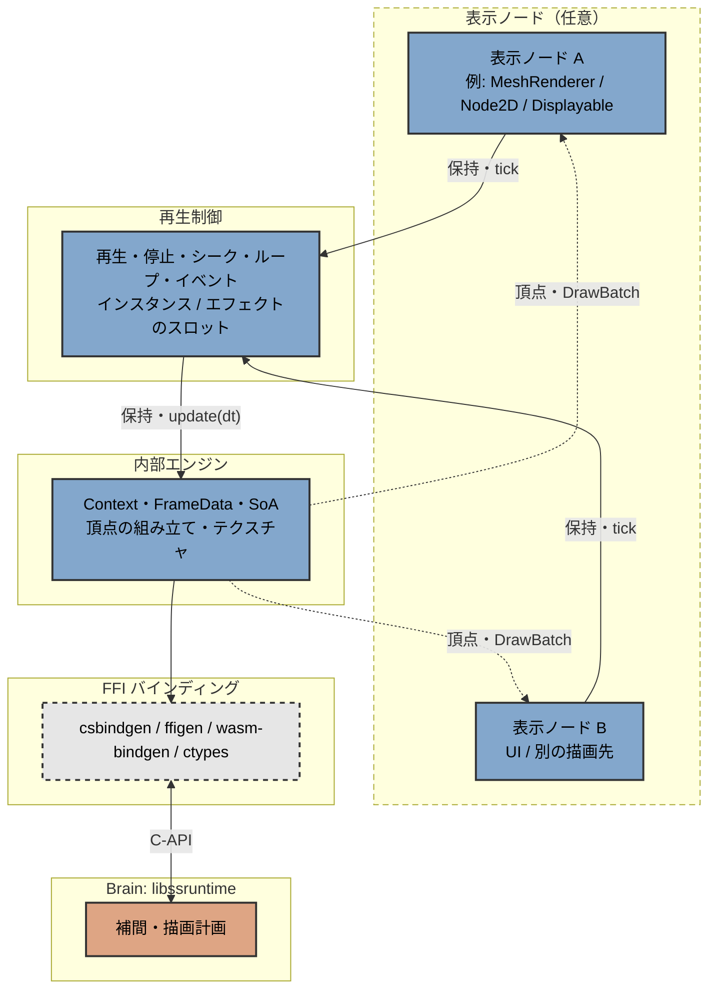

> **日本語** | [English](./20_architecture.md)

# Player の設計方針

実装に入る前に決めておくことの一覧です。どれも後から変えると広く書き直すことになります。Player の公開 API の名前と形は [Player API 規約](./30_api_conventions.ja.md) で決まっているので、ここでは内部の構成を扱います。

## 1. ライブラリの組み込み方

| 形式 | 使う場面 |
| :--- | :--- |
| 静的ライブラリ（`.lib` / `.a`） | C / C++ のエンジンにリンクする |
| 動的ライブラリ（`.dll` / `.so` / `.dylib`） | C# やスクリプト言語から FFI で呼ぶ |
| WebAssembly（`.wasm`） | ブラウザで動かす |

OS の標準ライブラリが無い環境や、エンジン独自のアロケータを使いたい環境では、`no_std` 構成でビルドします（[no_std 環境への統合](./40_no_std_integration.ja.md)）。

## 2. ssab のメモリの持ち方

ssab のバイト列を Brain にどう渡すかを決めます。目標は、同じバイト列を Player と Brain の両方に持たないことです。

| 方式 | 所有者 | 使う場面 | C-API |
| :--- | :--- | :--- | :--- |
| **borrow**（推奨） | Player | ポインタをそのまま渡せる言語（C++・C# など）。エンジンのアセットとして ssab を保持し続ける場合 | `ss_resource_create_borrow` |
| **copy** | Brain | ポインタを共有できない環境。特に WebAssembly では、JavaScript のヒープと WebAssembly のメモリが分かれているため、渡すと必ずコピーになる | `ss_resource_create_copy` |

borrow では、リソース自身と、それを参照するすべての Context・エフェクトスロットを破棄するまで、Player がバイト列を保持してください（[制限事項 §6](../10_introduction/20_limitations.ja.md#6-borrow-した-ssab-のバイト列は-player-が保持し続ける)）。

### 2-1. WebAssembly での持ち方

copy した後の元のバイト列をどう扱うかで、次の 3 つのどれかを選びます。

1. **すぐ手放す（基本）**: `new SSRuntimeResource(data)` でコピーした後、JavaScript 側の参照を切ってガベージコレクションに回収させます。ssab は WebAssembly のメモリに 1 つだけ残ります。
2. **WebAssembly のメモリを直接読む**: JavaScript 側でも FlatBuffers で ssab を読みたい場合は、Context の `get_ssab_buf()` / `get_ssab_len()` で Brain が持つバイト列の位置を取り、`new Uint8Array(memory.buffer, ptr, len)` として読みます。コピーは増えません。ただし WebAssembly のメモリが拡張されると、それまでに作ったビューはすべて無効になります。ビューはそれを使う直前に作り直してください。
3. **両方に持つ**: ビューを作り直せない場合（フレームワークが同じバッファを持ち続けることを要求する、Web Worker にも同じ ssab を渡す、エンジンのアセットキャッシュが元のバッファを握っている、など）は、二重に持つことを受け入れます。そのかわり、不要になった時点でエンジン側のアセットと Brain 側のリソース（`free()` / `ss_resource_destroy`）の両方を解放してください。

## 3. クラス構成

Player のクラスは、次の 3 つの責務に分けて考えます。既存の Player は、この 3 つをどうまとめるかは違っても、どれもこの分け方に沿っています。

- **(1) 内部エンジン** — Context とリソースを持ち、FrameData と SoA バッファを読み、頂点と DrawBatch を組み立て、テクスチャを解決する。エンジンの表示ノードに依存しないので、ヘッドレスのテストや複数の表示先から使える。
- **(2) 再生制御** — 再生・停止・シーク・速度・ループ・イベント・経過時間の入力。
- **(3) 表示ノード（任意）** — エンジンの表示ノード（`MonoBehaviour` / `Node2D` / `Displayable` / Widget など）の中に (1)(2) を持つ層。ドローコールの発行は、(1) で行う Player と (3) で行う Player があります。

インスタンスパーツとエフェクトパーツの子の状態（スロット）は、子の Context を持つ層に置きます（[インスタンスパーツ](../40_parts/50_instance.ja.md)）。

(1)(2) と、それらが使う言語ごとの FFI バインディングだけで、再生は完結します。描画ループを自分で回すホスト（C++ / SDL / OpenGL など）は、経過時間を渡して DrawBatch を描けばよく、(3) は要りません。(3) は、シーングラフやウィジェットを持つエンジン（Unity・Godot・Flutter など）にその作法で組み込むときに足します。

表示ノードは (1)(2) を**継承せず、メンバとして持ってください**。こうすると 1 つの再生状態を複数の表示方式へ出せます（Unity のワールドと uGUI、Web の PixiJS と RPG Maker MZ、Ren'Py の transform と mesh）。

### 3-1. 既存の Player での分け方

| Player | 言語 | バインディング | (1) 内部エンジン | (2) 再生制御 | (3) 表示ノード | まとめ方 |
| :--- | :--- | :--- | :--- | :--- | :--- | :--- |
| Unity | C# | csbindgen | `SpriteStudioNativeContext`（Context とリソースの寿命）＋ `SpriteStudioInternalPlayer` ＋ `SpriteStudioGeometryBuilder` | `SpriteStudioInternalPlayer`（表示ノードが共有する薄い `SpriteStudioPlaybackCore` を通す） | `SpriteStudioPlayer`（Mesh）/ `SpriteStudioGraphic`（uGUI） | 寿命管理だけ分け、(1)(2) はまとめる |
| Web | TypeScript | wasm-bindgen | `SSRuntimeManager` ＋ `FrameDataRaw` ＋ `GeometryBuilder` | `InternalPlayerBase` / `DirectInternalPlayer` | `SSPlayer`（PixiJS / WebGL / RPG Maker MZ ごと） | (1)(2) は密に結び、描画の発行は (3) |
| Godot | C++ | `ssruntime.h` を直接 | `SsInternalPlayer` | （同左） | `SpriteStudioPlayer2D`（Node2D） | (1)(2) をまとめ、(3) を分ける |
| Ren'Py | Python | ctypes | `SSInternalPlayer`（描画計画まで） | （同左） | `SSPlayer`（Displayable） | (1)(2) をまとめ、描画の発行は (3) |
| Flutter | Dart | ffigen | `SpriteStudioInternalPlayer` ＋ `GeometryBuilder` | `SpriteStudioPlayer` | `SpriteStudioView` / `SpriteStudioAnimation` / Flame の `SpriteStudioComponent` | 3 つとも分ける |
| React Native | TypeScript ＋ C++ | Nitro Modules | `HybridSsContext`（C++）/ `SsInternalPlayer` | `SpriteStudioPlayer` | `SpriteStudioView` / `SpriteStudioSprite` / `SpriteStudioScene` | 3 つとも分け、(1) の重い処理は C++ |
| Wgpu | Rust | `ssruntime` クレートを直接 | `SSPlayer` ＋ `SSScene` ＋ `SSRenderer` | `SSPlayer` | Bevy の `SsPlayer`、Web の `SsPlayerWeb`、C-API の `ss_player_t` | (1)(2) をまとめ、GPU の描画は別のクラス |

- **(1) と (2) はまとめてよい** — 再生制御が C-API の薄い包みで足りる場合。
- **(2) は (3) から分ける** — 表示ノードが作り直される場合（Flutter の Widget）や、複数の表示ノードで 1 つの再生状態を共有する場合。
- **迷ったら 3 つとも分ける。** クラス名ではなく責務で分けてください。「InternalPlayer」という名前が指す層は Player ごとに違います。

マスク・パーツカラー・インスタンス・エフェクト・ネイティブの寿命管理は、既存の Player のソースが手本になります。

### 3-2. ネイティブの寿命

- Context とリソースの生成と破棄を 1 か所にまとめてください。明示的な破棄に加えて、GC のあるホストではファイナライザでも解放します。
- 別スレッドの描画処理が SoA バッファを読んでいる間は、Context を破棄しないでください（[描画ループ §4-1](../30_core/40_render_loop.ja.md#4-1-マルチスレッドの描画と破棄)）。

### 3-3. ECS のエンジン

Unity DOTS や Bevy のような ECS では、オブジェクトの階層ではなくコンポーネントとシステムで組みます。クラスの形は変わりますが、3 つの責務の分け方は同じです。

## 4. 描画方式

| 方式 | 内容 | 向いている場面 |
| :--- | :--- | :--- |
| **ダイレクト描画**（推奨） | 1 つの描画コンポーネントで、全パーツを DrawBatch 単位で描く | ほとんどの場合。描画が速く、エンジンのノードを大量に作らない |
| **シーングラフ** | パーツごとにエンジンのノードを作り、階層を組む | パーツごとにエンジンの機能（当たり判定など）を付けたい場合。パーツが多いとエンジン側の負荷が大きい |

どちらを選ぶかで、Brain に設定する `RenderMode` が変わります（[描画ループ §3](../30_core/40_render_loop.ja.md#3-rendermode)）。

## 5. 座標系

Brain の既定の座標系は、SpriteStudio と同じ **Y-Up・中心原点・ピクセル単位** です。エンジンの座標系が違う場合は、Player で座標を計算し直さず、Context に設定して Brain に合わせさせてください。親子の回転の向きやオフセットを Player で直すと、誤りが入りやすくなります。

| 設定 | 関数 | 値 |
| :--- | :--- | :--- |
| Y 軸の向き | `ss_runtime_set_coordinate_system` | `0` = Y-Up（既定） / `1` = Y-Down。Y-Down では Y 座標と回転の向きを Brain が反転する |
| 原点 | `ss_runtime_set_origin` | `0` = 中心（既定） / `1` = 左上。左上ではキャンバスの大きさに応じたオフセットを Brain が足す |
| 単位 | `ss_runtime_set_unit` | `0` = ピクセル（既定） / `1` = 正規化。正規化ではパーツの位置をキャンバスの大きさで割る。サイズ・ローカル頂点・UV はピクセルのまま |

Y-Down を設定した場合、ローカル頂点は反転済みです。ワールド行列の側でさらに Y 軸を反転すると二重に反転するので、しないでください。エフェクトの頂点は `ss_effect_slot_step` の `y_flip` 引数で別に指定します（[エフェクトパーツ §2](../40_parts/60_effect.ja.md#2-ss_effect_slot_step-の引数)）。

## 6. ssab の種類

ssab には 2 種類あります。片方だけに対応しても、両方に対応してもかまいません。

| 種類 | アセットの置き場所 | 向いている場面 |
| :--- | :--- | :--- |
| **参照** | ssab の外のファイル | エンジンのアセット管理（AssetBundle やリソースの読み込み）をそのまま使うゲームエンジン |
| **埋め込み** | ssab の中 | Web 広告や小さなアプリなど、1 ファイルで配りたい場合 |

テクスチャの読み込み方は種類ごとに違います（[ロードと初期化 §3](../30_core/10_initialization.ja.md#3-テクスチャの読み込み)）。

## 7. 対応する機能の範囲

すべてを一度に実装するのは大変なので、段階を分けることを推奨します。進め方は [目次の「実装の進め方」](../README.ja.md#1-実装の進め方) にあります。

| 段階 | 機能 |
| :--- | :--- |
| 基本 | アトリビュート、親子の継承、合成モード、イベント |
| 次に | [パーツカラー](../40_parts/10_parts_color.ja.md)、[メッシュ](../40_parts/20_mesh.ja.md)、[マスク](../40_parts/40_mask.ja.md)、[インスタンスパーツ](../40_parts/50_instance.ja.md)、[エフェクトパーツ](../40_parts/60_effect.ja.md) |
| 必要に応じて | [9 スライス・シェイプ・テキスト](../40_parts/30_special_parts.ja.md)、[オーディオ](../50_features/50_audio.ja.md)、[アニメーションミキシング](../50_features/10_animation_mixing.ja.md)、[パーツオーバーライド](../50_features/20_part_overrides.ja.md)、[エディタ統合](../50_features/60_editor_integration.ja.md) |

---
[目次に戻る](../README.ja.md)
