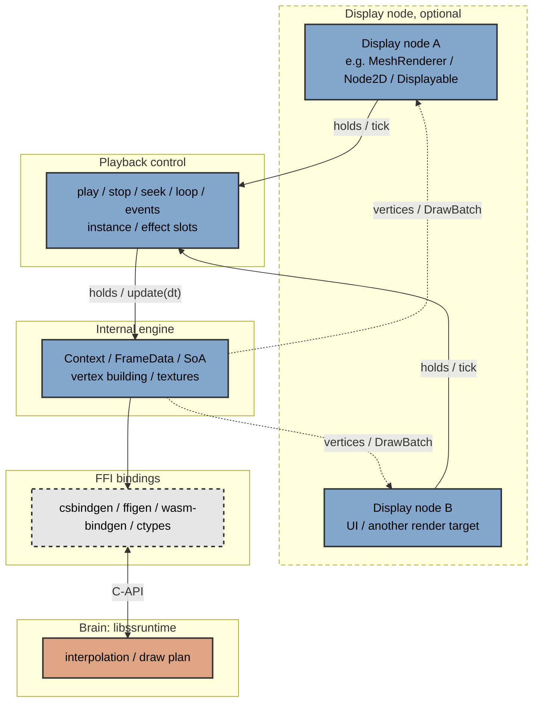

> [日本語](./20_architecture.ja.md) | **English**

# Player design decisions

This page lists what to decide before you start implementing. Changing any of these later means rewriting a lot. The names and shapes of a Player's public API are fixed by the [Player API conventions](./30_api_conventions.md), so this page covers the internal structure.

## 1. How to integrate the library

| Form | When to use it |
| :--- | :--- |
| Static library (`.lib` / `.a`) | Linking into a C / C++ engine |
| Dynamic library (`.dll` / `.so` / `.dylib`) | Calling over FFI from C# or a scripting language |
| WebAssembly (`.wasm`) | Running in a browser |

In an environment without the OS standard library, or where you want to use the engine's own allocator, build the `no_std` configuration ([Integrating into no_std environments](./40_no_std_integration.md)).

## 2. How ssab memory is held

Decide how to hand the ssab bytes to the Brain. The goal is not to hold the same bytes in both the Player and the Brain.

| Scheme | Owner | When to use it | C-API |
| :--- | :--- | :--- | :--- |
| **borrow** (recommended) | Player | Languages that can pass a pointer as-is (C++, C#, and so on), when the engine keeps holding the ssab as an asset | `ss_resource_create_borrow` |
| **copy** | Brain | Environments that cannot share a pointer. In WebAssembly in particular, the JavaScript heap and WebAssembly memory are separate, so passing the bytes always makes a copy | `ss_resource_create_copy` |

With borrow, keep the bytes in the Player until the resource itself, and every Context and effect slot that refers to it, has been destroyed ([Limitations §6](../10_introduction/20_limitations.md#6-the-player-keeps-the-bytes-of-a-borrowed-ssab-alive)).

### 2-1. Holding it in WebAssembly

Choose one of the following three, depending on what you do with the original bytes after the copy.

1. **Release them immediately (the basic case)**: after copying with `new SSRuntimeResource(data)`, drop the JavaScript-side reference and let the garbage collector reclaim it. Only one ssab remains, in WebAssembly memory.
2. **Read WebAssembly memory directly**: if you also want to read the ssab with FlatBuffers on the JavaScript side, get the location of the bytes the Brain holds with the Context's `get_ssab_buf()` / `get_ssab_len()`, and read them as `new Uint8Array(memory.buffer, ptr, len)`. No copy is added. However, when WebAssembly memory grows, every view created before that becomes invalid. Recreate a view right before you use it.
3. **Hold them in both**: if you cannot recreate views (the framework requires holding on to the same buffer, you also pass the same ssab to a Web Worker, the engine's asset cache holds the original buffer, and so on), accept holding them twice. In exchange, once they are no longer needed, release both the engine-side asset and the Brain-side resource (`free()` / `ss_resource_destroy`).

## 3. Class structure

Think of a Player's classes as split into the following three responsibilities. The existing Players differ in how they group the three, but every one of them follows this split.

- **(1) Internal engine** — holds the Context and the resource, reads FrameData and the SoA buffers, builds vertices and DrawBatches, and resolves textures. It does not depend on the engine's display node, so it can be used from headless tests and from several display targets.
- **(2) Playback control** — play, stop, seek, speed, looping, events, and elapsed-time input.
- **(3) Display node (optional)** — the layer that holds (1) and (2) inside the engine's display node (`MonoBehaviour` / `Node2D` / `Displayable` / a widget, and so on). Some Players issue draw calls in (1), others in (3).

Put the state of the children of instance parts and effect parts (the slots) in the layer that holds the child Contexts ([Instance parts](../40_parts/50_instance.md)).

(1) and (2), plus the per-language FFI bindings they use, are enough for playback. A host that runs its own drawing loop (C++ / SDL / OpenGL and so on) only needs to pass the elapsed time and draw the DrawBatches; it does not need (3). Add (3) when you integrate idiomatically into an engine that has a scene graph or widgets (Unity, Godot, Flutter and so on).

Have the display node **hold (1) and (2) as members, not inherit from them**. This lets one playback state feed several display methods (world and uGUI in Unity, PixiJS and RPG Maker MZ on the Web, transform and mesh in Ren'Py).

### 3-1. How the existing Players split them

| Player | Language | Bindings | (1) Internal engine | (2) Playback control | (3) Display node | How they are grouped |
| :--- | :--- | :--- | :--- | :--- | :--- | :--- |
| Unity | C# | csbindgen | `SpriteStudioNativeContext` (lifetime of the Context and resource) + `SpriteStudioInternalPlayer` + `SpriteStudioGeometryBuilder` | `SpriteStudioInternalPlayer` (through a thin `SpriteStudioPlaybackCore` shared by the display nodes) | `SpriteStudioPlayer` (Mesh) / `SpriteStudioGraphic` (uGUI) | Only lifetime management is separate; (1) and (2) are combined |
| Web | TypeScript | wasm-bindgen | `SSRuntimeManager` + `FrameDataRaw` + `GeometryBuilder` | `InternalPlayerBase` / `DirectInternalPlayer` | `SSPlayer` (one each for PixiJS / WebGL / RPG Maker MZ) | (1) and (2) tightly coupled; draws issued in (3) |
| Godot | C++ | `ssruntime.h` directly | `SsInternalPlayer` | (same as left) | `SpriteStudioPlayer2D` (Node2D) | (1) and (2) combined; (3) separate |
| Ren'Py | Python | ctypes | `SSInternalPlayer` (up to the draw plan) | (same as left) | `SSPlayer` (Displayable) | (1) and (2) combined; draws issued in (3) |
| Flutter | Dart | ffigen | `SpriteStudioInternalPlayer` + `GeometryBuilder` | `SpriteStudioPlayer` | `SpriteStudioView` / `SpriteStudioAnimation` / Flame's `SpriteStudioComponent` | All three separate |
| React Native | TypeScript + C++ | Nitro Modules | `HybridSsContext` (C++) / `SsInternalPlayer` | `SpriteStudioPlayer` | `SpriteStudioView` / `SpriteStudioSprite` / `SpriteStudioScene` | All three separate; the heavy work of (1) is in C++ |
| Wgpu | Rust | the `ssruntime` crate directly | `SSPlayer` + `SSScene` + `SSRenderer` | `SSPlayer` | Bevy's `SsPlayer`, the Web's `SsPlayerWeb`, the C-API's `ss_player_t` | (1) and (2) combined; GPU drawing in a separate class |

- **(1) and (2) may be combined** — when a thin wrapper over the C-API is enough for playback control.
- **Separate (2) from (3)** — when the display node is recreated (Flutter widgets), or when several display nodes share one playback state.
- **When in doubt, separate all three.** Separate by responsibility, not by class name. The layer the name "InternalPlayer" refers to differs between Players.

For masks, parts color, instances, effects and native lifetime management, the source of the existing Players is a good model.

### 3-2. Native lifetime

- Keep the creation and destruction of Contexts and resources in one place. In addition to explicit destruction, also release them in a finalizer on hosts with GC.
- Do not destroy a Context while drawing on another thread is reading its SoA buffers ([Render loop §4-1](../30_core/40_render_loop.md#4-1-multi-threaded-drawing-and-destruction)).

### 3-3. ECS engines

In an ECS such as Unity DOTS or Bevy, you build with components and systems rather than an object hierarchy. The shape of the classes changes, but the split into three responsibilities is the same.

## 4. Drawing method

| Method | What it does | Where it fits |
| :--- | :--- | :--- |
| **Direct drawing** (recommended) | One drawing component draws every part, DrawBatch by DrawBatch | Most cases. Drawing is fast, and you do not create large numbers of engine nodes |
| **Scene graph** | Creates an engine node per part and builds a hierarchy | When you want to attach engine features (collision and so on) per part. With many parts, the load on the engine side is high |

Your choice changes the `RenderMode` you set on the Brain ([Render loop §3](../30_core/40_render_loop.md#3-rendermode)).

## 5. Coordinate system

The Brain's default coordinate system is the same as SpriteStudio's: **Y-Up, origin at the center, pixel units**. If the engine's coordinate system differs, do not recompute coordinates in the Player; set it on the Context and let the Brain match it. Correcting parent/child rotation direction or offsets in the Player invites mistakes.

| Setting | Function | Values |
| :--- | :--- | :--- |
| Y-axis direction | `ss_runtime_set_coordinate_system` | `0` = Y-Up (default) / `1` = Y-Down. With Y-Down, the Brain flips the Y coordinate and the rotation direction |
| Origin | `ss_runtime_set_origin` | `0` = center (default) / `1` = top-left. With top-left, the Brain adds an offset based on the canvas size |
| Units | `ss_runtime_set_unit` | `0` = pixels (default) / `1` = normalized. Normalized divides coordinates by the canvas size, giving 0.0–1.0 |

With Y-Down set, the local vertices are already flipped. Flipping the Y axis again in the world matrix flips it twice, so do not do that. For effect vertices, specify it separately with the `y_flip` argument of `ss_effect_slot_step` ([Effect parts §2](../40_parts/60_effect.md#2-arguments-of-ss_effect_slot_step)).

## 6. ssab types

There are two kinds of ssab. You may support either one, or both.

| Type | Where the assets live | Where it fits |
| :--- | :--- | :--- |
| **Reference** | Files outside the ssab | Game engines that use the engine's asset management (AssetBundles, resource loading) as-is |
| **Embedded** | Inside the ssab | When you want to distribute a single file, as with web ads or small apps |

How textures are loaded differs by type ([Loading and initialization §3](../30_core/10_initialization.md#3-loading-textures)).

## 7. Scope of supported features

Implementing everything at once is hard, so we recommend working in stages. The order to work in is under ["Implementation steps" in the contents](../README.md#1-implementation-steps).

| Stage | Features |
| :--- | :--- |
| Basic | Attributes, parent/child inheritance, blend modes, events |
| Next | [Parts color](../40_parts/10_parts_color.md), [Mesh](../40_parts/20_mesh.md), [Mask](../40_parts/40_mask.md), [Instance parts](../40_parts/50_instance.md), [Effect parts](../40_parts/60_effect.md) |
| As needed | [9-slice, shapes and text](../40_parts/30_special_parts.md), [Audio](../50_features/50_audio.md), [Animation mixing](../50_features/10_animation_mixing.md), [Part overrides](../50_features/20_part_overrides.md), [Editor integration](../50_features/60_editor_integration.md) |

---
[Back to contents](../README.md)
