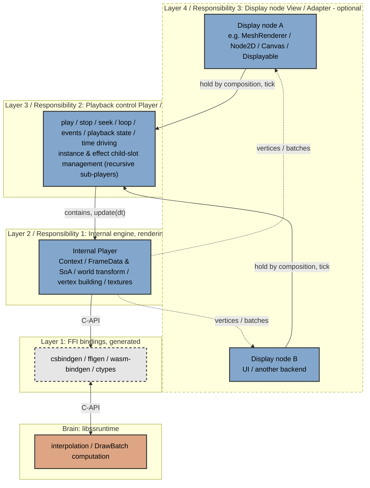

> [日本語](./20_architecture.ja.md) | **English**

# Division of Roles between the Player and libssruntime

The SpriteStudio-SDK playback environment is split in two: **libssruntime**, which handles the computation logic, and the **Player**, which handles the actual rendering and platform-dependent processing.

Thanks to this split, once you have implemented a Player, changes to the logic (added animation features, for example) can be absorbed simply by updating libssruntime, which gives high portability and maintainability.

## 1. Overview of the division of roles

| Feature category | libssruntime's role (compute / manage) | The Player's role (render / execute) |
| :--- | :--- | :--- |
| **Data management** | Parsing the range needed for animation computation, expanding the change-point data | **Parsing ssab metadata** (part composition, asset information) |
| **Time management** | Computing the frame number from elapsed time, loop control | Supplying the delta time (elapsed time) |
| **Value computation** | Interpolation between keyframes, merging attributes | - |
| **Coordinates / matrices** | Emitting the computed **local attributes (position, rotation, and so on)** | **Transforming into world coordinates**, matching the engine's coordinate system |
| **Rendering** | - | Loading textures, the actual drawing, optimization |
| **Events** | Extracting event data | Retrieving user data and invoking callbacks |
| **Sound** | - | Loading audio files, performing playback |

## 2. libssruntime's main responsibilities (the Brain)
libssruntime acts as the "animation calculator".

- **Expanding animations**: it analyzes the change-point information inside the ssab data and computes the state (attributes) of every part on the specified frame.
- **Sub-frame (floating-point frame) support**: libssruntime manages the frame number internally as a float (`f32`). This lets it correctly compute, by interpolation, the state of "fractional frames" that fall between keyframes, giving smooth animation even on high-refresh-rate displays.
- **Interpolation**: it computes values between frames correctly, including complex curve interpolation such as Hermite and Bezier.
- **Playback state management**: it holds state such as whether playback is running, where in the loop it is, and what the playback speed is.

## 3. The Player's main responsibilities (Body / Renderer)
The Player is responsible for "bridging to the game engine" and "integrating the data".

- **Referencing and validating ssab metadata**: **libssruntime does not return the metadata needed for rendering (part names, parent/child relationships, texture paths, and so on), and for performance reasons it does not validate the data either.** Parse the ssab with FlatBuffers on the Player side to obtain that information, and when using files obtained from outside, perform corruption / integrity checks on the Player side as needed.
- **Holding resources**: hold textures, sounds, and the libssruntime context as instances.
- **Coordinate / matrix transformation (important)**: libssruntime returns the **local attributes (position, rotation, scale, and so on)** with the parent/child hierarchy state taken into account, as a FlatBuffers binary chunk.
    - **Pattern 1 (direct drawing / batch rendering)**: the Player computes world coordinates itself using a matrix stack or similar, while referencing the ssab's parent/child relationships (`parent_index`). This is the efficient approach in modern data-driven architectures.
    - **Pattern 2 (scene graph / hierarchical nodes)**: build the parent/child hierarchy out of engine objects and feed the obtained values straight into their transforms, leaving matrix computation to the engine. This is easy to implement but incurs overhead when there are many parts.
- **Performing the drawing**: output the final picture using the engine's rendering features.

## 4. Why this division
- **Better portability**: by leaving rendering (DirectX, Metal, OpenGL, and so on) to the Player, libssruntime can be written once in Rust and carried to any platform.
- **Uniform quality**: sharing the complex animation computation (interpolation, parts-color computation, and so on) means every game engine produces the same animation result.

---

# Deciding on your Player implementation approach

Before you start implementing a Player, consider and decide the following technical specifications according to the characteristics of your target game engine and platform.

## 1. How to integrate libssruntime
Decide how the native library will be incorporated in your environment.

### Library type
- **Static library (.lib / .a)**: when linking into a C/C++ project.
- **Dynamic library (.dll / .so / .dylib)**: when calling over FFI from C# or a scripting language.
- **WebAssembly (.wasm)**: when running in a browser environment.

### On supporting `no_std` environments (embedded / game consoles)
The SDK can be integrated into `no_std` environments that have no filesystem or OS standard features, and into environments where you want to plug in your own memory allocator for a game console. For the concrete approach to building for `no_std` in a C/C++ project (using `libc_alloc`, injecting a custom allocator), see [Integrating into no_std Embedded Environments](../50_reference/10_no_std_integration.md).

### Memory-management strategy and avoiding duplicated data (zero duplication)
Decide how to hand the `ssab` data read from the network or disk to `libssruntime`. Especially in environments such as WebAssembly (WASM), it is important to design against **duplicated memory**, where the same binary exists both "on the Player side (the JS heap)" and "on the library side (the WASM heap)".

- **Borrow scheme (recommended)**:
  The Player fully manages ownership of the main memory and the library only references a pointer to the data. No unnecessary copy occurs at all, so this is the most memory-efficient and performant option.
  - **For C++ / C# and similar**: this is complete simply by passing `libssruntime` a pointer to memory read via file mapping (mmap) or a standard asset bundle.

- **Copy scheme and immediate GC (for special environments such as WASM)**:
  The library copies the memory once and takes ownership of it. In environments where the "JS heap" and the "WASM heap" are physically separated, as with WASM (JS), passing raw data always incurs a copy into the WASM heap, so this becomes the standard scheme.
  To avoid duplication in a WASM environment, adopt one of the following patterns.

  **Pattern A: discard immediately (basic)**
  ```typescript
  const data = await response.arrayBuffer();
  // 1. Copy the data to the Rust (WASM) side and create the resource (WASM becomes the owner)
  const resource = SSRuntimeResource.new(new Uint8Array(data));

  // 2. The raw data on the JS side is no longer needed: drop the reference so the garbage
  //    collector reclaims it immediately.
  //    This leaves exactly one copy of the ssab binary in memory, inside WASM.
  ```
  From then on, when the Player needs metadata such as animation names, obtain it through the library's API - for example `resource.get_animation_names()` - rather than parsing the raw binary yourself.

  **Pattern B: back-reference WASM memory (when you want to parse on the JS side)**
  If you have a requirement to parse the raw binary directly on the JS side with the `flatbuffers` library, do not keep holding the data on the JS side. Instead receive the data pointer (`ptr`) from the Rust side and **back-reference (borrow) the WASM-side memory** as `new Uint8Array(wasmMemory.buffer, ptr, len)`, which completely prevents allocating the memory twice.

## 2. Internal structure and rendering strategy
Decide how the Player manages and renders animations.

### Class-design best practice (separation of responsibilities and the recommended layering)

Split the Player's classes into **three responsibilities** (derived from the orthogonal concerns of **FFI lifetime management, playback state, and host integration**; every existing Player has converged on this shape). Beneath each responsibility sit the language's generated **FFI bindings** (csbindgen / ffigen / wasm-bindgen / ctypes, and so on).

- **(1) Internal engine (rendering core)** - holds the `libssruntime` context, obtains FrameData / SoA, performs world transformation, builds vertices, resolves textures, and issues draws. It is **host-independent** and reusable for headless tests and multiple views.
- **(2) Playback control (Player / Controller)** - `play` / `stop` / `seek`, speed, looping, events, playback state, delta input. **Plus management of instance / effect child slots** (children are *recursive sub-players*; this layer handles creation, destruction, independent playback, and sub-frame propagation, while `step` and vertex composition belong to (1). For details see [Instance Parts](../40_components/10_instance.md)).
- **(3) Display node (View / Adapter) - optional** - a thin layer that **holds the core by composition** inside the engine's standard display node (`MonoBehaviour` / `Node2D` / `Displayable` / a widget) and passes it to rendering.

**The core (Layers 1-3) is the deliverable; the display node (Layer 4) is glue**: the bindings plus the internal engine plus playback control - **L1-3 - form a host-independent "core Player"**, and that alone is sufficient for playback. A host that runs its own drawing loop (custom C++ / SDL / raw OpenGL / many graphics libraries) can drive the core directly with `update(dt)` → obtain the DrawBatch, or `paint`, and needs no L4. **L4 is optional**, added only for idiomatic integration with engines that have a retained scene graph or widgets (Unity / Godot / Flutter).



**Iron rule**: separate the core from the display node **by composition, not inheritance** (no implementation has a display node inherit from the core). The composition chain in the diagram is the backbone, and it lets one playback state feed **several display methods** (Unity = world / uGUI, Web = PixiJS / RMMZ, Ren'Py = transform / mesh).

#### How you bundle them is up to the host (the actual implementations)

| Player | Language | (1) Internal engine | (2) Playback control | (3) Display node | Bundling |
| :--- | :--- | :--- | :--- | :--- | :--- |
| Unity | C# | `SpriteStudioNativeContext` + `SpriteStudioInternalPlayer` + `GeometryBuilder` | `SpriteStudioPlaybackCore` | `SpriteStudioPlayer` (Mesh) / `SpriteStudioGraphic` (uGUI) | (1) standalone / each View holds (2) |
| Web | TS | `SSRuntimeManager` | `InternalPlayerBase` / `DirectInternalPlayer` | `SSPlayer` (PixiJS) | (1)+(2) tightly coupled / (3) separate |
| Godot | C++ | `SsInternalPlayer` | (contained in the same) | `SpriteStudioPlayer2D` (Node2D) | (1)+(2) fused / (3) separate |
| Ren'Py | Python | `SSRuntime` + framedata + rigs | `SSInternalPlayer` | `SSPlayer` (Displayable) | (1)/(2)/(3) separate (bindings contained in (1)) |
| Flutter (design) | Dart | `SpriteStudioInternalPlayer` | `SpriteStudioPlayer` | `SpriteStudioView` and others | bindings (`ffigen`) + (1)(2)(3) all independent = **4 layers** |

- **(1)+(2) may be fused** (Web / Godot) - when a thin wrapper over the C-API is enough for playback control.
- **Always separate (2) from (3)** - when the display node is recreated (Flutter widgets) or when several views share one playback state. If there are base-class constraints as in Unity (`MonoBehaviour` and `Graphic`), factor (2) out into a `PlaybackCore` that each View holds.
- **When in doubt, separate fully** (Ren'Py / Flutter). **Design by responsibility, not by name** (the layer that "InternalPlayer" refers to differs between implementations).

#### Reference implementations
For the hard parts (masks, parts color, Instance/Effect, lifetime management), the source of the existing Players is the best model.

- **SSPlayerForUnity** (C#) - Job System vertex building, two adapters for world / uGUI, `IDisposable` plus Burst job synchronization.
- **SSPlayerForWeb** (TS / PixiJS) - wasm-bindgen, zero-copy views, `FinalizationRegistry`, `IResourceManager`.
- **SSPlayerForGodot** (C++) - direct drawing through `RenderingServer`, Node2D composition, destruction order in the destructor.
- **SSPlayerForRenPy** (Python) - coverage-based masking, `Displayable` integration, headless tests of the core.

#### Notes (lifetime management, ECS)
- **Native lifetime**: concentrate lifetime management in one place and **strictly observe the destruction order** (Context → Resource; release asynchronous work only after it completes). Provide both explicit disposal and a GC finalizer.
- **ECS (Unity DOTS, Bevy, and so on)**: implement with **components plus systems** rather than an object hierarchy. The class structure changes, but keep the "core / control / integration" separation of responsibilities.

### Choosing a drawing method
- **Direct drawing / batch rendering**:
    - Loop over every part inside a single drawing component and draw them.
    - Pros: high drawing performance. Suits data-driven designs and offscreen rendering.
    - Cons: linking engine objects to specific parts takes a little extra work.
- **Scene graph / hierarchical nodes**:
    - Create as many engine objects (nodes and so on) as there are parts and build a hierarchy.
    - Pros: easy to use engine features per part (collision, attaching effects, and so on).
    - Cons: engine-side overhead grows when there are many parts. In recent game engines, direct drawing is becoming mainstream from a drawing-cost perspective.

### Matching the coordinate system (important)
Consider how to absorb the difference between SpriteStudio's coordinate system and your target engine's.
The standard coordinate system of SpriteStudio and **`libssruntime` is "Y-Up (up is positive)", "origin at the center", and "pixel units"**.

#### Why the coordinate-system setting is needed
The "canvas" in the SpriteStudio editor and the "world space" in a game engine typically treat coordinates differently.
- **Y-axis direction**: in the editor, down is positive (Y-Down), whereas 3D engines and many 2D engines take up as positive (Y-Up) by default.
- **Origin position**: in the editor the origin (0,0) is the top-left, whereas in a game engine you often want the character's center to be (0,0).

Recomputing these by hand on the Player side invites mistakes in rotation direction and offset computation within parent/child structures. Using `libssruntime`'s **`Context` configuration APIs**, the library absorbs all of this consistently and you obtain values you can feed straight into your engine.

- **Y-axis direction (`ss_context_set_coordinate_system`)**: up (Y-Up) or down (Y-Down).
    - Specifying `Y-Down` (1) makes the library flip the Y coordinate and the rotation direction automatically. Choose this when your engine's 2D coordinate system is Y-Down.
- **Origin position (`ss_context_set_origin`)**: center or top-left.
    - Specifying `Top-Left` (1) applies an offset based on the canvas size automatically. This is useful when you want to place things relative to the top-left, as in a UI system.
- **Units (`ss_context_set_unit`)**: pixels or normalized coordinates.
    - Specifying `Normalized` (1) divides every coordinate value by the canvas size, normalizing it into the 0.0-1.0 range. This suits resolution-independent drawing.

## 3. Asset-management strategy
Decide how the assets inside the ssab (textures and so on) are loaded and held.

### Deciding which ssab types to support
Choose the `ssab` types to support according to your Player's target. Implementing only one, or both, are equally fine.

- **Reference**:
    - **Characteristics**: assets are referenced as external files.
    - **Target**: game engines such as Unity and Godot. Best when you want to use the engine's standard asset management and loading mechanisms (AssetBundle, resource loading) as-is.
- **Embedded**:
    - **Characteristics**: assets are embedded as data inside the ssab itself.
    - **Target**: web ads, simple applications, or any case where you want the resource files bundled into one. Best when you want to avoid distributing and managing asset files individually.

## 4. Deciding the feature scope
Implementing every feature at once is difficult, so we recommend planning staged support.

- **Required (basic)**: basic attributes, parent/child inheritance, blend modes.
- **Recommended**: instance playback, user data.
- **Advanced**: mesh, bones, effects, shaders.
- **Optional**: audio, text, 9-slice.

## 5. Usability and toolchain
Consider the surrounding implementation that improves convenience for your users.

- **Automatic conversion**: an extension that runs the `sspj` → `ssab` conversion automatically inside the engine's editor (the Unity Editor, for example).

## 6. Player APIs you will need

Design guidelines for the minimum API interface a user needs in order to control animations in your Player implementation.

### Playback control
- **set_animation(name)**: sets up the animation to play. Because `ss_runtime_setup_animation` performs internal allocation at this point, do this **before** playback.
- **play(loop, startFrame)**: starts playing the already set-up animation with the given play count and start frame (a light operation with no allocation).
- **stop()**: stops animation playback completely.
- **pause()**: pauses the playing animation.
- **resume()**: resumes a paused animation. Map it to `ss_runtime_resume`, not to a second `play` — `play` heads out and would lose the playhead.
- **isPlaying()**: returns whether an animation is currently playing. Stays true while paused; publish `isPaused` from `ss_runtime_is_pausing` alongside it.

The exact semantics of these five, and what each does to the playhead, are in [Playback Control & Events](../30_core/20_playback_control.md#the-transport-contract).

### Time / frame control
- **setFrame(frame) / getFrame()**: directly specifies (seeks) or obtains the current playback frame.
- **setSpeed(speed) / getSpeed()**: sets or obtains the playback speed (time scale).
- **getTotalFrames()**: obtains the total frame count of the current animation.

### Part manipulation
- **setPartVisible(partName, visible)**: toggles visibility by part name.

### Event notification
We recommend that the Player poll events from `libssruntime` internally and provide the following callbacks or event mechanisms (a C# delegate, a Godot signal, and so on) so the game's scripts and systems can receive them.
- **setAnimationFinishedCallback(callback)**: notified when animation playback completes, including loops.
- **setAnimationLoopedCallback(callback)**: notified when the animation completes a cycle and returns to the start.
- **setUserDataCallback(callback)**: notified when user data on the timeline is detected.
- **setSignalCallback(callback)**: notified when a signal command is detected.

For the exact meaning of `finished` / `looped` and how to poll them, see [Playback Control & Events](../30_core/20_playback_control.md).

---
[Back to Table of Contents](../README.md)
