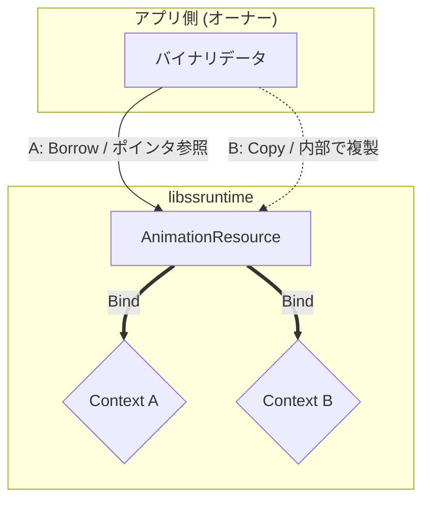

> **日本語** | [English](./10_initialization.md)

# データのロードと初期化 (Initialization)

Player の基本機能の実装において、初期化時に行うべき処理と、メモリ管理の戦略について記載します。

## 1. libssruntime の初期化 (Resource と Context の分離)
最新のアーキテクチャでは、バイナリデータの所有権(`SsabData`)と、パース済みの読み取り専用メタデータ(`AnimationResource`)、および再生状態・計算バッファ(`Context`)が安全に分離されています。
同一アニメーションを複数キャラクターで再生する場合、リソースは 1 つだけ作成し、キャラクターごとにコンテキストを作成してリソースをバインド(`bind_resource`)することでパフォーマンスが向上します。

### 1.5. libssruntime の no_std 対応とメモリ管理
`libssruntime` はフットプリント削減とポータビリティ向上のため、Rust の標準ライブラリ (`std`) に依存しない `no_std` 環境を完全にサポートしています。
`libssruntime` のデフォルト機能セットは no_std 向け（`ffi`）で、`std` はデスクトップでの開発利便性のためのオプトインです（リリース成果物では使用しません）。iOS/Android 向けのリリースビルドや組み込み環境はもちろん、すべてのプラットフォーム向けリリースは `no_std` 構成でビルドされます。

C-API (`cdylib` / `staticlib`) を `no_std` でビルドする際は、内部の動的メモリ確保 (ヒープアロケーション) を行うためにグローバルアロケータが必要です。SDK では `libc` の `malloc` / `free` を利用する `libc_alloc` 機能を用意しています。

#### デバッグログ出力の移譲
`no_std` 環境では標準出力 (`println!`, `eprintln!`) が利用できません。libssruntime 内部からのエラーや警告ログを受け取るには、初期化時にログコールバックを登録する必要があります。

```cpp
#include "ssruntime.h"

// ログを受け取るコールバック関数
void my_log_callback(int level, const char* message) {
    // 例: printf("libssruntime [%d]: %s\n", level, message);
    // ゲームエンジンのログ出力関数 (UE_LOG, Debug.Log, print_line など) に渡す
}

// 初期化の最初にコールバックを登録する
ss_runtime_set_log_callback(my_log_callback);
```

### 1.6. データバリデーション (Player 側の責任)
パフォーマンスとバイナリサイズの最適化のため、`libssruntime` は入力された `.ssab` データの構造的なバリデーション（FlatBuffers の境界チェック等）を行いません。
不正なデータや破損したデータを `ss_resource_create_*` や `ss_runtime_load_ssab_*` に渡すと、未定義動作（Out-of-bounds Read によるクラッシュ等）を引き起こす可能性があります。
Player の実装者は、入力データが信頼できるソースからのものであることを保証するか、必要に応じて事前にデータ検証（チェックサムや FlatBuffers バリデータ等）を行う責任があります。

#### 簡易な事前検証
ライブラリに渡す前に以下の確認を行うと、取り違えや破損データの大半は弾けます。

- **ファイル識別子のチェック**: `ssab` バイナリの **オフセット 4-7 バイト** に `file_identifier` として `"SSAB"` (ASCII 4 文字) が入っています。ライブラリに渡す前にこの 4 バイトを比較すれば、別フォーマットのファイルや空ファイルを誤って渡したケースを検出できます。言語に依存しない単純なバイト比較で実装できます。
- **FlatBuffers レベルの境界チェック**: `ssruntime` の C-API は内部でパフォーマンス優先のチェックなしパースを行うため、不正データは未定義動作になります。境界の妥当性まで検証したい場合は、Player 側の言語に対応した FlatBuffers バインディング (C++ の `flatbuffers::Verifier`, C# の `SsAnimeBinaryVerify`, Kotlin/TS の同等 API など) を使い、ssab スキーマで生成した Verifier を通してから C-API に渡してください。

> [!NOTE]
> ssconverter が出力する `.ssab` は size-prefix なしの形式です。Player 側で FlatBuffers バインディングを使う場合、`size-prefixed` 系のヘルパー (例: C++ の `GetSizePrefixedSsAnimeBinary`) は適合しないので、通常版 (`GetSsAnimeBinary` 相当) を使ってください。

### C-API (C/C++) を使用する場合
C-API では `SsabData` と `AnimationResource` は内部的に `FfiResource` として隠蔽されているため、以下の2ステップで初期化します。

```cpp
#include "ssruntime.h"

// 1. リソース（データの所有権とパース済みメタデータ）の作成
// ss_resource_create_borrow または ss_resource_create_copy を使用
void* resource = ss_resource_create_borrow(ssab_data_ptr, ssab_data_len);

// 2. コンテキスト（再生状態）の作成
void* context = ss_runtime_create();

// 3. リソースをコンテキストにバインド
ss_runtime_bind_resource(context, resource);
```

### Rust を直接使用する場合
Rust のエコシステム（Bevy や Amethyst など）から直接利用する場合は、ライフタイムを安全に管理するため明示的な 3 ステップになります。

```rust
// 1. データの参照 (SsabData) の確立
// ssab_data_ptr: *const u8, ssab_data_len: usize
let ssab_data = unsafe { 
    ssruntime::SsabData::load_borrow(ssab_data_ptr, ssab_data_len).unwrap() 
};

// 2. メタデータ (AnimationResource) の作成
let resource = ssruntime::AnimationResource::new(ssab_data.as_slice()).unwrap();

// 3. コンテキストの作成とバインド
let mut context = ssruntime::Context::new();
context.bind_resource(&resource);
```

### 💡 メモリ管理とライフタイム (Reference Counting)
最新の `libssruntime` では、Resource の内部管理に参照カウント (`Arc`) が導入されており、Player 側でのメモリ管理の負担を軽減しています。

#### 所有権と破棄のルール
| オブジェクト | 所有権の持ち方 | 破棄の影響 |
| :--- | :--- | :--- |
| **SsabData (バイナリ)** | **Player 側** (Borrow 時) または **Library 側** (Copy 時) | Borrow の場合、Resource 破棄まで維持が必要。 |
| **Resource (メタデータ)** | **Library 側** (参照カウント管理) | `ss_resource_destroy` でカウント減。Context があれば存続。 |
| **Context (再生状態)** | **Player 側** (明示的に破棄が必要) | `ss_runtime_destroy` で Context 本身と参照先リソースを解放。 |

#### オブジェクトの相関図

> **図の凡例**
> - **図形**: `[ ]` データ/リソース, `{ }` コンテキスト/状態
> - **矢印**: `-->` 参照, `-.->` 複製, `==>` 紐付け (Bind)



1. **バインド後の安全性**: `ss_runtime_bind_resource` を実行した後は、`ss_resource_destroy` を呼び出しても、そのリソースを参照している Context が存在し続ける限りメモリは解放されません。
2. **安全な破棄の順序**: 
    - 基本的には **Context → Resource** の順で破棄することを推奨しますが、ライブラリ内部で参照カウントを管理しているため、逆の順序（Resource → Context）で破棄しても Use-after-free は発生しません。
    - ただし、`ss_resource_create_borrow` を使用した場合は、**Resource が完全に解放される（全ての Context が破棄される）まで、元のバイナリデータ（`ssab_data_ptr`）のメモリを解放しないでください**。

## 2. ssab ファイルのロードと libssruntime への渡し方
ネイティブライブラリである libssruntime へ ssab データを渡す方法は、利用するプログラミング言語のポインタ操作能力とアーキテクチャ（[アーキテクチャと実装方針](../20_design/20_architecture.ja.md) の「メモリ管理戦略」参照）に合わせて選択します。

### パターン A：Borrow (参照) 方式（推奨）
- **対象言語:** C++, C# (unsafe) など、ポインタを直接渡してメモリを管理できる環境。
- **運用:** ssab データのオーナー（メモリ管理責任者）は Player 側になります。ゲームエンジン側のアセット管理（Godot の Resource や Unity の ScriptableObject 等）でバイナリを保持し続ける場合に最適です。
- **実装:** `ss_resource_create_borrow` を使用します。
- **メリット:** メモリコピーが発生せず、最も効率的です。

```cpp
// Godot (C++) での実装例
// Resource として保持している PackedByteArray からポインタを取得して渡す
void* resource = ss_resource_create_borrow(
    ssab_resource->get_data_ptr(), 
    ssab_resource->get_data_size()
);
```

### パターン B：Copy (コピー) 方式と即時 GC
- **対象言語:** WebAssembly (JS/TS), Kotlin など、ポインタの直接共有が難しい環境や、JS/WASM間のようにヒープ空間が分断されている環境。
- **運用:** ssab データのオーナーを libssruntime 側に移譲し、ライブラリ内部にデータの完全な複製を作らせます。
- **実装:** 
    1. `ss_resource_create_copy` (または言語バインディングの `SSRuntimeResource.new`) を実行してデータをライブラリ側にコピーします。
    2. コピー完了直後に、Player 側でダウンロードした元の生データの参照を切り、解放（GC等）して、メモリの二重持ちを防ぎます。
    3. ※ もし JS 側で直接パースしたい場合は、[アーキテクチャと実装方針](../20_design/20_architecture.ja.md) に記載の「WASM メモリの逆参照」を活用してください。

*(※ 従来の後方互換用APIとして `ss_runtime_load_ssab_borrow` や `ss_runtime_load_ssab_copy` も引き続き利用可能ですが、新規実装では Resource と Context を明示的に分けることを推奨します。)*

### パターン C: 両方で保持せざるを得ない方式（非推奨だが回避不能なケース）
基本的には「陥りやすいアンチパターン」として避けるべきですが、以下のような特定のアーキテクチャ上の制約がある場合は、あえて Player 側（JS等）と libssruntime 側（WASM等）の両方でコピーを保持する（二重持ちする）選択を取らざるを得ません。

- **ケース1: WASMメモリのデタッチ（無効化）リスクを許容できない場合**
  WASM のメモリ空間 (`wasmMemory.buffer`) は、内部でメモリの動的確保（ヒープ拡張）が発生した瞬間にリサイズされ、JS側に張っていた古い `Uint8Array` などのビューがすべて「デタッチ（参照切れ）」になりアクセスエラーを引き起こす仕様があります。JS側のフレームワークが安定した絶対的なバッファ参照を要求し、毎フレームビューを張り直すようなフック処理が不可能な場合は、「WASMの逆参照」テクニックが使えないため、JS側に安全なコピーを残す必要があります。
- **ケース2: エンジンのキャッシュ機構が極めて厳格な場合**
  一部のゲームエンジンやフレームワークでは、アセットローダーが取得した `ArrayBuffer` をエンジンのコアシステム（シーン管理や依存関係グラフ）が強固に握っており、開発者が勝手にキャッシュから削除したり、WASMのビューにすり替えたりするとシステム全体がクラッシュ・誤動作する場合があります。
- **ケース3: 複数の Web Worker への分配**
  メインスレッドの WASM とは別に、物理演算や別処理を行う Web Worker にも同じ `ssab` データを `postMessage` で渡す必要がある場合など。

**対策方針:**
これらのケースでは無理に即時GCや逆参照を行わず、パターンC（二重持ち）を受け入れます。その代わり、不要になったシーン遷移時などにエンジン側のアセットアンロードAPIと、WASM側の `ss_resource_destroy` を確実に両方呼んで、速やかに両方のメモリを解放するようにライフサイクル管理を徹底してください。

## 3. アセット（テクスチャ）のロードと紐付け
ssab 内には「どのセルマップ（画像）を使用するか」という情報が含まれています。Player は設計方針で選択した `ssab` のタイプに合わせて、テクスチャを準備する必要があります。

> [!IMPORTANT]
> **ロード対象は `cellmaps()` と `external_textures()` の 2 つです。** 描画時にバインドするテクスチャは `DrawBatch.texture_hash` で決まりますが、この値はセルマップ名のハッシュ（通常）と、テクスチャファイル名のハッシュ（作画でテクスチャ変更 `TCHG` が指定されたパーツ）のどちらにもなります。`external_textures()` をロードしていないと、後者のバッチでテクスチャが見つからず、そのパーツが描画されません。詳細は [外部リソースとテクスチャの管理](../40_components/70_external_resources.ja.md) を参照してください。

### 3.0. ssab に格納されるファイル参照文字列の仕様
ssab に格納されるファイル参照文字列 (テクスチャ・サウンド・フォントなど) は、ssconverter が以下のルールで生成します。Player はエンジン側のアセット参照と対応付ける際に、この仕様を前提にしてください。

- `sspj` / `ss*e` (`ssae` / `ssce` / `ssee` / `ssse`) / `fnt` に記載されているファイルパス・ファイル名は、**そのままの文字列** が ssab に格納されます。大文字小文字や区切り文字の正規化、絶対パス変換などは行われません。
- charmap (`.fnt`) のテクスチャファイル名は、変換時に **sspj 上の charmap ファイルパスのディレクトリ部分が前置** された状態で ssab に格納されます。
    - 例: sspj に `font/font.fnt` と記述され、`font.fnt` 内のテクスチャ名が `glyphs.png` の場合、ssab の `name_texture` は **`font/glyphs.png`** になります。

### Reference (参照方式) の場合
- **ロード元**: 外部ファイル（PNG 等）。
- **手順**: `cellmap->image_path()` から取得できるファイルパスを基に、エンジンの標準的なアセットロード機構を用いてテクスチャを読み込みます。続けて `external_textures()` も走査し、`name()`（テクスチャのファイル名）を同じ規則でパス解決してロードします。
- **注意点**: `image_path` や `external_textures()` の `name` は通常 `.sspj` や `.ssab` からの相対パスです。Player 側でベースディレクトリと結合して絶対パス（またはエンジン内のリソースパス）を生成する必要があります。

```cpp
// Godot (C++) での実装例
void loadTextures(const ss::format::SsAnimeBinary* binary, String base_dir) {
    for (int i = 0; i < binary->cellmaps()->size(); i++) {
        auto cellmap = binary->cellmaps()->Get(i);
        // パスの解決
        String image_path = base_dir.path_join(String::utf8(cellmap->image_path()->c_str()));
        // エンジンの機能でロード
        Ref<Texture2D> texture = ResourceLoader::get_singleton()->load(image_path);
        // セルマップ名のハッシュで管理
        _textures[cellmap->name_hash()] = texture;
    }
    // テクスチャ変更 (TCHG) がバインドする先。同じマップに、テクスチャ名のハッシュで入れる
    if (binary->external_textures() != nullptr) {
        for (int i = 0; i < binary->external_textures()->size(); i++) {
            auto etexture = binary->external_textures()->Get(i);
            String image_path = base_dir.path_join(String::utf8(etexture->name()->c_str()));
            _textures[etexture->name_hash()] = ResourceLoader::get_singleton()->load(image_path);
        }
    }
}
```

### Embedded (埋め込み方式) の場合
- **ロード元**: ssab バイナリ内部。
- **手順**: `ssab->embedded_assets()` を走査し、各セルマップに対応するバイナリデータを直接取得します。このメモリ上のデータを、エンジンの「画像データからのテクスチャ作成」機能に渡して読み込みます。
- **注意点**: `embedded_assets()` の `name_hash` は **ファイル名の** ハッシュです（セルマップの場合は `image_path`、外部テクスチャの場合は `name`）。セルマップ名のハッシュとは異なるので、`cellmaps()` / `external_textures()` 側のエントリを経由して対応付けてください。外部テクスチャも埋め込み対象に含まれます。

### 共通の処理：セル情報のインデックス化
描画パフォーマンスを向上させるため、初期化時に以下の情報をキャッシュしておくことを強く推奨します。

- **テクスチャのインデックス化**: `ssab->cellmaps()` の `name_hash()` と `ssab->external_textures()` の `name_hash()` の **両方** をキーとして、ロードしたテクスチャオブジェクトを 1 つのマップに紐付けます。描画時は `DrawBatch.texture_hash` をそのままキーとして引けます。
- **セルの高速検索**: 各 CellMap 内の `cells()` を走査し、`name_hash()` をキーとして、そのセルの切り出し矩形（UV）や原点（Pivot）情報を即座に引けるようにしておきます。

## 4. 再生するアニメーション情報の管理
ssab データには複数のアニメーションが格納されています。

```cpp
// ssab 内のアニメーション名一覧を取得する例
auto ss_anime_binary = ss::format::GetSsAnimeBinary(binary_ptr);
if (ss_anime_binary->animations()) {
    for (auto anime : *ss_anime_binary->animations()) {
        std::string name = anime->name()->str();
        // この名前を Player の外部 API（Play("name") など）で利用できるようにする
    }
}
```

## 5. 後処理（インスタンス破棄時）
Player の破棄時には、使用していた Context と Resource を破棄してメモリを解放します。
前述の通り内部で参照カウントを利用しているため、破棄の順序（Context が先か、Resource が先か）によるクラッシュの危険性はありませんが、明示的なリソース管理のために両方を適切に破棄してください。

```cpp
// コンテキスト（再生状態）を破棄する
ss_runtime_destroy(context);

// リソース（メタデータ）を破棄する
ss_resource_destroy(resource);
```

---
[目次に戻る](../README.ja.md)
