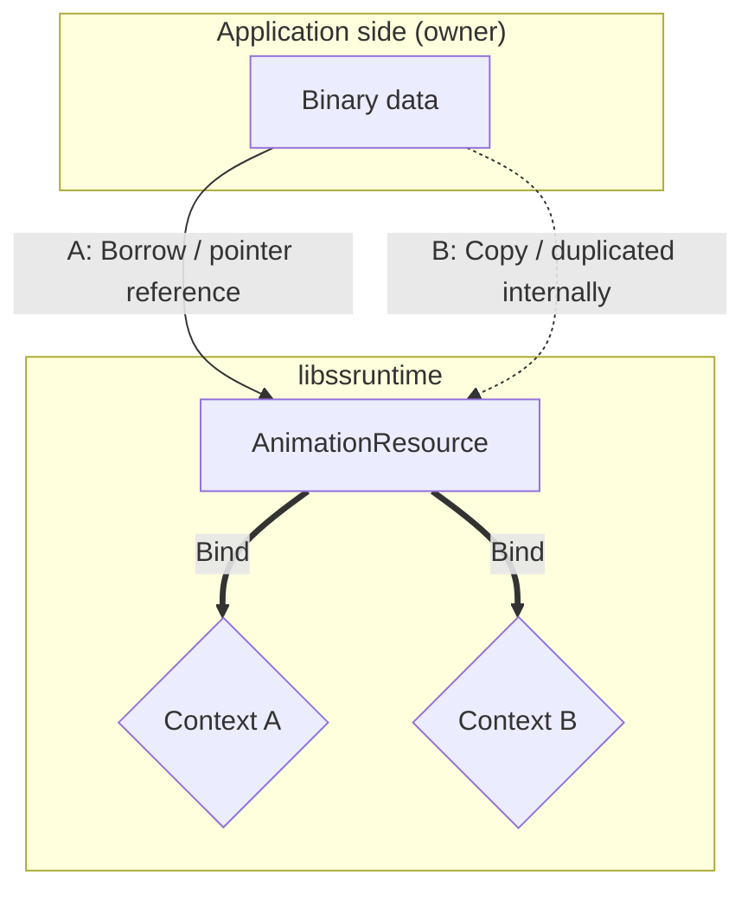

> [日本語](./10_initialization.ja.md) | **English**

# Loading & Initialization

This chapter describes the processing to perform at initialization when implementing a Player's basic functionality, and the memory-management strategy.

## 1. Initializing libssruntime (separating Resource and Context)
In the latest architecture, ownership of the binary data (`SsabData`), the parsed read-only metadata (`AnimationResource`), and the playback state / computation buffers (`Context`) are safely separated.
When playing the same animation for several characters, create only one resource and create a context per character, binding the resource to each (`bind_resource`), which improves performance.

### 1.5. `no_std` support and memory management in libssruntime
To reduce footprint and improve portability, `libssruntime` fully supports `no_std` environments that do not depend on Rust's standard library (`std`).
`libssruntime`'s default feature set targets `no_std` (`ffi`); `std` is an opt-in for convenience during desktop development (it is not used in release artifacts). Release builds for every platform - not just iOS/Android release builds and embedded environments - are built in the `no_std` configuration.

When building the C-API (`cdylib` / `staticlib`) for `no_std`, a global allocator is required for internal dynamic memory allocation (heap allocation). The SDK provides the `libc_alloc` feature, which uses `libc`'s `malloc` / `free`.

#### Delegating debug log output
Standard output (`println!`, `eprintln!`) is unavailable in a `no_std` environment. To receive error and warning logs from inside libssruntime, you must register a log callback at initialization.

```cpp
#include "runtime/ssruntime.h"

// The callback that receives logs
void my_log_callback(int level, const char* message) {
    // e.g. printf("libssruntime [%d]: %s\n", level, message);
    // Forward it to your game engine's logging function (UE_LOG, Debug.Log, print_line, and so on)
}

// Register the callback at the very start of initialization
ss_runtime_set_log_callback(my_log_callback);
```

### 1.6. Data validation (the Player's responsibility)
To optimize performance and binary size, `libssruntime` does not perform structural validation of the input `.ssab` data (FlatBuffers bounds checks and the like).
Passing invalid or corrupted data to `ss_resource_create_*` or `ss_runtime_load_ssab_*` may cause undefined behavior (a crash from an out-of-bounds read, for example).
The Player implementer is responsible for guaranteeing that the input data comes from a trusted source, or for validating the data beforehand as needed (checksums, a FlatBuffers verifier, and so on).

#### Simple pre-validation
Performing the following checks before handing data to the library rejects most cases of mix-ups and corruption.

- **Check the file identifier**: the `ssab` binary carries `"SSAB"` (4 ASCII characters) as its `file_identifier` at **byte offset 4-7**. Comparing those 4 bytes before passing the data to the library detects cases where a file of another format or an empty file was passed by mistake. It can be implemented as a simple, language-independent byte comparison.
- **FlatBuffers-level bounds checking**: `ssruntime`'s C-API performs check-free parsing internally for performance, so invalid data leads to undefined behavior. If you want to validate the bounds as well, use the FlatBuffers bindings for your Player's language (C++'s `flatbuffers::Verifier`, C#'s `SsAnimeBinaryVerify`, the equivalent API in Kotlin/TS, and so on) and run the data through the verifier generated from the ssab schema before passing it to the C-API.

> [!NOTE]
> The `.ssab` that ssconverter outputs is *not* size-prefixed. When using FlatBuffers bindings on the Player side, the `size-prefixed` helpers (C++'s `GetSizePrefixedSsAnimeBinary`, for example) do not apply - use the normal version (the equivalent of `GetSsAnimeBinary`).

### When using the C-API (C/C++)
In the C-API, `SsabData` and `AnimationResource` are hidden internally as an `FfiResource`, so initialization takes the following two steps.

```cpp
#include "runtime/ssruntime.h"

// 1. Create the resource (ownership of the data plus the parsed metadata)
// Use either ss_resource_create_borrow or ss_resource_create_copy
void* resource = ss_resource_create_borrow(ssab_data_ptr, ssab_data_len);

// 2. Create the context (the playback state)
void* context = ss_runtime_create();

// 3. Bind the resource to the context
ss_runtime_bind_resource(context, resource);
```

### When using Rust directly
When using it directly from the Rust ecosystem (Bevy, Amethyst, and so on), there are three explicit steps, so that lifetimes are managed safely.

```rust
// 1. Establish the data reference (SsabData)
// ssab_data_ptr: *const u8, ssab_data_len: usize
let ssab_data = unsafe {
    ssruntime::SsabData::load_borrow(ssab_data_ptr, ssab_data_len).unwrap()
};

// 2. Create the metadata (AnimationResource)
let resource = ssruntime::AnimationResource::new(ssab_data.as_slice()).unwrap();

// 3. Create the context and bind
let mut context = ssruntime::Context::new();
context.bind_resource(&resource);
```

### 💡 Memory management and lifetimes (reference counting)
The latest `libssruntime` manages Resources internally with reference counting (`Arc`), which lightens the memory-management burden on the Player side.

#### Rules of ownership and destruction
| Object | How ownership is held | Effect of destruction |
| :--- | :--- | :--- |
| **SsabData (the binary)** | **The Player** (when borrowing) or **the library** (when copying) | When borrowing, it must be kept alive until the Resource is destroyed. |
| **Resource (metadata)** | **The library** (reference counted) | `ss_resource_destroy` decrements the count. It survives while a Context exists. |
| **Context (playback state)** | **The Player** (must be destroyed explicitly) | `ss_runtime_destroy` frees the Context itself and the resources it references. |

#### Relationship between the objects

> **Legend**
> - **Shapes**: `[ ]` data / resource, `{ }` context / state
> - **Arrows**: `-->` reference, `-.->` duplicate, `==>` bind



1. **Safety after binding**: after calling `ss_runtime_bind_resource`, calling `ss_resource_destroy` does not free the memory as long as a Context that references that resource still exists.
2. **Safe destruction order**:
    - We recommend destroying in the order **Context → Resource**, but because the library manages reference counts internally, destroying in the reverse order (Resource → Context) does not cause a use-after-free.
    - However, when you used `ss_resource_create_borrow`, **do not free the memory of the original binary data (`ssab_data_ptr`) until the Resource is completely released (all Contexts have been destroyed)**.

## 2. Loading an ssab file and passing it to libssruntime
Choose how to pass ssab data to the native library libssruntime according to your programming language's pointer capabilities and your architecture (see "Memory-management strategy" in [Architecture & Implementation Approach](../20_design/20_architecture.md)).

### Pattern A: Borrow (recommended)
- **Target languages:** C++, C# (unsafe), and other environments where you can pass a pointer directly and manage the memory.
- **Usage:** the Player owns the ssab data (is responsible for its memory). Best when the binary stays held in the game engine's asset management (a Godot Resource, a Unity ScriptableObject, and so on).
- **Implementation:** use `ss_resource_create_borrow`.
- **Advantage:** no memory copy occurs, making it the most efficient option.

```cpp
// Implementation example in Godot (C++)
// Obtain the pointer from the PackedByteArray held as a Resource and pass it
void* resource = ss_resource_create_borrow(
    ssab_resource->get_data_ptr(),
    ssab_resource->get_data_size()
);
```

### Pattern B: Copy plus immediate GC
- **Target languages:** WebAssembly (JS/TS), Kotlin, and other environments where sharing a pointer directly is difficult, or where the heaps are separated as between JS and WASM.
- **Usage:** transfer ownership of the ssab data to libssruntime and let the library make a complete duplicate internally.
- **Implementation:**
    1. Call `ss_resource_create_copy` (or the language binding's `SSRuntimeResource.new`) to copy the data to the library side.
    2. Immediately after the copy completes, drop the Player's reference to the original downloaded raw data and release it (via GC or otherwise) to prevent duplicated memory.
    3. If you want to parse on the JS side, use the "back-referencing WASM memory" technique described in [Architecture & Implementation Approach](../20_design/20_architecture.md).

*(The legacy backward-compatibility APIs `ss_runtime_load_ssab_borrow` and `ss_runtime_load_ssab_copy` remain usable, but for new implementations we recommend separating Resource and Context explicitly.)*

### Pattern C: being forced to hold both copies (discouraged, but sometimes unavoidable)
This is normally an anti-pattern to avoid, but with certain architectural constraints you may have no choice but to hold a copy on both the Player side (JS and so on) and the libssruntime side (WASM and so on) - duplicated memory.

- **Case 1: you cannot tolerate the risk of WASM memory detaching (being invalidated)**
  By specification, the WASM memory space (`wasmMemory.buffer`) is resized the moment dynamic allocation (heap growth) happens internally, at which point every old view on the JS side, such as a `Uint8Array`, becomes "detached" and raises access errors. If your JS-side framework demands a stable, absolute buffer reference and you cannot hook in to re-create the view every frame, the "back-reference WASM memory" technique is unusable and you need to keep a safe copy on the JS side.
- **Case 2: the engine's caching mechanism is extremely strict**
  In some game engines and frameworks, the core system (scene management, the dependency graph) holds the `ArrayBuffer` obtained by the asset loader firmly, and removing it from the cache yourself or swapping in a WASM view crashes or breaks the whole system.
- **Case 3: distributing to several Web Workers**
  For example when the same `ssab` data must also be passed with `postMessage` to a Web Worker running physics or other processing separately from the main thread's WASM.

**Approach:**
In these cases, do not force immediate GC or back-referencing - accept Pattern C (duplication). In exchange, apply strict lifecycle management: when the data is no longer needed, for example on a scene transition, reliably call **both** the engine's asset-unload API and the WASM side's `ss_resource_destroy` so that both copies are freed promptly.

## 3. Loading and binding assets (textures)
The ssab contains information about "which cellmap (image) is used". The Player must prepare textures according to the `ssab` type chosen in its design.

> [!IMPORTANT]
> **There are two things to load: `cellmaps()` and `external_textures()`.** The texture to bind when drawing comes from `DrawBatch.texture_hash`, and that value is either a hash of the cellmap name (normally) or a hash of a texture file name (for a part under an authored texture change, `TCHG`). If you have not loaded `external_textures()`, batches of the latter kind find no texture and their parts do not draw. See [Managing External Resources and Textures](../40_components/70_external_resources.md) for details.

### 3.0. Specification of the file-reference strings stored in the ssab
ssconverter generates the file-reference strings stored in the ssab (textures, sounds, fonts, and so on) according to the following rules. Assume this specification when mapping them to your engine's asset references.

- The file paths and file names written in `sspj` / `ss*e` (`ssae` / `ssce` / `ssee` / `ssse`) / `fnt` are stored in the ssab **exactly as written**. No case or separator normalization and no conversion to absolute paths is performed.
- The texture file name of a charmap (`.fnt`) is stored in the ssab **prefixed with the directory part of the charmap file path as written in the sspj**.
    - Example: if the sspj says `font/font.fnt` and the texture name inside `font.fnt` is `glyphs.png`, then the ssab's `name_texture` becomes **`font/glyphs.png`**.

### For Reference type
- **Load from**: external files (PNG and so on).
- **Procedure**: using the file path obtained from `cellmap->image_path()`, load the texture with your engine's standard asset-loading mechanism. Then walk `external_textures()` as well and load each `name()` (a texture file name) resolved by the same rule.
- **Note**: `image_path`, and `name` in `external_textures()`, are normally relative to the `.sspj` or `.ssab`. The Player must join them with the base directory to produce an absolute path (or an in-engine resource path).

```cpp
// Implementation example in Godot (C++)
void loadTextures(const ss::format::SsAnimeBinary* binary, String base_dir) {
    for (int i = 0; i < binary->cellmaps()->size(); i++) {
        auto cellmap = binary->cellmaps()->Get(i);
        // Resolve the path
        String image_path = base_dir.path_join(String::utf8(cellmap->image_path()->c_str()));
        // Load with the engine's facility
        Ref<Texture2D> texture = ResourceLoader::get_singleton()->load(image_path);
        // Manage it by the hash of the cellmap name
        _textures[cellmap->name_hash()] = texture;
    }
    // What a texture change (TCHG) binds. Into the same map, keyed by the texture name's hash
    if (binary->external_textures() != nullptr) {
        for (int i = 0; i < binary->external_textures()->size(); i++) {
            auto etexture = binary->external_textures()->Get(i);
            String image_path = base_dir.path_join(String::utf8(etexture->name()->c_str()));
            _textures[etexture->name_hash()] = ResourceLoader::get_singleton()->load(image_path);
        }
    }
}
```

### For Embedded type
- **Load from**: inside the ssab binary.
- **Procedure**: walk `ssab->embedded_assets()` and obtain the binary data corresponding to each cellmap directly. Pass that in-memory data to your engine's "create a texture from image data" facility.
- **Note**: the `name_hash` in `embedded_assets()` is the hash of the **file name** (`image_path` for a cellmap, `name` for an external texture). That differs from the hash of the cellmap name, so map them through the matching `cellmaps()` / `external_textures()` entry. External textures are embedded too.

### Common processing: indexing the cell information
To improve rendering performance, we strongly recommend caching the following at initialization.

- **Indexing textures**: associate the loaded texture objects into a single map keyed by **both** `name_hash()` from `ssab->cellmaps()` and `name_hash()` from `ssab->external_textures()`. At draw time you can then look them up with `DrawBatch.texture_hash` directly.
- **Fast cell lookup**: walk the `cells()` inside each CellMap and make their cut-out rectangle (UV) and origin (pivot) information immediately retrievable with `name_hash()` as the key.

## 4. Managing the animations to play
An ssab contains several animations.

```cpp
// Example of obtaining the list of animation names inside an ssab
auto ss_anime_binary = ss::format::GetSsAnimeBinary(binary_ptr);
if (ss_anime_binary->animations()) {
    for (auto anime : *ss_anime_binary->animations()) {
        std::string name = anime->name()->str();
        // Make this name usable from the Player's external API (Play("name"), for example)
    }
}
```

## 5. Cleanup (when destroying an instance)
When the Player is destroyed, destroy the Context and Resource it used to free the memory.
As noted above, reference counting is used internally, so there is no crash risk from the destruction order (Context first or Resource first), but destroy both properly for explicit resource management.

```cpp
// Destroy the context (the playback state)
ss_runtime_destroy(context);

// Destroy the resource (the metadata)
ss_resource_destroy(resource);
```

---
[Back to Table of Contents](../README.md)
