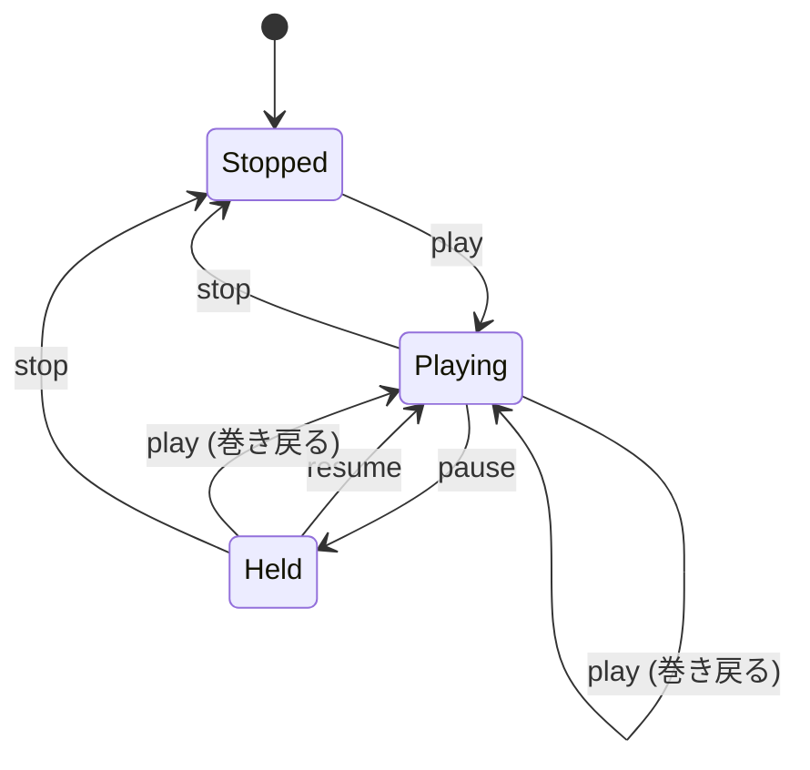

> **日本語** | [English](./20_playback_control.md)

# 再生制御とイベント処理 (Playback & Events)

アニメーションの再生状態（再生・停止・ループ）の管理と、タイムライン上のイベント（ユーザーデータ・シグナル）をゲームロジックへ通知する仕組みを実装します。

## 1. アニメーションのセットアップと再生

`libssruntime` コンテキストに対して、再生したいアニメーションを名前で指定し、再生を開始します。

```cpp
// 1. アニメーションのセットアップ
ss_runtime_setup_animation(context, "attack_pose");

// 2. 再生設定 (ループ回数: -1=無限, 1=1回のみ)
ss_runtime_set_loop(context, -1);

// 3. 再生開始
ss_runtime_play(context);
```

### `ss_runtime_set_loop` の値

| 値 | 意味 |
| :--- | :--- |
| `n` (> 0) | `n` 周再生して停止する。`1` = 1回のみ |
| `-1` | 無限ループ |
| `0` | 無限ループ（`-1` の別名。0 以下は全て `-1` に正規化される） |

### `setup_animation` が戻すもの

`setup_animation` は、Player のステートマシンが遷移のたびに呼ぶプリミティブです。
何を戻すかは **「誰が設定するか」** という一本の線で決まっています。

| 設定 | `setup_animation` を跨ぐか | 理由 |
| :--- | :--- | :--- |
| 再生区間 | 跨がない | フレーム番号は別のクリップに対して意味を持たない |
| authored フレームレート | 跨がない | クリップ自身のデータ。毎回読み直す |
| ループ回数 | 跨がない | 遷移が指定するもの（下記） |
| **再生方向 / スタイル (`set_playback_direction`)** | **跨ぐ** | 「逆再生する」は再生についての決定であって、たまたま読み込まれているクリップの性質ではありません |
| **速度 (`set_animation_speed`)** | **跨ぐ** | *別の* システムが設定する — スローモー、ヘイスト、難易度スケール |
| **フレームレート上書き (`set_frame_rate`)** | **跨ぐ** | Player のポリシー — クリップの authored 値に関わらず「このプレイヤーは 60fps で回す」 |
| **フレームスキップ** | **跨ぐ** | Player のポリシー — 収録やフレーム単位の演出で「全フレームを見せる」 |

跨ぐのは再生方向であって、*進行中の向き* ではありません。ping-pong の復路の途中で
アニメーションが切り替わった場合、新しいアニメーションは往路から walk を始めます。
遷移が跳ね返りの途中から始まることはありません。

レート系の 2 つはどちらもホスト側のもので合成されますが、意味が異なります。
`set_animation_speed` は authored 値に対する **倍率** なので、どのクリップに対しても
同じ意味になります。`set_frame_rate` は **絶対値** なので、効果はクリップに依存します
（30fps のクリップに 60 を指定すれば 2 倍、60fps のクリップなら等速）。それがこの API の
目的で、倍率がスケールするのに対しこちらは正規化します。`set_frame_rate(0)` で上書きを
解除し、authored 値へ戻します。

遷移自身が指定するものは戻ります。これにより **各遷移が直前の遷移から独立** します。
ループ回数が持ち越されると、attack のために設定した `1` がそのまま walk について回り、
不具合の再現条件が遷移そのものではなく遷移の履歴に埋まってしまいます。

速度とフレームスキップは逆です。ステートマシンはこれらを設定しないため、ここで戻すと
「アニメーションの遷移が、それとは無関係な設定を破壊する」ことになります。Player 側の
サブフレームフラグも同じ種類の設定で、C-API の Player 側に置かれているという理由だけで
既にこの挙動になっています。

> [!NOTE]
> `play` はその時点のループ回数でカウンタを再武装するため、完了したアニメを再生し直すと
> 同じ回数がもう一度適用されます。ループ回数は `setup_animation` の後、`play` の前に
> 設定してください。

### 再生ヘッドの操作
- **シーク**: `ss_runtime_set_frame_no(context, frame)` で任意のフレームへジャンプできます。
- **一時停止 / 再開**: `ss_runtime_pause(context)` がその場で保持し、`ss_runtime_resume(context)` が保持を解除します。どちらも冪等です。

### トランスポートの契約

各 Player が公開すべきセマンティクスです。`resume` を `play` に畳み込まず、4 つの動詞として公開してください。

| 呼び出し | 意味 | 再生ヘッド | `is_playing` | `is_pausing` |
| :--- | :--- | :--- | :--- | :--- |
| `ss_runtime_play` | **先頭出し。** 区間の先頭（逆方向なら末尾）へ巻き戻し、ループカウンタを再武装します | 巻き戻る | `true` | `false` |
| `ss_runtime_play_with_start_frame` | 指定フレームからの先頭出し | そのフレーム | `true` | `false` |
| `ss_runtime_pause` | その場で保持します。冪等 | 保持 | `true` | `true` |
| `ss_runtime_resume` | 保持を解除し、その場から再開します。冪等で、停止中のアニメを**開始はしません** | 保持 | `true` | `false` |
| `ss_runtime_stop` | 再生を終了します。巻き戻さないため、停止したフレームを描画し続けます | 保持 | `false` | `false` |

### 速度とフレームレート

`ss_runtime_set_animation_speed` は実効フレームレートに対する倍率です。

| 値 | 効果 |
| :--- | :--- |
| `1.0` | authored のまま |
| `0.5` / `2.0` | 半分 / 倍 |
| **`0.0`** | **再生ヘッドが止まります。** 時間は流れ `is_playing` も `true` のままで、進行だけがありません |
| **負値** | **同じく停止します。** 逆再生は `ss_runtime_set_playback_direction` の担当であって、速度の担当ではありません |

> [!NOTE]
> 以前は `0.0` と負値が `1.0` に正規化されていました。そのため速度スライダーを最小まで
> 下げたホストは、値が示すのとは逆に全速再生になり、逆再生を期待して負値を渡したホストは
> 「未対応である」という手掛かりのないまま順方向の全速再生を得ていました。

`ss_runtime_get_animation_speed` で倍率を読み戻せます。Player 側が最後に設定した値を
自前で保持する必要はありません（その控えこそが実体とずれる原因です）。返るのは **保持された**
値であり、渡された値とは限りません。上表でクランプされる 2 行は `0.0` として読み戻るため、
渡した負値が逆再生ではなく停止になったことをホスト側から判別できます。

### 再生の状態遷移

2 つのフラグが表す状態は **3 つだけ**です。`is_pausing` が真なら `is_playing` も真
であり、「停止しているのに一時停止中」には到達できません。これにより Player 側は
`is_playing` を併せて見ることなく `is_pausing` 単独で判定できます。

| 状態 | `is_playing` | `is_pausing` | `update` で進むか |
| :--- | :--- | :--- | :--- |
| **Stopped**（初期状態でもある） | `false` | `false` | 進まない |
| **Playing** | `true` | `false` | 進む |
| **Held**（一時停止） | `true` | `true` | 進まない |



上図に無い呼び出しはすべて意図的に **no-op** です。ホストは現在の状態を先に調べる
ことなく、意図どおりの動詞を呼べます。

| 現在の状態 | `play` | `pause` | `resume` | `stop` |
| :--- | :--- | :--- | :--- | :--- |
| **Stopped** | → Playing（区間の先頭から） | *no-op* | *no-op* | *no-op* |
| **Playing** | → Playing（区間の先頭へ巻き戻す） | → Held | *no-op* | → Stopped（再生ヘッド保持） |
| **Held** | → Playing（巻き戻し、保持も解除） | *no-op* | → Playing（再生ヘッド保持） | → Stopped（再生ヘッド保持） |

`setup_animation` は状態を **Stopped** に戻し、前のアニメーションが残した保持も落とします。

Player 側で取り違えられやすいのは次の 2 点です。

- **`play` を呼ぶまで何も進みません。** `update` は `is_playing` でゲートしているため、
  セットアップしただけのコンテキストを毎フレーム tick しても動きません。
- **`stop` は巻き戻しません。** 再生ヘッドはその場に留まるため、ホストは停止したフレーム
  を描画し続けます。別の位置にしたい場合はシークしてください。

> [!IMPORTANT]
> **`play` は再開ではありません。** 常に先頭出しになるため、一時停止の解除に使うと再生ヘッドが無言で先頭に戻ります。再開は `ss_runtime_resume` を使ってください。
>
> **一時停止は「保持」であって「停止」ではありません。** 一時停止中も `ss_runtime_is_playing` は `true` のままで、両者を区別するのが `ss_runtime_is_pausing` です。Player が `is_paused` を公開する場合は `is_pausing` をそのまま渡して構いません。一度も再生していないアニメでは `false`、`stop` 後も `false` になります。

## 2. 毎フレームの更新と終了検知

Player は毎フレーム、ゲームエンジンのデルタタイムをライブラリに渡して状態を更新します。

### 実装の型

`looped` / `finished` の通知は、**以下の形で実装してください**。フラグごとに寿命が違うため、扱い方も異なります。

```cpp
class MyPlayer {
    bool prev_finished = false;   // finished の立ち上がりエッジ検出用

    void update(float delta_seconds) {
        // 1. 更新実行 (デルタタイムはミリ秒で渡す)
        ss_runtime_update(context, delta_seconds * 1000.0f);

        // 2. looped は「パルス」。update の直後にそのまま読む
        if (ss_runtime_is_looped(context)) {
            emit_looped();
        }

        // 3. finished は「状態」。立ち上がりエッジで 1 回だけ通知する
        bool finished = ss_runtime_is_finished(context);
        if (finished && !prev_finished) {
            emit_finished();
        }
        prev_finished = finished;
    }

    void play() {
        prev_finished = false;   // 再生し直しに備えてラッチを戻す
        ss_runtime_play(context);
    }
};
```

### 2つのフラグの違い

| API | 意味 | 寿命 | 扱い方 |
| :--- | :--- | :--- | :--- |
| `ss_runtime_is_looped` | 再生ヘッドが**頭に戻った**（＝1周した） | **パルス**。`update` の先頭で毎回クリアされる | そのまま通知 |
| `ss_runtime_is_finished` | 指定ループ回数を**すべて完了した** | **状態**。次の `play` / `setup_animation` まで `true` のまま | **エッジを取って**通知 |

- `is_looped` は 1 回の `update` で複数周した場合も 1 回にまとまります（大きな `delta` ＋ フレームスキップ有効時）。
- `is_finished` は `stop()` では立ちません。指定ループ回数を完走した場合のみです。
- `is_finished` は無限ループ（既定値）では永久に立ちません。無限ループの終了は `looped` を数えるか、Player 側で `stop()` を呼んで判断してください。

### よくある誤り

実際に複数の Player で起きた不具合です。いずれも `is_finished` を上記の型で使えば起きません。

| 誤った実装 | 症状 |
| :--- | :--- |
| エッジを取らずに `is_finished` をそのまま通知する | 完了後、**毎フレーム発火し続ける** |
| `prev_finished` を `play` でリセットしない | 完了 → 再生し直しの際、次の完了を**取りこぼす**ことがある |
| `!is_playing` を `finished` として代用する | `stop()` や再生開始前と区別できず**誤発火**する |
| 「最終フレームに到達したか」で終了を判定する | 有限ループで**毎周発火**する。無限ループでは**一度も発火しない**。再生ループをそこで止めると**1周目で再生が打ち切られる** |

> [!NOTE]
> 「最終フレームを表示中」という内部状態（`end_frame_reached`）は、かつて C-API / WASM に公開されていましたが、**これを終了判定に使った Player がすべてバグを踏んだ**ため、Player 向け API から外しました。終了判定は `is_finished` だけを使ってください。

> [!NOTE]
> `is_playing` が false の間は `update` 自体を早期 return する作りなら、その guard がエッジ検出を兼ねるため `prev_finished` は理屈の上では不要です。しかし依存関係が暗黙になり、後から guard を動かすと壊れます。**上記の型どおり明示的にラッチを持つことを推奨します。**

### イベント列の例

`set_loop(3)` で 0〜4 フレームのアニメを再生した場合:

| 周 | 通知 |
| :--- | :--- |
| 1周目の末尾 → 頭に戻る | `looped` |
| 2周目の末尾 → 頭に戻る | `looped` |
| 3周目の末尾 | `finished`（頭には戻らず最終フレームで停止、`is_playing` が false になる） |

無限ループ（`-1` / `0`）では `looped` のみが繰り返し発火し、`finished` は永久に発火しません。

## 3. イベントの取得 (ポーリング)

`libssruntime` は更新中に通過したイベント（ユーザーデータ、シグナル、サウンド）を収集します。Player は `update` の直後にこれらを一括取得（ポーリング）します。

```cpp
// 通過したイベント数を取得
int count = ss_runtime_get_passed_event_count(context);

for (int i = 0; i < count; i++) {
    // イベントデータのインデックスを取得
    int event_idx = ss_runtime_get_passed_event_index(context, i);
    
    // SSAB (FlatBuffers) から具体的なデータを参照
    auto events = ssab_binary->events()->Get(event_idx);
    
    // UserData の処理
    if (events->users()) {
        for (auto user : *events->users()) {
            emit_signal("user_data", user->part_index(), user->value());
        }
    }
    // Signal の処理
    if (events->signals()) {
        for (auto sig : *events->signals()) {
            if (!sig || !sig->value() || !sig->value()->active()) continue;
            
            auto val = sig->value();
            const char* command = val->command_id() ? val->command_id()->c_str() : "";
            
            // パラメータの展開処理 (C++の汎用的な map 等に格納する例)
            std::map<std::string, MyVariant> params_map;
            if (auto params = val->params()) {
                for (uint32_t k = 0; k < params->size(); k++) {
                    auto param = params->Get(k);
                    if (!param || !param->param_id()) continue;
                    std::string p_id = param->param_id()->c_str();

                    // FlatBuffers の Union 型から値を取り出して格納する
                    switch (param->value_type()) {
                        case ss::format::SignalCommandParamValue_Bool:
                            if (auto b = param->value_as_Bool()) params_map[p_id] = b->value();
                            break;
                        case ss::format::SignalCommandParamValue_Index:
                            if (auto i = param->value_as_Index()) params_map[p_id] = i->value();
                            break;
                        case ss::format::SignalCommandParamValue_Integer:
                            if (auto i = param->value_as_Integer()) params_map[p_id] = i->value();
                            break;
                        case ss::format::SignalCommandParamValue_Floating:
                            if (auto f = param->value_as_Floating()) params_map[p_id] = f->value();
                            break;
                        case ss::format::SignalCommandParamValue_Text:
                            if (auto t = param->value_as_Text()) {
                                if (t->value()) params_map[p_id] = t->value()->c_str();
                            }
                            break;
                        default:
                            break;
                    }
                }
            }
            emit_signal("signal", command, params_map);
        }
    }
    
    // Audio の処理
    if (events->audios()) {
        for (auto audio : *events->audios()) {
            if (!audio || !audio->value()) continue;
            
            auto val = audio->value();
            const char* sound_name = val->sound_name() ? val->sound_name()->c_str() : "";
            int loop_num = val->loop_num();
            
            emit_signal("audio", audio->part_index(), sound_name, loop_num);
        }
    }
}
```

## 4. 推奨される Player API (設計指針)

利用者がアニメーションを容易に扱えるよう、以下の API インターフェースを提供することを推奨します。

| カテゴリ | 推奨 API | 内容 |
| :--- | :--- | :--- |
| **基本操作** | `set_animation(name)`, `play(loop)`, `stop()`, `pause()` | アニメーション設定・再生・停止・一時停止 |
| **パラメータ** | `set_speed(f32)`, `set_frame(f32)` | 速度と現在のフレーム位置 |
| **コールバック** | `finished`, `looped`, `user_data`, `signal` | 各種イベント発生時の通知（本章 2. 参照） |

### `set_animation` と `play` の分離（推奨）

アニメーションの**セットアップ**（`set_animation`）と**再生開始**（`play`）は、別メソッドへ分けて公開することを推奨します（Godot / Unity 移植が採用）。内部的には C-API の `ss_runtime_setup_animation` → `ss_runtime_play`（本章 1. 参照）をそのまま 2 つの公開 API に割り当てます。

> **なぜ分けるか（メモリアロケーション）**: `set_animation`（`ss_runtime_setup_animation`）はアニメーションのセットアップ時に ssruntime 内部でヒープアロケーションを伴います。これを `play` の内部で毎回行うと、再生のたびにアロケートが走ってしまいます。**アロケーションを伴うセットアップは再生前に済ませ、`play()` はアロケーションの無い軽い操作に保つ**のが狙いです。

| API | 内容 |
| :--- | :--- |
| `set_animation(name)` | アニメのデータをロード・設定し、先頭フレームで待機する（**再生は開始しない**）。ここで内部アロケーションが発生する |
| `play()` / `play(startFrame)` | セットアップ済みのアニメをその場（または指定フレーム）から再生開始する |

利点:

- `play()` の直前までに重い準備（`setup_animation` や、そのアニメが必要とするアセットのロード）を済ませられるため、再生開始を即時にできる。
- 再生せずに先頭フレームを posed 表示できる（待機ポーズ）。
- 再生中でなくてもアニメを差し替えられる（次に `play()` を呼ぶまで開始しない）。

この設計では、再生開始時の通知として `started` コールバックを併せて提供すると、`set_animation`（差し替え）と `play`（開始）の区別が利用側で扱いやすくなります。

> [!NOTE]
> ループ回数と再生区間は `setup_animation` が既定値へ戻すため、`setAnimation` 内で（または `play` の前に）設定してください。速度・フレームレート上書き・フレームスキップ・再生方向 / スタイルはいずれも跨いで保持されるので（[`setup_animation` が戻すもの](#setup_animation-が戻すもの) を参照）、Player 側で再適用する必要は **ありません**。再適用しても同じ値を書き戻すだけです。

#### すでに選択済みのアニメーションを指定したときは何もしない

`set_animation(name)` は `ss_runtime_setup_animation` の 1:1 のラッパーでは **ありません**。`name` がすでにセットアップ済みのアニメーションであれば、C-API を呼ばずに戻ってください。

これは「切り替え」であり、切り替え先が無いなら何もすることはありません。そして C-API の呼び出しは決して「何もしない」ものではありません。コントローラを **Stopped** に戻し、再生ヘッドを巻き戻し、再生区間を捨て、`Permanent` 以外のオーバーライドをすべて解除します。現在のクリップを毎フレーム主張する state machine は —

```cpp
// ごく普通のホストコード。ガードが無いと、このアニメーションは永久に再生されません。
player.set_animation(state.clip);
```

— その毎フレームでアニメーションを巻き戻すことになります。

理由はもう一つあり、`setup_animation` を滅多に呼ばない Player にも効きます。多くの Player はセットアップ後に自前のループ回数を再適用しますが（上の表がその理由です）、`ss_runtime_set_loop` は **書き込みのたびに残りループ数を再武装します**。つまり現在のアニメーションを毎フレーム再セットアップする Player は、ループ予算も毎フレームリセットしてしまい、有限のループ回数が永久に尽きませんでした。ガードは **その再適用より手前**に置く必要があります。ネイティブのセットアップ内側では遅すぎます。

**「すでに選択済み」はランタイムが持っているものと突き合わせ**、リソースをバインドしたら必ず無効化してください。

- **ホストが最後に要求した名前**と比べるのは二重に間違いです。アニメーション名をシリアライズして持つコンポーネントは最初のセットアップ前からその値を持っているので、最初の `set_animation` がスキップされ、何もセットアップされないまま終わります。
- `ss_runtime_bind_resource`（およびそれを呼ぶロード処理）の後は何もセットアップされていません。バインドで選択が消えるように追跡してください。さもないと、1 つ目と同じ名前のアニメーションを持つ 2 つ目のパックが「すでに選択済み」と判定され、そのパックはバインドされたまま再生不能になります。しかも無言で、名前が衝突したパックだけで起きます。1 つのプロジェクトから書き出したキャラクター一式では、それは例外ではなく通常のケースです。

アニメーションを **再スタート**したいなら `play` を呼んでください。頭出しはそちらの役目です。オーバーライドを捨てたいなら clear-overrides API を、区間を捨てたいならアニメーション全体を覆う区間を設定してください。いずれも、これまでは「切り替えでない切り替え」の副作用としてしか到達できませんでした。

> [!NOTE]
> 公式 Player 7 本すべてがこの挙動です。C-API を包む内部層は C-API の名前と意味論をそのまま保ちます（`SpriteStudioInternalPlayer.SetupAnimation`、`SsInternalPlayer.setupAnimation` など）。ガードはその上の、利用者に向いた層のものです。

### サブフレーム (Sub-frame) 再生
`libssruntime` はフレーム番号を `f32` で管理しており、整数フレーム間の「補間」が可能です。高リフレッシュレート環境での滑らかな動きを実現するため、Player 側でも `f32` でのフレーム管理をサポートすることを推奨します。

#### 受け付けるフレーム範囲と終端の扱い
`ss_runtime_get_frame_data(frame_no)` が受け付ける `frame_no` は、半開区間 **`[start_frame, end_frame + 1)`** です。これは「フレーム N は連続的な再生タイムライン上で時間区間 `[N, N+1)` を占有する」という考え方に対応します。

- サブフレーム再生では、終端・ループ境界で再生ヘッドが一瞬 `(end_frame, end_frame + 1)` の小数値になります。この区間は **有効** で、最終キーフレームの値を保持したポーズ（`end_frame` ちょうどと同一）が返ります。終端を越えた外挿は行われません。
- 範囲外（`frame_no < start_frame` / `frame_no >= end_frame + 1` / `NaN`）は `InvalidParameter` を返します。この場合 **FrameData が得られず、そのフレームの描画が消える**（全パーツが一瞬消失する）ため注意してください。

> [!NOTE]
> サブフレーム再生時に、終端での消失を避ける目的で `frame_no` を `end_frame` へクランプする必要は **ありません**。ランタイムが末尾区間 `(end_frame, end_frame + 1)` を正しく扱います。
>
> ただしこの範囲は **アニメーションデータ全体（クリップ）** の範囲です。`set_animation_section` で再生区間を限定している場合、ランタイムはセクション端へのクランプを行わず、セクションを越えてもクリップ内の実キーフレームを評価します。セクション再生とサブフレームを併用する場合は、表示用に **Player 側で `frame_no` をセクション端へクランプ** してください。

### 複数アニメーションのブレンド (State machine / Locomotion blend)
クロスフェードやアニメーションの重ね合わせを実装する場合は [アニメーションミキシング](../40_components/60_animation_mixing.ja.md) を参照。トラックと `alpha`、加算オーバーレイ、1トラックに複数アニメを weight で混ぜる方法を解説します。

---
[目次に戻る](../README.ja.md)
