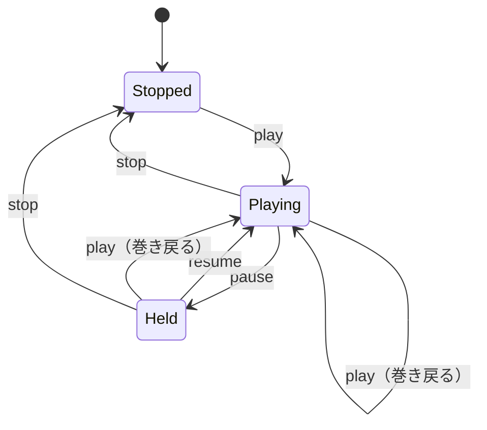

> **日本語** | [English](./20_playback_control.md)

# 再生制御

Brain の再生制御（セットアップ・再生・一時停止・停止・速度・ループ）の意味と、毎フレームの更新の手順です。これを Player の公開 API としてどう見せるかは、[Player API 規約 §8](../20_design/30_api_conventions.ja.md#8-アニメーションの選択と再生) にあります。

## 1. 1 フレームの流れ

Player は毎フレーム、次の順で Brain を呼びます。

```cpp
void MyPlayer::tick(float delta_seconds) {
    // 1. 時間を進める。経過時間はミリ秒で渡す。戻り値は描画するフレーム番号
    float frame_no = ss_runtime_update(ctx, delta_seconds * 1000.0f);

    // 2. ループと終了を通知する（§7）
    // 3. そのフレームで通過したイベントを通知する（イベントのページ）

    // 4. そのフレームの状態を計算させる（§6）
    float draw_frame = sub_frame_enabled ? frame_no : floorf(frame_no);
    const uint8_t* fd; size_t fd_len;
    ss_runtime_get_frame_data(ctx, draw_frame, &fd, &fd_len);

    // 5. インスタンスパーツ・エフェクトパーツの子を進め、描画する（描画ループのページ）
}
```

イベントは [イベント](./30_events.ja.md)、描画は [描画ループ](./40_render_loop.ja.md) で説明します。

## 2. セットアップと再生

再生するアニメーションを名前で選び（セットアップ）、再生を始めます。

```cpp
// 1. アニメーションを選ぶ。Brain の内部でメモリを確保する
ss_runtime_setup_animation(ctx, "attack");

// 2. ループ回数を設定する（セットアップで既定値に戻るので、その後に設定する）
ss_runtime_set_loop_count(ctx, 1);

// 3. 再生を始める
ss_runtime_play(ctx);
```

**`ss_runtime_play` を呼ぶまで、`ss_runtime_update` は何も進めません。** セットアップしただけの Context を毎フレーム更新しても、アニメーションは動きません。

`ss_runtime_set_loop_count` の値は次のとおりです。

| 値 | 意味 |
| :--- | :--- |
| `n`（> 0） | `n` 周再生して止まる。`1` は 1 回だけ |
| `-1` | 無限にループする（既定） |
| `0` 以下 | `-1` と同じ |

`ss_runtime_set_loop_count` は、書き込むたびに残りのループ回数を設定し直します。`ss_runtime_play` も、その時点のループ回数で残りの回数を設定し直します。ループ回数は、セットアップの後、`ss_runtime_play` の前に設定してください。

## 3. セットアップが戻す設定

`ss_runtime_setup_animation` は、Player のステートマシンが遷移のたびに呼ぶ操作です。どの設定を既定値に戻すかは、**その設定を誰が決めるか**で分かれています。

| 設定 | セットアップで | 理由 |
| :--- | :--- | :--- |
| 再生区間 | 戻る | フレーム番号は、別のアニメーションに対しては意味を持たない |
| アニメーションのフレームレート | 戻る | アニメーション自身のデータなので、毎回読み直す |
| ループ回数 | 戻る | 遷移ごとに指定するもの |
| **再生方向・スタイル**（`ss_runtime_set_playback_direction`） | **保持** | 「逆再生する」は再生についての決定で、読み込まれているアニメーションの性質ではない |
| **速度**（`ss_runtime_set_speed_scale`） | **保持** | スローモーションや難易度など、別のシステムが決める |
| **フレームレートの上書き**（`ss_runtime_set_frame_rate`） | **保持** | Player の方針（「この Player は 60fps で回す」） |
| **フレームスキップ**（`ss_runtime_set_skip_frames`） | **保持** | Player の方針（収録のために全フレームを見せる、など） |

遷移が指定するものを戻すのは、**遷移をそれぞれ独立させるため**です。ループ回数が持ち越されると、攻撃のために設定した `1` が歩行にもついて回り、不具合の再現条件が遷移の履歴に埋もれます。速度やフレームスキップはステートマシンが設定しないものなので、戻すと、アニメーションの遷移が無関係な設定を壊すことになります。

保持するのは再生方向の設定で、**往復の途中の向き**ではありません。往復（PingPong）の復路の途中でアニメーションを切り替えると、新しいアニメーションは往路から始まります。

セットアップは、再生の状態も **Stopped** に戻し、一時停止の保持も解きます（§4）。

track 0 のアニメーションを替える残りの 2 つの方法、track 0 への `ss_runtime_crossfade` と `ss_runtime_set_track_animation` も、同じ表に従います。保持する設定は track 0 のもので、載せたアニメーションに効きます。再生区間とループ回数は戻ります。セットアップと違い、再生の状態はそのままです（クロスフェードは再生を続けます）。[アニメーションミキシング §1-5](../50_features/10_animation_mixing.ja.md) を参照してください。

## 4. 再生の状態

### 4-1. 各操作の意味

`resume` を `play` にまとめず、4 つの操作として扱ってください。

| 呼び出し | 意味 | 再生ヘッド | `is_playing` | `is_pausing` |
| :--- | :--- | :--- | :--- | :--- |
| `ss_runtime_play` | **先頭から再生する。** 区間の先頭（逆方向なら末尾）へ巻き戻し、ループの残り回数を設定し直す | 巻き戻る | `true` | `false` |
| `ss_runtime_play_with_start_frame` | 指定したフレームから再生する | そのフレーム | `true` | `false` |
| `ss_runtime_pause` | その場で保持する | そのまま | `true` | `true` |
| `ss_runtime_resume` | 保持を解き、その場から続ける。停止しているアニメーションを**始めはしない** | そのまま | `true` | `false` |
| `ss_runtime_stop` | 再生を終える。巻き戻さないので、止めたフレームを描き続ける | そのまま | `false` | `false` |

- **`play` は再開ではありません。** 常に先頭から始めるので、一時停止の解除に使うと再生ヘッドが先頭に戻ります。
- **一時停止は「保持」で、「停止」ではありません。** 一時停止中も `ss_runtime_is_playing` は `true` です。両者を区別するのが `ss_runtime_is_pausing` です。
- **`stop` は巻き戻しません。** 別の位置を表示したい場合は、シークしてください。
- **`play_with_start_frame` に負の値を渡すと、`play` と同じく区間の先頭（逆方向なら末尾）から始まります。** 0 以上の値は再生区間に丸めないので、区間の中のフレームを渡してください。
- **キャラクター全体に効きます。** [アニメーションミキシング](../50_features/10_animation_mixing.ja.md#1-4-キャラクター全体で-1-つの時計)を使っている場合、`pause` / `resume` / `stop` は、すべてのトラックとすべてのフェードを止める・再開する・停止します。`play` が先頭へ戻すのは track 0 だけで、他のトラックは再生位置をそのまま保ちます。

### 4-2. 状態遷移

2 つのフラグが表す状態は **3 つだけ**です。`is_pausing` が真なら `is_playing` も真なので、`is_pausing` だけで一時停止中かを判定できます。

どちらのフラグも track 0 のアニメーションの状態を表します。アニメーションミキシングを使っている場合、track 0 が終わると、他のトラックが再生を続けていても両方とも `false` になります。そのあとの `pause` は他のトラックを止めますが、`is_pausing` は `true` になりません。`resume` で再開します（[アニメーションミキシング §1-4](../50_features/10_animation_mixing.ja.md#1-4-キャラクター全体で-1-つの時計)）。`ss_runtime_is_clock_playing` と `ss_runtime_is_clock_pausing` は、同じ 3 つの状態を時計そのものから返します。track 0 が終わっても値は変わりません。

| 状態 | `is_playing` | `is_pausing` | `update` で進むか |
| :--- | :--- | :--- | :--- |
| **Stopped**（初期状態） | `false` | `false` | 進まない |
| **Playing** | `true` | `false` | 進む |
| **Held**（一時停止） | `true` | `true` | 進まない |



図に無い組み合わせは、何もしません。ホストは現在の状態を調べずに、意図どおりの操作を呼べます。

| 現在の状態 | `play` | `pause` | `resume` | `stop` |
| :--- | :--- | :--- | :--- | :--- |
| **Stopped** | → Playing（区間の先頭から） | 何もしない | 何もしない | 何もしない |
| **Playing** | → Playing（区間の先頭へ巻き戻す） | → Held | 何もしない | → Stopped（再生ヘッドはそのまま） |
| **Held** | → Playing（巻き戻し、保持も解く） | 何もしない | → Playing（再生ヘッドはそのまま） | → Stopped（再生ヘッドはそのまま） |

### 4-3. シーク

`ss_runtime_set_frame_no(ctx, frame)` で再生ヘッドを動かします。再生区間の外の値は、区間の端になります。シークしても再生の状態は変わりません。

シークの後の最初の `update` は、移動先のフレームのイベントを報告します。移動元との間のイベントは報告しません（[イベント §3](./30_events.ja.md#3-イベントが報告されるフレーム)）。

`ss_runtime_next_frame` / `ss_runtime_prev_frame` は、再生方向にかかわらず 1 フレーム先 / 前へシークします。区間の端では動きません。

## 5. 速度・フレームレート・再生方向

### 5-1. 速度

`ss_runtime_set_speed_scale` は、実際のフレームレートに対する倍率です。

| 値 | 効果 |
| :--- | :--- |
| `1.0` | アニメーションのとおり |
| `0.5` / `2.0` | 半分 / 2 倍 |
| **`0.0`** | **再生ヘッドが止まる。** `is_playing` は `true` のままで、時間が経っても進まない |
| **負の値** | **`0.0` と同じく止まる。** 逆再生は再生方向（§5-3）で指定する |

`ss_runtime_get_speed_scale` は、Brain が保持している値を返します。負の値を渡した場合は `0.0` が返るので、逆再生にならず止まったことをホストが確かめられます。Player は、設定した値を自分で控えておく必要はありません。

### 5-2. フレームレート

`ss_runtime_set_frame_rate` は、アニメーションのフレームレートを**絶対値**で上書きします。速度が倍率なのでどのアニメーションにも同じように効くのに対し、フレームレートの上書きは、アニメーションのフレームレートをそろえるためのものです（30fps のアニメーションに 60 を指定すれば 2 倍、60fps のアニメーションなら等速）。`0` を渡すと上書きを解除します。速度とフレームレートの上書きは、掛け合わせて効きます。

### 5-3. 再生方向

`ss_runtime_set_playback_direction(ctx, direction, style)` で指定します。

| 引数 | `0` | `1` |
| :--- | :--- | :--- |
| `direction` | `Forward`（順方向） | `Backward`（逆方向） |
| `style` | `Normal`（一方向） | `PingPong`（往復） |

実際にいま進んでいる向き（往復の復路や逆方向の設定を反映したもの）は、`ss_runtime_is_playing_forward` で読めます。

### 5-4. 再生区間

`ss_runtime_set_animation_section(ctx, start_frame, end_frame)` で、再生する範囲をフレーム番号で限定します。範囲外の値（`-1` など）を渡すと、その側はアニメーションの端になります。設定すると、再生ヘッドは区間の先頭（逆方向なら末尾）に移ります。

## 6. サブフレーム

Brain はフレーム番号を `float` で扱い、整数フレームの間の状態を補間して計算できます。高いリフレッシュレートやゆっくりした再生でも、動きが滑らかになります。

サブフレームを使うかどうかは Player が決めます。使う場合は `ss_runtime_update` が返したフレーム番号をそのまま、使わない場合は切り捨てた値を `ss_runtime_get_frame_data` に渡します（§1）。インスタンスパーツの子にも、親と同じ設定を渡してください（[インスタンスパーツ §4](../40_parts/50_instance.ja.md#4-子に渡すもの)）。

### 6-1. 受け付けるフレーム番号

`ss_runtime_get_frame_data` が受け付けるフレーム番号は、半開区間 **`[先頭フレーム, 最終フレーム + 1)`** です。フレーム N が、時間の上で `[N, N+1)` を占めると考えてください。

- 終端やループ境界では、再生ヘッドが一瞬 `(最終フレーム, 最終フレーム + 1)` の小数になります。この範囲は**有効**で、最終フレームと同じポーズが返ります。終端を越えた外挿はしません。**`frame_no` を最終フレームに丸める必要はありません。**
- 範囲外（先頭フレームより小さい、最終フレーム + 1 以上、`NaN`）では、FrameData を返さず、失敗します（`ss_runtime_get_last_error` が `InvalidParameter`）。そのフレームは何も描けないので、全パーツが一瞬消えます。

この範囲は**アニメーション全体**の範囲です。再生区間（§5-4）を設定していても、Brain は区間の端で丸めません。再生ヘッドが区間の最終フレームの枠 `(区間の最終フレーム, 区間の最終フレーム + 1)` にあるとき（逆方向・一方向（`Normal`）のループでは、区間の先頭を越えた直後もここに来ます）は、区間の次のフレームのキーへ向かって補間したポーズを返します。区間の外の次のフレームに区間の先頭と同じ姿勢を置いておけば、ループの継ぎ目もサブフレームで滑らかにつながります。1 つのアニメーションを再生区間で切り分けて使い、区間の外のキーを見せたくない場合は、描画に使う `frame_no` を Player で区間の最終フレームに丸めることもできます（状態として持つ値は丸めません。§6-2）。

### 6-2. 小数を捨てない

`ss_runtime_update` やスロットの `step` が返すフレーム番号は、小数を含む値です。**状態として持つフレーム番号を、整数に丸めたり区間の端に丸めたりして書き戻さないでください。** 丸めた値を書き戻すと、次の更新が丸めた位置から始まるので、1 回の更新で進む量が 1 フレームに満たない環境では、進んだ分が毎回捨てられ、アニメーションが止まります。丸めるのは、描画に渡す値だけにしてください。

## 7. ループと終了の検知

### 7-1. 実装の形

`looped` と `finished` の通知は、次の形で実装してください。2 つのフラグは寿命が違うので、扱い方も違います。

```cpp
class MyPlayer {
    bool prev_finished = false;   // finished の立ち上がりを検出するため

    void tick(float delta_seconds) {
        ss_runtime_update(ctx, delta_seconds * 1000.0f);

        // looped はパルス。update の直後にそのまま読む
        if (ss_runtime_just_looped(ctx)) {
            emit_looped();
        }

        // finished は状態。立ち上がりで 1 回だけ通知する
        bool finished = ss_runtime_is_finished(ctx);
        if (finished && !prev_finished) {
            emit_finished();
        }
        prev_finished = finished;
    }

    void play() {
        prev_finished = false;   // 再生し直しに備えて戻す
        ss_runtime_play(ctx);
    }
};
```

| 関数 | 意味 | 寿命 | 扱い方 |
| :--- | :--- | :--- | :--- |
| `ss_runtime_just_looped` | 直近の `update` で、再生ヘッドが先頭に戻った（1 周した） | **パルス**。`update` のたびに消える | そのまま通知する |
| `ss_runtime_is_finished` | 設定したループ回数をすべて再生し終えた | **状態**。次の `play`・セットアップ・track 0 の差し替え（下記）まで `true` のまま | **立ち上がりを取って**通知する |

- 1 回の `update` で複数周した場合（大きな経過時間とフレームスキップ）も、`just_looped` は 1 回です。
- `is_finished` は `stop` では立ちません。設定したループ回数を最後まで再生したときだけです。
- track 0 に `ss_runtime_crossfade` か `ss_runtime_set_track_animation` でアニメーションを載せると、`is_finished` は偽に戻ります。それ以降は、入ってきたアニメーションの状態を返します（[アニメーションミキシング §1-1](../50_features/10_animation_mixing.ja.md#1-1-track-0-は特別)）。
- 無限ループ（既定）では `is_finished` は立ちません。無限ループの終わりは、`just_looped` を数えるか、Player が `stop` を呼んで判断してください。

### 7-2. よくある誤り

どれも、既存の Player で実際に起きた不具合です。§7-1 の形で実装すれば起きません。

| 誤った実装 | 症状 |
| :--- | :--- |
| `is_finished` を立ち上がりを取らずに通知する | 終了後、**毎フレーム通知し続ける** |
| `prev_finished` を `play` で戻さない | 終了した後に再生し直すと、次の終了を**取りこぼす**ことがある |
| `!is_playing` を終了とみなす | `stop` や再生前と区別できず、**誤って通知する** |
| 「最終フレームに着いたか」で終了を判定する | 有限のループでは**毎周通知する**。無限ループでは**一度も通知しない**。そこで再生を止めると、**1 周目で打ち切られる** |

`is_playing` が偽の間は `tick` の先頭で戻る作りなら、その判定が立ち上がりの検出を兼ねるので、`prev_finished` が無くても動きます。ただしその依存は目に見えず、後で判定の位置を動かすと壊れます。`prev_finished` を明示的に持ってください。

### 7-3. 通知の順

`set_loop_count(3)` で 0〜4 フレームのアニメーションを再生した場合:

| 周 | 通知 |
| :--- | :--- |
| 1 周目の終わり → 先頭に戻る | `looped` |
| 2 周目の終わり → 先頭に戻る | `looped` |
| 3 周目の終わり | `finished`（先頭に戻らず最終フレームで止まり、`is_playing` が偽になる） |

無限ループ（`-1` / `0`）では `looped` だけが繰り返され、`finished` は来ません。

---
[目次に戻る](../README.ja.md)
