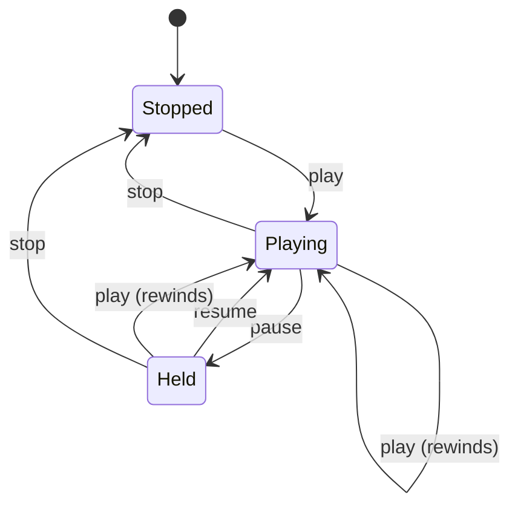

> [日本語](./20_playback_control.ja.md) | **English**

# Playback Control

This page covers what the Brain's playback controls mean (setup, play, pause, stop, speed, loop) and how to update every frame. How to expose them in the Player's public API is in [Player API Conventions §8](../20_design/30_api_conventions.md#8-selecting-and-playing-an-animation).

## 1. The flow of one frame

Every frame, the Player calls the Brain in the following order.

```cpp
void MyPlayer::tick(float delta_seconds) {
    // 1. Advance time. Pass the elapsed time in milliseconds. The return value is the frame number to draw
    float frame_no = ss_runtime_update(ctx, delta_seconds * 1000.0f);

    // 2. Notify loops and the end (§7)
    // 3. Notify the events passed in this frame (the Events page)

    // 4. Have the Brain compute the state of that frame (§6)
    float draw_frame = sub_frame_enabled ? frame_no : floorf(frame_no);
    const uint8_t* fd; uintptr_t fd_len;
    ss_runtime_get_frame_data(ctx, draw_frame, &fd, &fd_len);

    // 5. Advance the children of instance parts and effect parts, and draw (the Render Loop page)
}
```

Events are explained in [Events](./30_events.md), and drawing in [Render Loop](./40_render_loop.md).

## 2. Setup and play

Select the animation to play by name (setup), then start playback.

```cpp
// 1. Select the animation. The Brain allocates memory internally
ss_runtime_setup_animation(ctx, "attack");

// 2. Set the loop count (setup resets it to the default, so set it afterwards)
ss_runtime_set_loop_count(ctx, 1);

// 3. Start playback
ss_runtime_play(ctx);
```

**`ss_runtime_update` advances nothing until you call `ss_runtime_play`.** If a Context has only been set up, updating it every frame does not move the animation.

The values of `ss_runtime_set_loop_count` are as follows.

| Value | Meaning |
| :--- | :--- |
| `n` (> 0) | Play `n` cycles and stop. `1` plays once |
| `-1` | Loop forever (default) |
| `0` or less | Same as `-1` |

`ss_runtime_set_loop_count` resets the remaining loop count every time you write it. `ss_runtime_play` also resets the remaining count from the loop count at that moment. Set the loop count after setup and before `ss_runtime_play`.

## 3. What setup resets

`ss_runtime_setup_animation` is the operation a Player's state machine calls on every transition. Which settings it resets to their defaults depends on **who decides the setting**.

| Setting | On setup | Why |
| :--- | :--- | :--- |
| Playback section | Reset | A frame number means nothing for a different animation |
| Animation frame rate | Reset | It is the animation's own data, so it is re-read every time |
| Loop count | Reset | It is specified per transition |
| **Playback direction / style** (`ss_runtime_set_playback_direction`) | **Kept** | "Play backwards" is a decision about playback, not a property of the loaded animation |
| **Speed** (`ss_runtime_set_speed_scale`) | **Kept** | Another system decides it, such as slow motion or difficulty |
| **Frame-rate override** (`ss_runtime_set_frame_rate`) | **Kept** | Player policy ("this Player runs at 60fps") |
| **Frame skip** (`ss_runtime_set_skip_frames`) | **Kept** | Player policy (show every frame for a recording, for example) |

What a transition specifies is reset **to keep each transition independent**. If the loop count carried over, a `1` set for an attack would follow the character into its walk, and the conditions to reproduce the bug would be buried in the transition history. The state machine does not set speed or frame skip, so resetting them would let an animation transition break a setting unrelated to it.

What is kept is the playback direction setting, not **the heading partway through a round trip**. If you switch animations partway through the return leg of a round trip (PingPong), the new animation starts on the outward leg.

Setup also returns the playback state to **Stopped** and releases any pause hold (§4).

The other two ways to change track 0's animation, `ss_runtime_crossfade` and `ss_runtime_set_track_animation` on track 0, follow the same table: the kept settings belong to track 0 and reach the animation laid there, and the section and the loop count start over. Unlike setup, they leave the playback state as it is — a crossfade carries on playing. See [Animation Mixing §1-5](../50_features/10_animation_mixing.md#1-5-a-tracks-playback-settings).

## 4. Playback state

### 4-1. What each operation means

Treat these as four operations. Do not fold `resume` into `play`.

| Call | Meaning | Playhead | `is_playing` | `is_pausing` |
| :--- | :--- | :--- | :--- | :--- |
| `ss_runtime_play` | **Plays from the start.** Rewinds to the start of the section (the end when backward) and resets the remaining loop count | Rewinds | `true` | `false` |
| `ss_runtime_play_with_start_frame` | Plays from the given frame | That frame | `true` | `false` |
| `ss_runtime_pause` | Holds in place | Unchanged | `true` | `true` |
| `ss_runtime_resume` | Releases the hold and continues from there. Does **not start** a stopped animation | Unchanged | `true` | `false` |
| `ss_runtime_stop` | Ends playback. It does not rewind, so the frame it stopped on keeps being drawn | Unchanged | `false` | `false` |

- **`play` is not resume.** It always starts from the start, so using it to release a pause sends the playhead back to the start.
- **A pause is a "hold", not a "stop".** `ss_runtime_is_playing` is `true` while paused. `ss_runtime_is_pausing` is what tells the two apart.
- **`stop` does not rewind.** To show a different position, seek.
- **A negative value passed to `play_with_start_frame` starts from the section start (the end when backward), as `play` does.** A value of 0 or more is not clamped to the playback section, so pass a frame inside the section.
- **They act on the whole character.** With [animation mixing](../50_features/10_animation_mixing.md#1-4-one-clock-for-the-whole-character), `pause` / `resume` / `stop` hold, release and stop every track and every fade. `play` rewinds track 0 only; the other tracks keep their playheads.

### 4-2. State transitions

The two flags represent **only three** states. If `is_pausing` is true, `is_playing` is also true, so `is_pausing` alone tells you whether playback is paused.

Both flags describe track 0's animation. With animation mixing, once track 0 has finished both read `false` even though the other tracks keep playing, and a `pause` then still holds those tracks without `is_pausing` turning `true`; `resume` releases them ([Animation Mixing §1-4](../50_features/10_animation_mixing.md#1-4-one-clock-for-the-whole-character)). `ss_runtime_is_clock_playing` and `ss_runtime_is_clock_pausing` read the same three states from the clock itself, which track 0 finishing does not change.

| State | `is_playing` | `is_pausing` | Advances on `update` |
| :--- | :--- | :--- | :--- |
| **Stopped** (initial state) | `false` | `false` | No |
| **Playing** | `true` | `false` | Yes |
| **Held** (paused) | `true` | `true` | No |



Combinations not in the diagram do nothing. The host can call the operation it intends without checking the current state.

| Current state | `play` | `pause` | `resume` | `stop` |
| :--- | :--- | :--- | :--- | :--- |
| **Stopped** | → Playing (from the start of the section) | Does nothing | Does nothing | Does nothing |
| **Playing** | → Playing (rewinds to the start of the section) | → Held | Does nothing | → Stopped (playhead unchanged) |
| **Held** | → Playing (rewinds, and also releases the hold) | Does nothing | → Playing (playhead unchanged) | → Stopped (playhead unchanged) |

### 4-3. Seeking

`ss_runtime_set_frame_no(ctx, frame)` moves the playhead. A value outside the playback section becomes the edge of the section. Seeking does not change the playback state.

The first `update` after a seek reports the events of the destination frame. It does not report the events between the origin and the destination ([Events §3](./30_events.md#3-which-frames-are-reported)).

`ss_runtime_next_frame` / `ss_runtime_prev_frame` seek one frame forward / back, regardless of the playback direction. They do not move at the edge of the section.

## 5. Speed, frame rate and playback direction

### 5-1. Speed

`ss_runtime_set_speed_scale` is a multiplier on the effective frame rate.

| Value | Effect |
| :--- | :--- |
| `1.0` | As in the animation |
| `0.5` / `2.0` | Half / double |
| **`0.0`** | **The playhead stops.** `is_playing` stays `true`, and nothing advances as time passes |
| **Negative** | **Stops, the same as `0.0`.** Specify reverse playback with the playback direction (§5-3) |

`ss_runtime_get_speed_scale` returns the value the Brain holds. If you passed a negative value, it returns `0.0`, so the host can confirm that playback stopped rather than reversed. The Player does not need to keep its own copy of the value it set.

### 5-2. Frame rate

`ss_runtime_set_frame_rate` overrides the animation's frame rate with an **absolute** value. Speed is a multiplier, so it works the same way on every animation. The frame-rate override, by contrast, is for making the frame rates of animations uniform (60 on a 30fps animation doubles the speed; on a 60fps animation it plays at normal speed). Passing `0` clears the override. Speed and the frame-rate override multiply together.

### 5-3. Playback direction

Set it with `ss_runtime_set_playback_direction(ctx, direction, style)`.

| Argument | `0` | `1` |
| :--- | :--- | :--- |
| `direction` | `Forward` (forward) | `Backward` (backward) |
| `style` | `Normal` (one way) | `PingPong` (round trip) |

`ss_runtime_is_playing_forward` reads the direction playback is actually moving in now (reflecting the return leg of a round trip and the backward setting).

### 5-4. Playback section

`ss_runtime_set_animation_section(ctx, start_frame, end_frame)` limits the range to play, by frame number. Both ends are included, so a section whose ends are the same frame plays that one frame. If you pass an out-of-range value (such as `-1`), that side becomes the edge of the animation. An end before the start, both in range, is refused: the call returns `false` with `InvalidParameter`, and the section and the playhead stay as they were. Setting a section moves the playhead to the start of the section (the end when backward).

## 6. Sub-frames

The Brain handles frame numbers as `float`, and can compute interpolated states between integer frames. This keeps motion smooth at high refresh rates and in slow playback.

The Player decides whether to use sub-frames. If it does, pass the frame number returned by `ss_runtime_update` to `ss_runtime_get_frame_data` as is; if it does not, pass the value rounded down (§1). Pass the same setting as the parent to the children of instance parts too ([Instance Parts §4](../40_parts/50_instance.md#4-what-to-pass-to-the-child)).

### 6-1. Accepted frame numbers

`ss_runtime_get_frame_data` accepts frame numbers in the half-open interval **`[first frame, last frame + 1)`**. Think of frame N as occupying `[N, N+1)` in time.

- At the end and at loop boundaries, the playhead briefly takes a fractional value in `(last frame, last frame + 1)`. This range is **valid**, and returns the same pose as the last frame. Nothing is extrapolated past the end. **You do not need to clamp `frame_no` to the last frame.**
- Out of range (less than the first frame, last frame + 1 or more, or `NaN`), the call fails without returning FrameData (`ss_runtime_get_last_error` is `InvalidParameter`). Nothing can be drawn for that frame, so every part disappears for a moment.

This range is that of **the whole animation**. Even with a playback section set (§5-4), the Brain does not clamp to the section edges. While the playhead is in the slot of the section's last frame, `(section's last frame, section's last frame + 1)` (with a backward, one-way (`Normal`) loop it also lands here right after crossing the section start), the pose returned is interpolated toward the key on the frame after the section. Put the same pose as the section start on that frame outside the section, and the loop seam also joins smoothly at sub-frame precision. When you cut one animation into playback sections and do not want keys outside the section to show, you may instead clamp the `frame_no` used for drawing to the section's last frame in the Player (not the value you hold as state; §6-2).

### 6-2. Do not discard the fraction

The frame numbers returned by `ss_runtime_update` and by a slot's `step` include a fraction. **Do not round the frame number you hold as state to an integer, or clamp it to the section edges, and write it back.** If you write back a rounded value, the next update starts from the rounded position. Where one update advances less than one frame, the progress is thrown away every time and the animation stops. Round only the value you pass to drawing.

## 7. Detecting loops and the end

### 7-1. The implementation pattern

Implement the `looped` and `finished` notifications in the following form. The two flags have different lifetimes, so they are handled differently.

```cpp
class MyPlayer {
    bool prev_finished = false;   // to detect the rising edge of finished

    void tick(float delta_seconds) {
        ss_runtime_update(ctx, delta_seconds * 1000.0f);

        // looped is a pulse. Read it as is, right after update
        if (ss_runtime_just_looped(ctx)) {
            emit_looped();
        }

        // finished is a state. Notify only once, on the rising edge
        bool finished = ss_runtime_is_finished(ctx);
        if (finished && !prev_finished) {
            emit_finished();
        }
        prev_finished = finished;
    }

    void play() {
        prev_finished = false;   // reset in preparation for replaying
        ss_runtime_play(ctx);
    }
};
```

| Function | Meaning | Lifetime | How to handle it |
| :--- | :--- | :--- | :--- |
| `ss_runtime_just_looped` | In the latest `update`, the playhead returned to the start (completed one cycle) | **Pulse**. Cleared on every `update` | Notify as is |
| `ss_runtime_is_finished` | All the set loops have been played | **State**. Stays `true` until the next `play`, setup, or replacement of track 0 (below) | Notify **on the rising edge** |

- Even when one `update` completes several cycles (a large elapsed time with frame skip), `just_looped` is raised once.
- `stop` does not raise `is_finished`. It is raised only when the set loop count has been played to the end.
- Laying an animation on track 0 with `ss_runtime_crossfade` or `ss_runtime_set_track_animation` turns `is_finished` false again. From then on it reports the incoming animation's state ([Animation Mixing §1-1](../50_features/10_animation_mixing.md#1-1-track-0-is-special)).
- With an infinite loop (the default), `is_finished` is never raised. For the end of an infinite loop, count `just_looped`, or decide it by having the Player call `stop`.

### 7-2. Common mistakes

Each of these is a defect that actually occurred in an existing Player. None of them happen if you implement the form in §7-1.

| Wrong implementation | Symptom |
| :--- | :--- |
| Notifying `is_finished` without taking the rising edge | After the end, it **keeps notifying every frame** |
| Not resetting `prev_finished` in `play` | When you replay after the end, the next end can be **missed** |
| Treating `!is_playing` as the end | It cannot be told apart from `stop` or from before playback, so it **notifies wrongly** |
| Deciding the end by "did it reach the last frame?" | With a finite loop it **notifies every cycle**. With an infinite loop it **never notifies**. If you stop playback there, playback is **cut off in the first cycle** |

If your `tick` returns at the top while `is_playing` is false, that check doubles as the rising-edge detection, so it works without `prev_finished`. But that dependency is invisible, and it breaks if the check is moved later. Hold `prev_finished` explicitly.

### 7-3. Notification order

Playing an animation of frames 0–4 with `set_loop_count(3)`:

| Cycle | Notification |
| :--- | :--- |
| End of cycle 1 → back to the start | `looped` |
| End of cycle 2 → back to the start | `looped` |
| End of cycle 3 | `finished` (it does not return to the start; it stops on the last frame and `is_playing` becomes false) |

With an infinite loop (`-1` / `0`), only `looped` repeats, and `finished` never comes.

---
[Back to contents](../README.md)
