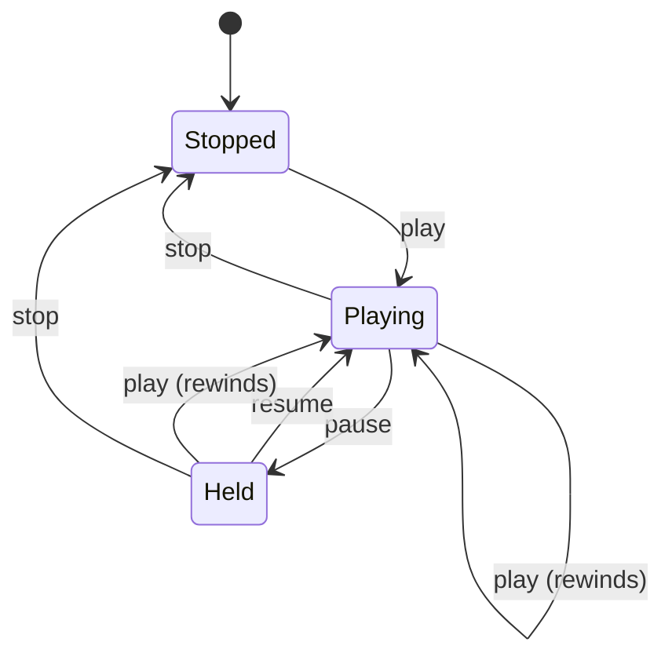

> [日本語](./20_playback_control.ja.md) | **English**

# Playback Control & Events

Here you implement management of the animation playback state (play, stop, loop) and the mechanism that notifies your game logic of timeline events (user data, signals).

## 1. Setting up and playing an animation

Specify the animation you want to play on the `libssruntime` context by name and start playback.

```cpp
// 1. Set up the animation
ss_runtime_setup_animation(context, "attack_pose");

// 2. Playback settings (loop count: -1 = infinite, 1 = once)
ss_runtime_set_loop(context, -1);

// 3. Start playback
ss_runtime_play(context);
```

### Values for `ss_runtime_set_loop`

| Value | Meaning |
| :--- | :--- |
| `n` (> 0) | Play `n` cycles and stop. `1` = once |
| `-1` | Infinite loop |
| `0` | Infinite loop (an alias of `-1`; anything ≤ 0 is normalized to `-1`) |

### What `setup_animation` resets

`setup_animation` is the primitive a Player's state machine calls on every
transition, so what it resets is drawn along one line: **who sets it.**

| Setting | Survives `setup_animation`? | Why |
| :--- | :--- | :--- |
| Playback section | no | Frame indices mean nothing against a different clip |
| Authored frame rate | no | It is the clip's own data, re-read every time |
| Loop count | no | The transition states it; see below |
| **Direction / style (`set_playback_direction`)** | **yes** | "Play this backwards" describes the playback, not the clip that happens to be loaded |
| **Speed (`set_animation_speed`)** | **yes** | A *different* system sets it — slow motion, a haste buff, a difficulty scale |
| **Frame-rate override (`set_frame_rate`)** | **yes** | A Player policy — "this player runs at 60fps", whatever a clip was authored at |
| **Frame skip** | **yes** | A Player policy — "show every frame" for a capture or a frame-counted cutscene |

The direction survives; the *heading* does not. A ping-pong that was on its
return leg when the animation changed starts the new one walking outward again,
so a transition never begins mid-bounce.

The two rate controls are both the host's and compose, but they say different
things. `set_animation_speed` is a **multiple** of whatever the clip was authored
at, so it means the same thing against every clip. `set_frame_rate` is an
**absolute** rate, so its effect does depend on the clip — 60 against a 30fps
clip is double speed and against a 60fps clip is none. That is the point of it:
it normalizes, where the multiplier scales. `set_frame_rate(0)` clears the
override and hands playback back to the authored rate.

Anything the transition itself specifies is reset, so **transitions stay
independent of the one before them**. Were the loop count to persist, a `1` meant
for an attack would quietly follow the character into its walk, and the bug's
reproduction would live in the transition history rather than in the transition.

Speed and frame skip are the other way round: nothing in the state machine sets
them, so resetting them would let an animation transition clobber a setting it
never knew about. A Player's own sub-frame flag is the same kind of setting and
already behaves this way, simply because it lives on the Player's side of the
C-API.

> [!NOTE]
> `play` re-arms the loop counter with the count in effect at that moment, so
> replaying a finished animation applies the same count again. Set the loop count
> after `setup_animation` and before `play`.

### Moving the playhead
- **Seek**: jump to an arbitrary frame with `ss_runtime_set_frame_no(context, frame)`.
- **Pause / resume**: `ss_runtime_pause(context)` holds playback in place and `ss_runtime_resume(context)` lifts the hold. Both are idempotent.

### The transport contract

These are the semantics every Player is expected to publish. Expose them as four
distinct verbs — do not fold `resume` into `play`.

| Call | Meaning | Playhead | `is_playing` | `is_pausing` |
| :--- | :--- | :--- | :--- | :--- |
| `ss_runtime_play` | **Head-out.** Rewinds to the section start (its end when the direction is backward) and re-arms the loop counter | rewinds | `true` | `false` |
| `ss_runtime_play_with_start_frame` | Head-out from the given frame | that frame | `true` | `false` |
| `ss_runtime_pause` | Holds playback where it stands. Idempotent | kept | `true` | `true` |
| `ss_runtime_resume` | Lifts the hold, carrying on in place. Idempotent; does **not** start a stopped animation | kept | `true` | `false` |
| `ss_runtime_stop` | Ends playback. Nothing rewinds, so the host keeps drawing the frame it stopped on | kept | `false` | `false` |

### Speed and the frame rate

`ss_runtime_set_animation_speed` is a multiple of the effective frame rate.

| Value | Effect |
| :--- | :--- |
| `1.0` | As authored |
| `0.5` / `2.0` | Half / double |
| **`0.0`** | **The playhead stops.** Time still passes and `is_playing` stays true; nothing advances |
| **negative** | **Also stops.** Reverse playback is `ss_runtime_set_playback_direction`'s business, not the speed's |

> [!NOTE]
> `0.0` and negative values used to normalize to `1.0`, so a host that dragged a
> speed slider to its minimum got full-speed playback — the opposite of what the
> value said — and a host that passed a negative rate hoping for reverse got
> forward at full speed with no indication the request was unsupported.

`ss_runtime_get_animation_speed` reads the rate back, so a Player does not have
to keep a copy of what it last set — the copy is what drifts. It returns the
value that was **stored**, which is not always the one that was passed: the two
clamped rows above read back as `0.0`, so a host can tell that its negative
became a stop instead of assuming it became reverse playback.

### Playback states

The two flags describe **three** states, and only three — `is_pausing` implies
`is_playing`, so "stopped, and also paused" is not reachable. That is what lets a
Player read `is_pausing` on its own without also testing `is_playing`.

| State | `is_playing` | `is_pausing` | Advances on `update` |
| :--- | :--- | :--- | :--- |
| **Stopped** (also the initial state) | `false` | `false` | no |
| **Playing** | `true` | `false` | yes |
| **Held** (paused) | `true` | `true` | no |



Every call not drawn above is a **no-op**, deliberately, so a host can call the
verb that matches its intent without first checking the state:

| From | `play` | `pause` | `resume` | `stop` |
| :--- | :--- | :--- | :--- | :--- |
| **Stopped** | → Playing, from the section start | *no-op* | *no-op* | *no-op* |
| **Playing** | → Playing, rewound to the section start | → Held | *no-op* | → Stopped, playhead kept |
| **Held** | → Playing, rewound and no longer held | *no-op* | → Playing, playhead kept | → Stopped, playhead kept |

`setup_animation` returns the controller to **Stopped**, dropping any hold left by
the animation before it.

Two consequences worth stating outright, because they are what Players get wrong:

- **Nothing advances until `play`.** `update` gates on `is_playing`, so a
  controller that has only been set up can be ticked every frame and will not
  move.
- **`stop` does not rewind.** The playhead stays where it was, so the host keeps
  drawing the frame it stopped on. Seek if you want it elsewhere.

> [!IMPORTANT]
> **`play` is not a resume.** It always heads out, so using it to lift a pause silently sends the playhead back to the start. Resume with `ss_runtime_resume`.
>
> **A pause is a hold, not a stop.** `ss_runtime_is_playing` stays `true` while paused; `ss_runtime_is_pausing` is what distinguishes the two. A Player publishing an `is_paused` can pass `is_pausing` straight through — it is `false` on an animation that has never played, and `false` again after `stop`.

## 2. Per-frame updates and detecting the end

Every frame the Player passes the game engine's delta time to the library to update the state.

### The implementation pattern

**Implement `looped` / `finished` notifications in the following form.** The two flags have different lifetimes, so they must be handled differently.

```cpp
class MyPlayer {
    bool prev_finished = false;   // for rising-edge detection of finished

    void update(float delta_seconds) {
        // 1. Run the update (pass the delta time in milliseconds)
        ss_runtime_update(context, delta_seconds * 1000.0f);

        // 2. looped is a "pulse". Read it as-is immediately after update
        if (ss_runtime_is_looped(context)) {
            emit_looped();
        }

        // 3. finished is a "state". Notify exactly once on the rising edge
        bool finished = ss_runtime_is_finished(context);
        if (finished && !prev_finished) {
            emit_finished();
        }
        prev_finished = finished;
    }

    void play() {
        prev_finished = false;   // reset the latch in preparation for replaying
        ss_runtime_play(context);
    }
};
```

### The difference between the two flags

| API | Meaning | Lifetime | How to handle it |
| :--- | :--- | :--- | :--- |
| `ss_runtime_is_looped` | The playhead **returned to the start** (completed one cycle) | A **pulse**. Cleared at the top of every `update` | Notify as-is |
| `ss_runtime_is_finished` | **All** the specified loops have completed | A **state**. Stays `true` until the next `play` / `setup_animation` | Notify **on the edge** |

- `is_looped` collapses into a single occurrence even when several cycles complete within one `update` (a large `delta` with frame skipping enabled).
- `is_finished` is not raised by `stop()`. It is raised only when the specified loop count completes.
- `is_finished` is never raised for an infinite loop (the default). To detect the end of an infinite loop, count `looped` or decide it on the Player side by calling `stop()`.

### Common mistakes

These are real defects that occurred in several Players. None of them happen if you use `is_finished` in the pattern above.

| Wrong implementation | Symptom |
| :--- | :--- |
| Notifying `is_finished` directly without taking the edge | **Fires every frame** after completion |
| Not resetting `prev_finished` in `play` | The next completion can be **missed** when replaying after a completion |
| Substituting `!is_playing` for `finished` | **False firing** - indistinguishable from `stop()` or from before playback starts |
| Deciding completion from "did we reach the final frame?" | **Fires every cycle** with a finite loop; **never fires** with an infinite loop; and if you stop the playback loop there, **playback is cut off during the first cycle** |

> [!NOTE]
> The internal state "the final frame is being displayed" (`end_frame_reached`) used to be exposed in the C-API / WASM, but **every Player that used it for completion detection hit a bug**, so it was removed from the Player-facing API. Use only `is_finished` for completion detection.

> [!NOTE]
> If your `update` early-returns while `is_playing` is false, that guard also serves as edge detection, so `prev_finished` is unnecessary in theory. But the dependency becomes implicit and moving the guard later breaks it. **We recommend holding the latch explicitly, exactly as in the pattern above.**

### Example event sequence

Playing a 0-4 frame animation with `set_loop(3)`:

| Cycle | Notification |
| :--- | :--- |
| End of cycle 1 → back to the start | `looped` |
| End of cycle 2 → back to the start | `looped` |
| End of cycle 3 | `finished` (it does not return to the start; it stops on the final frame and `is_playing` becomes false) |

With an infinite loop (`-1` / `0`), only `looped` fires repeatedly and `finished` never fires.

## 3. Retrieving events (polling)

`libssruntime` collects the events passed during an update (user data, signals, sounds). The Player retrieves them in bulk (polls) immediately after `update`.

```cpp
// Get the number of events passed
int count = ss_runtime_get_passed_event_count(context);

for (int i = 0; i < count; i++) {
    // Get the index of the event data
    int event_idx = ss_runtime_get_passed_event_index(context, i);

    // Reference the concrete data from the SSAB (FlatBuffers)
    auto events = ssab_binary->events()->Get(event_idx);

    // Handling UserData
    if (events->users()) {
        for (auto user : *events->users()) {
            emit_signal("user_data", user->part_index(), user->value());
        }
    }
    // Handling Signal (SpriteStudio v7 and later)
    if (events->signals()) {
        for (auto sig : *events->signals()) {
            if (!sig || !sig->value() || !sig->value()->active()) continue;

            auto val = sig->value();
            const char* command = val->command_id() ? val->command_id()->c_str() : "";

            // Expanding the parameters (example: storing them in a generic C++ map)
            std::map<std::string, MyVariant> params_map;
            if (auto params = val->params()) {
                for (uint32_t k = 0; k < params->size(); k++) {
                    auto param = params->Get(k);
                    if (!param || !param->param_id()) continue;
                    std::string p_id = param->param_id()->c_str();

                    // Take the value out of the FlatBuffers union type and store it
                    switch (param->value_type()) {
                        case ss::format::SignalCommandParamValue_Bool:
                            if (auto b = param->value_as_Bool()) params_map[p_id] = b->value();
                            break;
                        case ss::format::SignalCommandParamValue_Index:
                            if (auto i = param->value_as_Index()) params_map[p_id] = i->value();
                            break;
                        case ss::format::SignalCommandParamValue_Integer:
                            if (auto i = param->value_as_Integer()) params_map[p_id] = i->value();
                            break;
                        case ss::format::SignalCommandParamValue_Floating:
                            if (auto f = param->value_as_Floating()) params_map[p_id] = f->value();
                            break;
                        case ss::format::SignalCommandParamValue_Text:
                            if (auto t = param->value_as_Text()) {
                                if (t->value()) params_map[p_id] = t->value()->c_str();
                            }
                            break;
                        default:
                            break;
                    }
                }
            }
            emit_signal("signal", command, params_map);
        }
    }

    // Handling Audio
    if (events->audios()) {
        for (auto audio : *events->audios()) {
            if (!audio || !audio->value()) continue;

            auto val = audio->value();
            const char* sound_name = val->sound_name() ? val->sound_name()->c_str() : "";
            int loop_num = val->loop_num();

            emit_signal("audio", audio->part_index(), sound_name, loop_num);
        }
    }
}
```

## 4. Recommended Player API (design guidelines)

To make animations easy for your users to work with, we recommend providing the following API interface.

| Category | Recommended API | Contents |
| :--- | :--- | :--- |
| **Basic operations** | `set_animation(name)`, `play(loop)`, `stop()`, `pause()` | Setting, playing, stopping, and pausing an animation |
| **Parameters** | `set_speed(f32)`, `set_frame(f32)` | Speed and the current frame position |
| **Callbacks** | `finished`, `looped`, `user_data`, `signal` | Notification when each event occurs (see §2 of this chapter) |

### Separating `set_animation` from `play` (recommended)

We recommend exposing **setup** (`set_animation`) and **starting playback** (`play`) as separate methods (adopted by the Godot and Unity ports). Internally, map the C-API's `ss_runtime_setup_animation` → `ss_runtime_play` (see §1 of this chapter) onto those two public APIs directly.

> **Why separate them (memory allocation)**: `set_animation` (`ss_runtime_setup_animation`) involves heap allocation inside ssruntime when setting the animation up. Doing that inside `play` every time means an allocation on every playback. The aim is to **finish the allocating setup before playback and keep `play()` a light, allocation-free operation**.

| API | Contents |
| :--- | :--- |
| `set_animation(name)` | Loads and sets the animation data and waits on the first frame (**does not start playback**). The internal allocation happens here |
| `play()` / `play(startFrame)` | Starts playing the already set-up animation from where it is (or from a specified frame) |

Benefits:

- Heavy preparation (`setup_animation`, and loading the assets that animation needs) can be finished before `play()`, so playback can start immediately.
- You can display the first frame posed without playing (an idle pose).
- You can swap the animation even while not playing (it does not start until the next `play()`).

With this design, also providing a `started` callback as the notification for playback beginning makes it easier for users to distinguish `set_animation` (swapping) from `play` (starting).

> [!NOTE]
> `setup_animation` resets the loop count and the section, so set those inside `setAnimation` (or before `play`). Speed, the frame-rate override, frame skip and the playback direction / style all survive it — see [What `setup_animation` resets](#what-setup_animation-resets) — so a Player does **not** need to re-apply them, and one that does is simply writing the same value back.

#### Selecting the animation already selected must do nothing

`set_animation(name)` is **not** a 1:1 wrapper over `ss_runtime_setup_animation`. When `name` is already the animation set up, the Player returns without calling the C-API at all.

It is a *switch*, so with nothing to switch to there is nothing to do — and the C-API call is very much not nothing. It returns the controller to **Stopped**, rewinds the playhead, drops the playback section, and clears every override that is not `Permanent`. A state machine asserting its current clip every frame —

```cpp
// Perfectly reasonable host code. Without the guard, this animation never plays.
player.set_animation(state.clip);
```

— would rewind the animation on every frame it did that.

There is a second reason, and it bites even a Player that calls `setup_animation` sparingly. Most Players re-apply their own loop count after a setup (the row above says why), and `ss_runtime_set_loop` **re-arms the remaining-loop counter on every write**. So a Player that re-set-up the current animation each frame also reset the loop budget each frame, and a finite loop count never ran out. The guard has to sit **ahead of that re-application**, not inside the native setup.

**Judge "already selected" against what the runtime has**, and invalidate it whenever a resource is bound:

- Comparing against the name the *host* last asked for is wrong twice over. A component whose animation name is serialized already holds it before the first setup, so the first `set_animation` would be skipped and nothing would ever be set up.
- `ss_runtime_bind_resource` (and any load that calls it) leaves nothing set up. Track the selection so a bind clears it, or a second pack that happens to name an animation the same way as the first is taken for one already selected — leaving that pack bound and unplayable, silently, and only for the packs whose names collide. For a family of characters exported from one project that is the normal case, not the exotic one.

To *restart* an animation, call `play` — that is what heads out. To drop the overrides, call the clear-overrides API. To drop a section, set one covering the whole animation. Each of those was reachable through a re-setup only as a side effect of a switch that was not a switch.

> [!NOTE]
> All seven official Players behave this way. The internal layer that wraps the C-API keeps the C-API's name and semantics (`SpriteStudioInternalPlayer.SetupAnimation`, `SsInternalPlayer.setupAnimation`, …); the guard belongs to the Player-facing layer above it.

### Sub-frame playback
`libssruntime` manages the frame number as an `f32`, which allows "interpolation" between integer frames. To achieve smooth motion on high-refresh-rate displays, we recommend that the Player support `f32` frame management too.

#### The accepted frame range and how the end is handled
The `frame_no` accepted by `ss_runtime_get_frame_data(frame_no)` is the half-open interval **`[start_frame, end_frame + 1)`**. This corresponds to the idea that "frame N occupies the time interval `[N, N+1)` on a continuous playback timeline".

- During sub-frame playback, the playhead momentarily takes a fractional value in `(end_frame, end_frame + 1)` at the end and at loop boundaries. That interval is **valid** and returns a pose holding the final keyframe's values (identical to exactly `end_frame`). No extrapolation beyond the end is performed.
- Out-of-range values (`frame_no < start_frame` / `frame_no >= end_frame + 1` / `NaN`) return `InvalidParameter`. Note that in that case **no FrameData is obtained and that frame's drawing disappears** (every part vanishes momentarily).

> [!NOTE]
> During sub-frame playback there is **no need** to clamp `frame_no` to `end_frame` in order to avoid the disappearance at the end. The runtime handles the final interval `(end_frame, end_frame + 1)` correctly.
>
> Note however that this range is that of **the whole animation data (the clip)**. When you have limited the playback range with `set_animation_section`, the runtime does not clamp to the section boundaries and evaluates the real keyframes within the clip even beyond the section. When combining section playback with sub-frame playback, **clamp `frame_no` to the section boundary on the Player side** for display purposes.

### Blending several animations (state machine / locomotion blend)
To implement crossfades or to stack animations, see [Animation Mixing](../40_components/60_animation_mixing.md). It covers tracks and their `alpha`, additive overlays, and blending several animations on one track by weight.

---
[Back to Table of Contents](../README.md)
