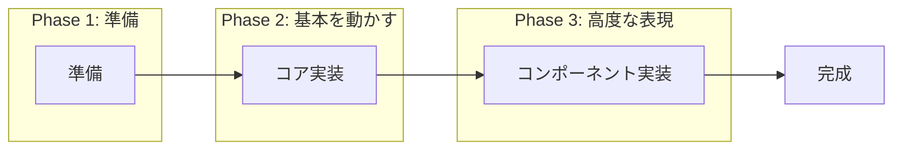

> **日本語** | [English](./README.md)

# SpriteStudio 7 Player 移植ガイド

このガイドでは、`libssruntime` (Brain) を使用して、独自のゲームエンジンやプラットフォーム向けに **SpriteStudio 7 プレイヤー (Player)** を実装する手順を解説します。

## 🚀 実装の全体フロー

Player の実装は、以下の 3 つのフェーズで進めることを推奨しています。

---

## 📚 目次

### 10. はじめに (Introduction)
- [**はじめに・用語解説**](./10_introduction/10_introduction.ja.md) — SDK の基本コンセプトと用語
- [**制限事項 (Limitations)**](./10_introduction/20_limitations.ja.md) — サポート範囲や仕様上の制約（**実装前に必読**）

### 20. 設計と準備 (Design)
- [**事前確認とプロジェクトの準備**](./20_design/10_preparation.ja.md) — 開発環境のセットアップ（実装の前提条件）
- [**アーキテクチャと実装方針**](./20_design/20_architecture.ja.md) — Brain (計算) と Body (描画) の役割分担
- [**実装ロードマップ**](./20_design/30_implementation_roadmap.ja.md) — `overall.sspj` を参照して実装していく順序・検証計画

### 30. コア実装 (Core / 基本再生)
最小限のアニメーションを画面に出し、制御するまでのステップです。
- [**データのロードと初期化**](./30_core/10_initialization.ja.md)
- [**再生制御とイベント処理**](./30_core/20_playback_control.ja.md)
- [**レンダリングループとバッチ描画**](./30_core/30_render_loop.ja.md)

### 40. コンポーネント実装 (Components / 高度な表現)
リッチな演出を実現するための、各パーツ種別の詳細な実装です。
- [**インスタンスパーツ (Instance)**](./40_components/10_instance.ja.md)
- [**エフェクトパーツ (Effect)**](./40_components/20_effect.ja.md)
- [**メッシュとデフォーム (Mesh)**](./40_components/30_mesh.ja.md)
- [**Mask の実装**](./40_components/40_mask.ja.md)
- [**パーツカラー (Parts Color)**](./40_components/50_parts_color.ja.md)
- [**アニメーションミキシング**](./40_components/60_animation_mixing.ja.md) — トラックに積んで合成する: クロスフェード・オーバーレイ・加算
- [**パーツオーバーライド (Override Layer API)**](./40_components/65_override_layer.ja.md) — カラー / セル / 表示のパーツ単位の実行時上書き (Phase 2)
- [**外部リソースとテクスチャの管理**](./40_components/70_external_resources.ja.md) — テクスチャの解決 / 作画によるテクスチャ変更 (TCHG) / 外部 SSAB 参照
- [**シーケンス (Sequence)**](./40_components/80_sequence.ja.md)
- [**オーディオ（サウンド）再生の統合**](./40_components/90_audio.ja.md)
- [**特殊なパーツタイプ (9スライス / シェイプ / テキスト / サウンド)**](./40_components/95_special_parts.ja.md) — テキストはグリフのレイアウト仕様も含みます

### 50. リファレンス (Reference)
- [**no_std 組み込み環境への統合**](./50_reference/10_no_std_integration.ja.md)
- [**トラブルシューティング**](./50_reference/20_troubleshooting.ja.md)

### 60. ツール連携 (Tooling)
- [**エディタインテグレーションとコンバート**](./60_tooling/10_editor_integration.ja.md) — `ssconverter` をエンジンのエディタに統合

---
> [!TIP]
> 実装の各段階で **`tests/overall/overall.sspj`** を動かしてみることを強くお勧めします。エディタと同じ見た目になれば、そのステップはクリアです！

[SpriteStudio-SDK Top](https://github.com/cri-middleware/SpriteStudio-SDK/blob/HEAD/README.ja.md) / [libssruntime Top](https://github.com/cri-middleware/SpriteStudio-SDK/blob/HEAD/libs/ssruntime/README.ja.md)
