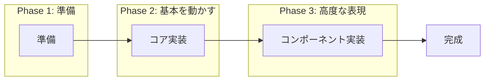

# SpriteStudio 7 Player 移植ガイド

このガイドでは、`libssruntime` (Brain) を使用して、独自のゲームエンジンやプラットフォーム向けに **SpriteStudio 7 プレイヤー (Player)** を実装する手順を解説します。

## 🚀 実装の全体フロー

Player の実装は、以下の 3 つのフェーズで進めることを推奨しています。

---

## 📚 目次

### ⚠️ はじめに
実装に着手する前に必ずお読みください。
- [**制限事項 (Limitations)**](./00_limitations.ja.md) — サポート範囲や仕様上の制約
- [**はじめに・用語解説**](./01_introduction.ja.md) — SDK の基本コンセプト

### 🏗️ 第1章：設計と準備
- [**アーキテクチャと実装方針**](./02_architecture.ja.md) — Brain (計算) と Body (描画) の役割分担
- [**事前確認とプロジェクトの準備**](./03_preparation.ja.md) — 開発環境のセットアップ
- [**実装ロードマップ**](./04_roadmap.ja.md) — `overall.sspj` を使った段階的な検証計画

### ⚡ 第2章：コア実装 (基本再生)
最小限のアニメーションを画面に出し、制御するまでのステップです。
- 05. [**データのロードと初期化**](./05_initialization.ja.md)
- 06. [**再生制御とイベント処理**](./06_playback_control.ja.md)
- 07. [**レンダリングループとバッチ描画**](./07_render_loop.ja.md)

### 🎨 第3章：コンポーネント実装 (高度な表現)
リッチな演出を実現するための、各パーツ種別の詳細な実装です。
- 08. [**Instance / Effect / Mesh の実装**](./08_advanced_rendering.ja.md)
- 09. [**パーツカラーと特殊アトリビュート**](./09_parts_color.ja.md)
- 10. [**外部リソースとオプション機能**](./10_optional_features.ja.md)

### 🛠️ 第4章：リファレンス
- 11. [**no_std 組み込み環境への統合**](./11_no_std_integration.ja.md)
- 12. [**トラブルシューティング**](./12_troubleshooting.ja.md)

---
> [!TIP]
> 実装の各段階で **`tests/overall/overall.sspj`** を動かしてみることを強くお勧めします。エディタと同じ見た目になれば、そのステップはクリアです！

[SpriteStudio7-SDK Top](../../../README.ja.md) / [libssruntime Top](../README.ja.md)
